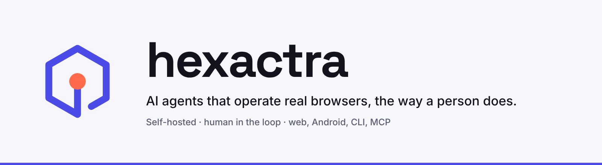
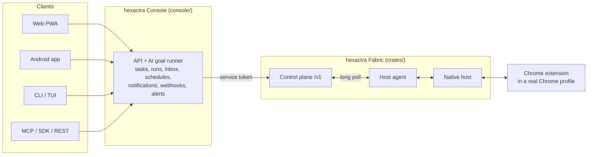
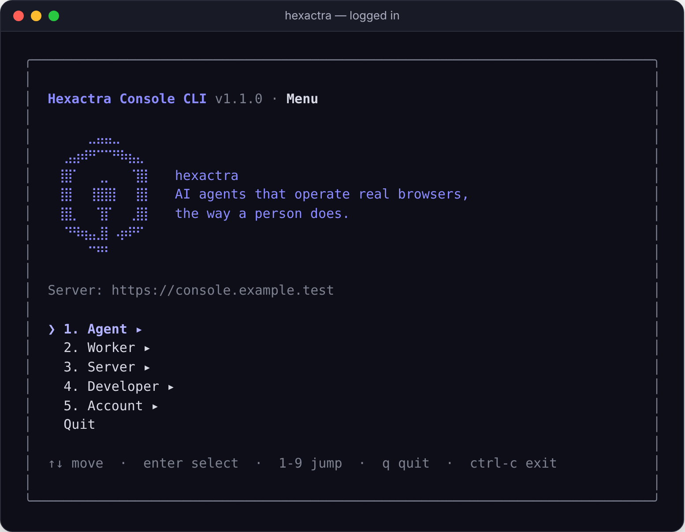
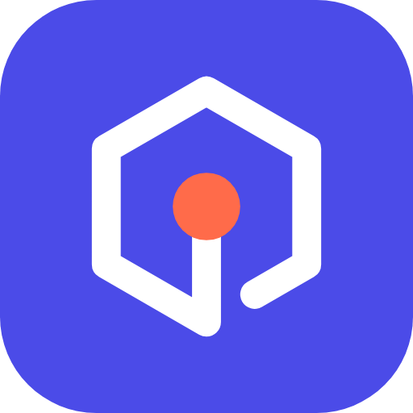

<p align="center">
  <picture>
    <source media="(prefers-color-scheme: dark)" srcset="docs/brand/hexactra-banner-dark.png">
    
  </picture>
</p>

<p align="center">
  <a href="https://github.com/marinoscar/hexactra/actions/workflows/ci.yml"></a>
  <a href="https://github.com/marinoscar/hexactra/actions/workflows/console.yml"></a>
  <a href="https://github.com/marinoscar/hexactra/actions/workflows/console-android.yml"></a>
</p>

**hexactra** is a self-hosted computer-use runtime. It lets AI agents operate real, visible Chrome browsers with persistent sign-ins, the way a person would: they click, type, read the page and wait for you when they need a human. You assign the work from the web, your phone, a terminal or your own agent framework, and you watch every step.

- **Real browsers, not headless scripts.** Real, headful Google Chrome with persistent profiles that keep their cookies and sign-ins.
- **On machines you own, at home.** Browsers run on **nodes**, such as a mini PC on your residential network, because many sites block or challenge datacenter IPs. A node connects out over HTTPS to your console, with no inbound ports and no VPN, and runs **unattended** (its own desktop, nobody logged in) or **attended** (your own desktop and Chrome). See [docs/nodes.md](docs/nodes.md).
- **A human in the loop by design.** CAPTCHAs, one-time codes, sign-ins and purchases come to you as handoffs; your answer resumes the run.
- **The model never sees secrets.** You type codes and passwords into a handoff, and the runner types them into the page.
- **One capability, every surface.** Web app (installable PWA), Android app, CLI and TUI, REST with a TypeScript SDK, and MCP for agent frameworks.

---

## What you can do with it

| Capability | What it means |
|---|---|
| **Tasks** | Save a goal with a browser profile, the sites it may visit, step and time budgets, and confirmation before purchases. |
| **Runs (the AI goal runner)** | Start a task and the server-side runner works the browser step by step: observe, reason, act, verify. Every run is a durable state machine you can cancel at any time. |
| **Live run view** | Watch steps stream in with a live screenshot, and take over the browser yourself when you want to. |
| **Inbox (handoffs)** | Everything agents are waiting for (a CAPTCHA, a code, a sign-in, a confirmation) in one place. Answer it and the run continues. |
| **Schedules** | Run tasks on a cron schedule in your time zone. |
| **Notifications** | Run results and handoffs by web notification, email, Web Push and the Android app. Stop a run or approve a step straight from the notification. |
| **Webhooks and alerts** | Signed outbound webhooks for run and schedule events. Alerts fire for an offline browser host, a schedule failing several times in a row, or a user over a token or budget limit. |
| **External agents** | Your own agent drives a browser through the console, and the console records it as a run: you see each step, can stop it, and answer its handoffs. |
| **Fleet** | Enroll browser hosts, run several named profiles per host, drain, revoke and restart them, and open a gated web viewer on any browser. |
| **Standalone extension** | The Chrome extension is also an AI browser assistant on its own: side-panel chat with your own OpenAI-compatible provider, no server required. |
| **Operations** | Sign-in with roles and personal access tokens, an encrypted credential store, OpenTelemetry traces and metrics with a browser-agent dashboard, the admin Doctor, database backup and restore. |

## Use it from anywhere

| Surface | Where |
|---|---|
| **Web app**, installable as a PWA (desktop and mobile) | The console at `/` ([console/README.md](console/README.md)) |
| **Android app**: a Trusted Web Activity with deep links and actionable notifications | [console/docs/runbooks/android-app.md](console/docs/runbooks/android-app.md) |
| **CLI and terminal UI**: `hexactra tasks`, `runs`, `inbox`, `fleet`, ... | [console/apps/cli/README.md](console/apps/cli/README.md) |
| **REST API**, OpenAPI at `/api/docs`, with a generated TypeScript SDK | `console/packages/sdk` |
| **MCP** for agent frameworks: `POST /api/mcp` (Streamable HTTP) or `hexactra mcp serve` (stdio) | [console/docs/mcp.md](console/docs/mcp.md), [console/docs/agent-frameworks.md](console/docs/agent-frameworks.md) |
| **Chrome extension**: the hand inside each browser, and a standalone AI assistant | [apps/chrome-extension/DEMO_GUIDE.md](apps/chrome-extension/DEMO_GUIDE.md) |

`console/packages/shared/capabilities.json` is the parity registry: each surface's tests fail when a capability is missing from it without a recorded reason.

## How it fits together



- **The Console** is the single user-facing control point. It holds identity, roles, tasks, runs and the AI goal runner, and it is the only client that holds the fabric's service token.
- **The Fabric** is the browser execution layer: a Rust control plane with durable state, and host agents that keep one browser per profile.
- **Nodes** are where the host agents run. The primary node is a machine on your residential network (a mini PC at home), connected outbound over HTTPS, in unattended or attended mode, or both. A browser host bundled on the VPS is optional, and expect more challenges from sites there. See [docs/nodes.md](docs/nodes.md).
- Architecture in depth: [VISION.MD §26](VISION.MD) (console and fabric) and §5 to §6.

## Get started

**Install the `hexactra` CLI** (Node 24; it updates in place when re-run):

```bash
curl -fsSL https://raw.githubusercontent.com/marinoscar/hexactra/main/install.sh | bash
hexactra login --server https://<your console>
hexactra            # the terminal UI
```

<p align="center">
  
</p>

The terminal UI groups everything into **Agent** (Inbox, Runs, Fleet, this machine as a browser node), **Worker** (jobs queue, worker node), **Server** (deploy, status), **Developer** (Android app, API calls) and **Account**. Logged out, it shows only what works without a server. Details and screenshots: [console/apps/cli/README.md](console/apps/cli/README.md#the-terminal-ui).

Re-running the same command updates the CLI. It prints the current and the new version (with their commits) before it builds, for example `current version: hexactra 0.1.1 (0822b47)` and `new version: hexactra 0.1.2 (…)`.

Install options, commands and screenshots: [console/apps/cli/README.md](console/apps/cli/README.md).


**Run the console on a server** (console and fabric in one Compose stack, with an optional bundled browser host):
[console/docs/runbooks/vps-stack.md](console/docs/runbooks/vps-stack.md)

**Add a node at home** (the primary way to run browsers). On a Linux machine on your home network, with the CLI logged in to your console:

```bash
hexactra agent install                       # today: a browser host in your desktop session
# planned (epic #333): hexactra agent install --mode unattended|attended|both
```

The node model, modes, security and troubleshooting: [docs/nodes.md](docs/nodes.md).

**Drive your own signed-in Chrome on a Linux desktop**, from the `hexactra-fabric` CLI or the `hexactra-mcp` MCP server:

```bash
scripts/install-remote-control.sh   # build, install to ~/.local/bin, start user services
# load apps/chrome-extension/dist in Chrome (Developer mode -> Load unpacked)
hexactra-fabric status
hexactra-fabric navigate https://example.com && hexactra-fabric screenshot -o page.jpg
```

- Quickstart, remote access and safety: [docs/remote-control-quickstart.md](docs/remote-control-quickstart.md)
- Desktop off? Run the always-on container host (browser on demand, plus a web viewer): [docs/container-host.md](docs/container-host.md)
- Fabric `/v1` API: [docs/remote-control-api.md](docs/remote-control-api.md)
- Proven by a real-Chromium end-to-end test in CI: `tests/e2e/remote-control.e2e.mjs`

**Use the extension on its own**: build it (`pnpm --filter @hexactra/chrome-extension build`), load `apps/chrome-extension/dist` unpacked, and add your model provider in the side panel.

## Repository layout

```
console/            hexactra Console: NestJS API, React web app (PWA), CLI/TUI, Android TWA shell, TypeScript SDK
                    (an EnterpriseAppBase starter app; its own README and AGENTS.md apply inside it)
crates/             hexactra Fabric (Rust)
apps/
  chrome-extension/ MV3 extension: the in-browser driver, and the standalone side-panel assistant
  dashboard/        early standalone HITL inbox (the console's Inbox is the main one)
packages/           @hexactra/sdk (TypeScript SDK), @hexactra/contracts (OpenAPI and MCP contracts)
api/                openapi.yaml and JSON schemas (CI checks they parse)
deploy/             systemd units, container images and Compose for hosts
docs/               guides, runbooks and the brand (docs/brand/)
release/            built release artifacts
scripts/            install, build, release and brand scripts
tests/              end-to-end tests
```

<details>
<summary>The Rust crates</summary>

| Crate | Role |
|---|---|
| `hexactra-control` | Control plane: `hexactra-control serve`, the `/v1` API with durable state |
| `hexactra-agent` | Host agent: keeps a Chromium per profile, long-polls the control plane |
| `hexactra-native-host` | Chrome Native Messaging host: relays the extension to the agent |
| `hexactra-cli` | The `hexactra-fabric` CLI |
| `hexactra-mcp` | MCP server (stdio) exposing the fabric's browsers as tools |
| `hexactra-client` | HTTP client for the `/v1` API |
| `hexactra-core` | Core types and traits |
| `hexactra-agent-run`, `hexactra-planning-loop`, `hexactra-execution` | Durable run state machine; observe, reason, act, verify loop; execution policy, budgets, retries and takeover |
| `hexactra-model-adapter` | OpenAI-compatible model adapter |
| `hexactra-credential-resolver`, `hexactra-notification-delivery` | Secret resolution; notification delivery |
| `hexactra-provider-sdk`, `hexactra-provider-tests`, `hexactra-demo-provider` | Provider SDK, conformance tests and a demo provider |
| `hexactra-desktop-input` | Desktop input driver |
| `hexactra-telemetry`, `hexactra-otel` | Tracing; OpenTelemetry setup and trace-context propagation |
| `hexactra-aef-connector`, `hexactra-benchmark` | Optional Agent Experience Framework connector and its benchmarks |
| `hexactra-worker` | Earlier session-worker scaffolding (not on the remote-control path) |

</details>

## Development

Prerequisites: Rust (stable), Node.js 22+ with pnpm for the workspace, Node 24 and Docker for the console.

```bash
# Rust
cargo fmt --all --check
cargo clippy --workspace --all-targets
cargo test --workspace --all-targets

# TypeScript workspace (SDK, contracts, extension, dashboard)
pnpm install --frozen-lockfile && pnpm build
pnpm --filter @hexactra/sdk --filter @hexactra/chrome-extension test
python3 scripts/ci/validate-contracts.py

# Console (Node 24)
cd console && npm ci && npm run platform:check && npm run typecheck && npm test && npm run build
```

CI runs all of the above (`.github/workflows/ci.yml`, `console.yml`), plus the Android build (`console-android.yml`).

Work is tracked in GitHub issues (epics `[EPIC Exx]` with child tasks). Contributor and agent rules: [AGENTS.md](AGENTS.md).

## Documentation

| Topic | Read |
|---|---|
| Product vision and architecture | [VISION.MD](VISION.MD) |
| Console: features, layout, run it locally | [console/README.md](console/README.md) |
| Console operations, capacity, VPS stack, Android app | [console/docs/runbooks/](console/docs/runbooks/) |
| MCP and agent-framework recipes | [console/docs/mcp.md](console/docs/mcp.md), [console/docs/agent-frameworks.md](console/docs/agent-frameworks.md) |
| Fabric: install, operations, API, security, recovery | [docs/installation.md](docs/installation.md), [docs/operations.md](docs/operations.md), [docs/api.md](docs/api.md), [docs/security.md](docs/security.md), [docs/recovery.md](docs/recovery.md) |
| Fleet orchestration | [docs/fleet-orchestration.md](docs/fleet-orchestration.md) |
| Deploying hosts (systemd, containers) | [deploy/README.md](deploy/README.md), [docs/container-host.md](docs/container-host.md) |
| Releases | [docs/release-checklist.md](docs/release-checklist.md) |
| Brand: logo, colors, type, icons | [docs/brand/README.md](docs/brand/README.md) |

## Brand



The **Trace** mark is one continuous line that starts at a single point and traces a hexagon: the path a person's hand takes. The wordmark is always lowercase **hexactra**. Logos, PNG exports, the color tokens (primary `#4B4BE8`, accent `#FF6B4A`) and usage rules are in [docs/brand/](docs/brand/README.md).

<br clear="left">
