# Hexactra Console

Assign work to AI browser agents and watch them do it.

[](https://github.com/marinoscar/hexactra/actions/workflows/console.yml)

This app was started from the platform starter. The platform (sign-in, users and organizations, settings, the job queue, the admin Doctor, the CLI, the Compose and nginx stack) comes from the published `@marinoscar/platform-*` packages. This repository holds only what is yours: the composition (`apps/api/src/platform/`, `apps/web/src/App.tsx`, `apps/cli/src/app.ts`), your domain code, and your appearance.

**Never edit platform code here.** There is none to edit: it lives in `node_modules`. When the platform lacks a seam you need, ask for it upstream with a [seam request](https://github.com/marinoscar/EnterpriseAppBase/issues/new?template=seam_request.yml); see [Changing the platform](#changing-the-platform).

## What the console adds

The console drives the **Hexactra Fabric**: the Rust control plane and its browser hosts (`../crates`, `../docs/remote-control-api.md`). Every capability is a REST operation, and lives on the web, CLI, TUI and MCP surfaces unless [packages/shared/capabilities.json](packages/shared/capabilities.json) says why not. That file is the parity registry: each surface's tests fail when a capability it names is missing there, or when a REST operation, command or MCP tool belongs to no capability.

| Capability | Web | API | CLI / TUI | Permission |
|---|---|---|---|---|
| Fabric connection (URL and `hxs_` service token, stored encrypted; Doctor checks `fabric.*`) | Administration → Fabric connection | `GET/PUT/DELETE /api/fabric/connection`, `POST …/test` | `hexactra fabric show\|set URL --token-stdin\|test\|clear --yes` | `fabric_config:read` / `:write` |
| Home: what needs you, what is running, what runs next, what just happened, the week and the machines, in one request ([Home](#home)) | `/` | `GET /api/home/summary` | none: the CLI and TUI list each part on their own | any signed-in user; each block needs its own (`runs:read`, `tasks:read`, `fleet:read`) |
| Tasks: saved goals with a profile, an agent policy (budgets and models), optional allowed sites, opt-in confirm-before-purchase ([Create a task](#create-a-task), [A task's page](#a-tasks-page)) | `/tasks`, `/tasks/new`, `/tasks/:id`, `/tasks/:id/edit` | `/api/tasks` | `hexactra tasks list\|create\|update\|run [--watch]\|pause\|resume\|delete` | `tasks:read` / `tasks:write` |
| Agent policies: named, versioned bundles of model tiers, budgets (any of them unlimited), stall detection and context settings; four built-ins, a default per user, one per task, schedule or run ([Agent policies](#agent-policies)) | Settings → Browser agent → Agent policies; Administration → Browser agent | `/api/agent-policies` | `hexactra policies`; MCP `policies_*` and `policy_*` tools; SDK `hx.policies` | `agent_policies:read` / `:write` |
| Runs: the AI goal runner (`browser.goal.run` job): steps, handoffs, cancel; the list is paged, filtered and searched on the server, with counts per status; finished runs can be deleted, one, many or everything a filter matches ([docs/runs.md](docs/runs.md)) | `/runs`, `/runs/:id` | `/api/runs`, `GET /api/runs/counts`, `POST /api/tasks/:id/runs`, `POST /api/runs/:id/cancel`, `DELETE /api/runs/:id`, `POST /api/runs/delete` | `hexactra runs list\|start\|show\|watch\|cancel\|delete [--older-than DAYS]` | `runs:read` / `runs:write` / `runs:delete` |
| Chats: say what you want done; the AI replies, asks one clarifying question, or starts a browser run whose result lands in the thread (a `chat.turn` job, AI feature `chat_orchestrator`; runs carry the trigger `chat`). Rename, archive, delete; machine, profile, policy, allowed sites and purchase confirmation per chat ([Chat](#chat)) | `/chat`, `/chat/new`, `/chat/:id` | `/api/chats`, `POST /api/chats/:id/messages`, `GET /api/chats/:id/stream` | none: a chat is a web surface | `chat:read` / `chat:write` |
| Run history: each user's retention rule (keep N days, the newest N per task), enforced nightly; a deployment limit for administrators ([Run history and retention](#run-history-and-retention)) | Settings → Browser agent → Run history; Administration → Browser agent → Run history limit | `GET /api/runs/retention`, `GET /api/runs/retention/preview`, `POST /api/runs/retention/apply`; the `runs` namespace of `/api/user-settings` and `/api/system-settings` | — | `runs:delete`; `system_settings:read` / `:write` for the limit |
| Inbox: what agents wait for (CAPTCHA, code, sign-in, confirmation); answers resume the run | `/inbox` | `GET /api/inbox`, `POST /api/inbox/:runId/respond` | `hexactra inbox list\|answer RUN --done\|--value\|--choice\|--secret-stdin\|--decline`; TUI **Agent ▸ Inbox** | `runs:read` / `runs:write` |
| Questions: an agent asks its user a typed question (text, choice, multi-choice, number, confirm, none, takeover; a secret only in a browser session) and waits for the typed answer; the person answers on any channel, the first answer wins ([docs/questions.md](docs/questions.md)) | `/inbox`, `/inbox/q/:id` | `/api/questions`, `POST /api/questions/:id/answer\|cancel\|answer-by-token` | `hexactra questions ask\|list\|show\|answer`; TUI **Agent ▸ Inbox** | `runs:read` / `runs:write` |
| Live run view: steps over SSE, live screenshot, take over | `/runs/:id` | `GET /api/runs/:id/stream\|screenshot\|viewer` | `hexactra runs watch`; TUI **Agent ▸ Runs** | `runs:read` |
| External agents: a browser session through the console, recorded as a run (trigger `external`); the user sees each step, can stop it, and answers its handoffs | `/runs` | `POST /api/browser/sessions`, `…/:runId/actions\|handoffs\|artifacts/:id`, `DELETE …/:runId` | via MCP | `runs:read` / `runs:write` |
| MCP server for agent frameworks: delegate goals or drive browsers, with every call going through the REST API as the user ([docs/mcp.md](docs/mcp.md)) | — | `POST /api/mcp` (Streamable HTTP) | `hexactra mcp serve` (stdio) | the tools' routes |
| Fleet: hosts, enrollment, drain, revoke, profiles | `/fleet` | `/api/fleet/…` | `hexactra fleet hosts\|enroll\|drain\|undrain\|revoke\|commands`, `hexactra fleet profile create\|delete\|restart\|close`; TUI **Agent ▸ Fleet** | `fleet:read` / `fleet:write` |
| Remote desktop of a host: a viewer session bound to the host, the person and the organization; every connect re-checks the permission (docs/nodes.md) | `/fleet/hosts/:id/desktop` (Fleet → Open desktop) | `POST/DELETE /api/fleet/hosts/{id}/viewer-session` | `hexactra fleet desktop <host>`; TUI **Agent ▸ Fleet** key `o` | `fleet:desktop` |
| Take over a host's desktop: the agent's next steps wait until you release it; keyboard and mouse pass only while you hold the lease | Desktop page **Take over** / **Release** | `/api/fleet/hosts/{id}/takeover` (GET, POST, renew, DELETE) | `hexactra fleet takeover\|release <host>` | `fleet:desktop` |
| Alerts: a browser host offline (or the fabric unreachable), a schedule failing 3+ runs in a row, a user's runs over their token, cost or budget limits, a user's runs stalling, one expensive run ([Watching a run's spend](#watching-a-runs-spend)); incidents fire, notify the holders of `alerts:read` (and `alerts.alert.*` webhooks) and resolve on their own | Administration → Alerts | `/api/admin/alerts/…` (the platform slice) | — | `alerts:read` / `alerts:write` |

**Connect ChatGPT and Claude with OAuth.** A hosted AI app (ChatGPT, Claude on the web, desktop and mobile, Claude Code) connects to `https://<console>/api/mcp` without a token to copy: it finds the console's sign-in from the first `401`, sends you to the console's consent page, and gets a short-lived token limited to the scopes you tick (delegating goals, tasks and the Inbox by default; driving a browser, running JavaScript, controlling the desktop and changing agent policies only when you allow them). The OAuth server is the platform's and ships off: an administrator switches it on and accepts the client hosts in Administration → **OAuth clients**, and each user sees and disconnects their apps in Settings → **Connected apps**. Agent frameworks keep using personal access tokens, unchanged. Details and the scope table: [docs/mcp.md](docs/mcp.md#sign-in-with-oauth-chatgpt-claude).

**In-chat run card.** In AI apps that render [MCP Apps](https://github.com/modelcontextprotocol/ext-apps) (Claude on the web, desktop and mobile, and ChatGPT), a run started or followed over MCP appears in the chat as a live card. The card shows the browser's latest screenshot, what the agent is doing, its budget, **Stop**, and **Open in Hexactra**. It updates itself through the AI app, never by contacting the console directly. It is one self-contained HTML file (`apps/mcp-ui`, under 300 KB) served as the resource `ui://hexactra/run-card`. Two more cards answer an agent's question with one tap (`ui://hexactra/question-card`: choices, numbers, text and low-risk confirmations; codes, passwords and risky approvals still open Hexactra) and list your tasks with Run and Pause (`ui://hexactra/tasks-card`). Clients without MCP Apps get the same text results as before. Details: [docs/mcp-apps.md](docs/mcp-apps.md).

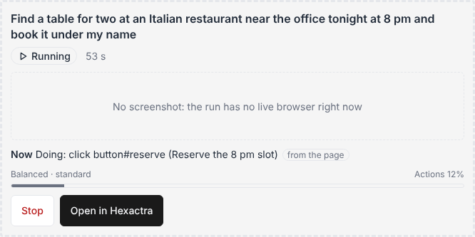

Run it all on a VPS (console, fabric and an optional browser host in one stack): [docs/runbooks/vps-stack.md](docs/runbooks/vps-stack.md). Run the browsers on **nodes** at home, which keep a residential IP and connect outbound over HTTPS: [../docs/nodes.md](../docs/nodes.md).

**Deleting runs** ([docs/runs.md](docs/runs.md#deleting-runs)):
- `DELETE /api/runs/:id` deletes one run; `POST /api/runs/delete` deletes a list of ids (up to 500) or every finished run that matches a filter. All three need `runs:delete` (contributors and organization admins), which is separate from `runs:write`.
- Deletion is permanent and covers the run, its steps, its questions and its stored screenshots.
- Live runs are never deleted: a run that is queued, running or waiting for a person must be cancelled first.
- A filter that matches more than 500 finished runs is deleted by a queue job (`browser.runs.delete`); the request answers `202` with the job id.
- Deleting runs also removes their cost and stop-reason history from task spend and from alert counts. The AI usage report keeps its own records and is not affected.

**The goal runner**:
- It uses the AI slice: feature `browser_agent`, a model with `tools`. Configure a provider at Administration → AI.
- The model never sees secrets: codes and passwords come from handoffs, and the fabric types them into the page (`type_secret`); the console never holds them.
- Steps store redacted arguments only.
- It works like a person at the computer, with your full powers (VISION §27, epic #366):
  - every model round starts with a screenshot of the page, with the interactive elements numbered;
  - it acts by selector, by mark or by position, with trusted mouse and keyboard;
  - it runs JavaScript in the page;
  - it uses the node's desktop for native dialogs and file pickers.
  A model without vision keeps working from the page's text and elements.
- A run's limits come from its [agent policy](#agent-policies) (the built-in Balanced by default: 60 actions, 20 active minutes). No confirmation before purchases. Two limits are opt-in per task: an allowed-sites list, and "Ask me before purchases".
- Every model call is priced from the admin's `agentPricing` table (USD per million tokens, [Model prices](docs/runbooks/operations.md#model-prices)): a run shows its model calls, tokens and cost (a lower bound, "at least", while a model has no price) and a task its spend over 30 days.

The CLI's commands use the login from `hexactra login`, or `HEXACTRA_SERVER_URL` and `HEXACTRA_TOKEN`. Install it with one `curl | bash` line; the terminal UI groups its screens into Agent, Worker, Server, Developer and Account; the guide, with screenshots, is [apps/cli/README.md](apps/cli/README.md).

## Agent policies

An **agent policy** says which models a run may use and how much it may spend. It is a named, versioned, personal bundle. The spec is `console/apps/api/src/policies/agent-policy.schema.ts`, the single source of truth: the API, the OpenAPI document, the built-ins, the run snapshot, the export file and the web editor all derive from it, and every field carries its own description.

A policy holds four blocks, and every one is enforced:

| Block | What it sets | Read more |
|---|---|---|
| **Models** | The start tier and the highest tier (`fast`, `standard`, `frontier`) a run may escalate to, whether a tier's fallback model may be used on a provider error, and optional **model pins** | [Model tiers](#model-tiers) |
| **Budget** | Most browser actions, model calls, active minutes, input tokens, output tokens and cost in US dollars, and a warning threshold. **`null` means unlimited**, for any of them | [Budgets](#budgets) |
| **Stall** | Failures in a row, a repeated action, actions without progress, and what to do (nudge then escalate, escalate, ask a person, fail). **Always on**, even when every budget is unlimited | [Stall detection and escalation](#stall-detection-and-escalation) |
| **Context** | Screenshots kept, prune batch, model calls per chunk and observation size | [Context settings](#context-settings) |

### Built-in policies and your own

The four **built-in policies** are code (`builtin:economy`, `builtin:balanced`, `builtin:thorough`, `builtin:unlimited`): read-only, versioned with the console and never pinning a model. Duplicate one to edit a copy.

| | Economy | **Balanced** | Thorough | Unlimited |
|---|---|---|---|---|
| Tiers (start to max) | fast to standard | standard to frontier | frontier to frontier | standard to frontier |
| Actions / model calls | 40 / 80 | 60 / 120 | 200 / 400 | no limit |
| Active minutes / cost | 10 / $0.50 | 20 / $2 | 60 / $10 | no limit |
| On a stall | nudge, escalate once | nudge, escalate twice | ask a person | nudge, escalate twice |
| Screenshots kept / calls per chunk | 1 / 8 | 2 / 10 | 3 / 10 | 2 / 10 |

Your own policies are personal (organization-shared policies are not offered; a [JSON file](#export-and-import) is how you share one). Names are unique among your policies, and every edit bumps the policy's `version`.

**The default.** Each user has one default policy, stored as `browserAgent.defaultPolicyRef` in their user settings (`GET`/`PUT /api/agent-policies/default`). With none chosen it is `builtin:balanced`. A default cannot be deleted.

### Which policy a run uses

Most specific first:

1. the run's own `policyId` (`POST /api/runs`, `POST /api/tasks/:id/runs`: "Run with...");
2. the schedule's `policyId`, for a scheduled run;
3. the task's `policyId`;
4. the user's default;
5. `builtin:balanced`.

A reference to a deleted policy (or someone else's) falls through to the next level. The fall-through is logged and noted in the run's first log line, and never fails the run.

**The policy is snapshotted onto the run** at its first step (`runs.policy_snapshot`, with `policy_ref`, `policy_version` and `policy_source`) and never changed. The snapshot also holds the effective budget and the resolved model tiers. The runner and the budget engine read only the snapshot, so editing a policy, your settings or a ceiling later does not affect a run in flight. Run responses carry `policy: { id, name, version, source, builtin }`, where `source` is `run`, `schedule`, `task`, `user_default` or `system_default`.

### The API

`/api/agent-policies`, with permissions `agent_policies:read` / `:write` (granted like `tasks:*`). The per-endpoint reference is the OpenAPI document at `/api/docs`; in short:

- **List** (built-ins and your own, each with `isDefault`, `usage` and `hasNoHardStop`), **create**, **read**, **duplicate**.
- **Edit** with `PATCH` and `If-Match: <version>` (`412 POLICY_VERSION_CONFLICT` on a stale version; built-ins answer `403`).
- **Delete**: `409 POLICY_IN_USE` lists the tasks and schedules that use it, or pass `?reassignTo=<id>`; `409 POLICY_IS_DEFAULT` for your default.
- **Default**: `GET`/`PUT /default`. **Tiers**: `GET /model-tiers/effective`. **Share**: `GET /export` and `POST /import`.
- Tasks and schedules take `policyId`; `null` follows the next level.

**The earlier task fields are deprecated.** `maxSteps`, `maxMinutes` and `model` on a task still work, and are removed in the release after the one that introduced agent policies. Sending one (with no `policyId`) saves a derived personal policy named `Task: <task name>`, built from Balanced (`maxActions` = `maxSteps`, `maxActiveMinutes` = `maxMinutes`; a model becomes the `standard` pin and caps `maxTier` at `standard`), and answers with a `Deprecation: true` header. The `agent_policies` migration converted existing tasks the same way. Use `policyId` instead.

### Model tiers

Models are chosen by **tier**, not by name. There are three fixed tiers: **Fast** (cheap and quick), **Standard** (the everyday one) and **Frontier** (the strongest, for a run that is stuck). A tier is a model, a reasoning effort (`none`, `low`, `medium`, `high`; blank is the provider's default), a cap on output tokens and an optional fallback model. A policy only says which tier a run starts on and how high it may climb, and may pin a model to a tier.

**Model pins.** A policy may pin one model to a tier: `provider:modelId`, or a bare model id. A pin beats the tier's own definition for runs under that policy. Saving a policy refuses (`400 POLICY_PIN_INVALID`) a pin to a model that is not enabled for you, or that lacks tool calls and vision (one check, `PolicyModelCheck`). Built-in policies never pin, so they follow your tiers.

**Where tiers are defined**, once, in two layers (the spec is `console/apps/api/src/policies/model-tiers.schema.ts`):

- the **deployment default**, the `browserAgentTiers` system setting, edited by an administrator (`PATCH /api/system-settings`, `system_settings:write`; the page is **Administration → Browser agent → Agent model tiers**);
- **your own override**, `tiers` in your `browserAgent` user setting (`PATCH /api/user-settings`), per tier and per field. A field you leave out uses the deployment's.

**Which model a tier uses**, most specific first:

1. the policy's **pin** for that tier;
2. your tier;
3. the deployment's tier;
4. **fill-down**: a tier with no model borrows the nearest tier that has one (Fast and Frontier borrow Standard first; Standard borrows Frontier, then Fast);
5. your default model in your AI settings (`ai.defaultModel`).

If none gives a model the run fails at once, before a browser is allocated, with `No model selected`, naming the Model tiers page. The effort, output cap and fallback are the tier's own (your tier, then the deployment's, else unset): they are never borrowed, so Fast keeps the provider's default effort even when it borrows Standard's model. `none` asks the provider for the least reasoning it offers; an effort is not sent to a model that cannot reason. The per-model output caps an admin set in the AI settings still clamp the tier's cap.

**Same model, different effort.** Standard and Frontier may name the same model with a lower and a higher effort (for example Standard = model X at `low`, Frontier = model X at `high`). Escalating then changes only how hard the model thinks, so the provider's prompt cache stays warm, which is cheaper and faster than switching models.

**Checked at the start of a run.** Every resolved model must be one you can call right now (enabled by the administrator, on an enabled provider, with a key) and must support tool calls; otherwise the run fails with a message naming the tier. A model **without image input** is allowed: the run starts with screenshots off (it works from `observe_elements` and `read_text`) instead of finding out from a refused call.

**Fixed for the run.** The resolved tiers (model, provider, effort, cap, fallback and what each can do) are written to the run's policy snapshot (`resolvedTiers`) when it starts. Every model call reads them from there, so editing the tiers while a run is in flight changes nothing for it; the next run picks the change up.

**Reading them.** `GET /api/agent-policies/model-tiers/effective` (`agent_policies:read`; `?policyId=` resolves for another policy) returns the tiers a new run of your default policy would use, with where each value came from (`pin`, `user`, `deployment`, `fill_down`, `ai_default`) and `vision` / `tools` flags.

**Under the hood.** The console binds the platform's `AI_TARGET_RESOLVER` (`console/apps/api/src/platform/ai/browser-agent-target.resolver.ts`). The goal runner always names the tier's provider and model (the `browser_agent` feature); every other feature (`notes-summary`) resolves exactly as the platform does by default.

### Budgets

A run is held to six budgets: **actions**, **model calls**, **active minutes** (time waiting for a person never counts), **input tokens**, **output tokens** and **cost** (US dollars, from the admin price table; an unpriced call counts nothing toward the limit and the run shows "at least"). The budget engine is `console/apps/api/src/runner/budget.ts` (`BudgetTracker`, pure and unit tested).

- **`null` is unlimited ("No limit" in the editor).** A policy with every budget `null` (the built-in Unlimited) has no hard stop: the run ends when it finishes, when you stop it, or when it stalls. The first line of its run log says so, and the editor warns (but does not block saving). Stop and takeover always work.
- **Ceilings.** The deployment's admin sets ceilings in the `browserAgentCeilings` system setting (**Administration → Browser agent → Agent budget ceilings**; same keys as a policy's budget, each nullable, none by default). A run's effective limit is `min(policy, ceiling)`; it is unlimited only when both are `null`, so a ceiling also caps an Unlimited policy. The effective budget is written to the run's snapshot at its first step (`policy_snapshot.effectiveBudget`, with where each limit came from: `policy` or `ceiling`), so changing a policy or a ceiling never changes a run in flight.
- **Where it is checked.** After every model call (model calls, tokens, cost), before every browser action (actions) and before each chunk (everything, active time included). A run continued after a handoff or in a new job starts from what it already used, never from a fresh budget.
- **Warning.** The first time a budget reaches the policy's `warnAtPercent`, the model's next round carries: `Budget: <budget> is at <p>% (<used> of <limit>). Finish the goal now if you can; otherwise call finish with what you achieved and what remains.` The run log records it once per budget.
- **Wrap-up.** When a budget is used up the run makes one last model call with only the `finish` tool (one step, a capped output), exempt from the exhausted budget and counted in the run's totals, so a stopped run still returns a partial result: `finish(success: true)` ends the run `succeeded`; anything else ends it `failed` with the model's summary as `result` and the budget message (for example `Step budget exhausted`) as `error`. If the model calls no `finish`, the run ends with the budget message alone.
- **`stopReason`.** Every finished run carries a typed `stopReason` (`runs.stop_reason`): `finished`, `budget_actions`, `budget_model_calls`, `budget_active_time`, `budget_input_tokens`, `budget_output_tokens`, `budget_cost`, `stalled`, `cancelled`, `error` or `no_model`. A wrap-up that succeeds keeps the budget reason, so the run page can say what forced the stop. Runs from before the column have `null`.
- **API.** Run responses (and the `run` events of `GET /api/runs/:id/stream`) carry `stopReason` and `budget: { effective, used, percent, source, costKnown }`: the limits, what the run used (active time in minutes, cost in USD), the percent of each limit (`null` when unlimited), and the source of each limit. `budget` is `null` until the run's first step.
- **Stalls.** Stall detection is always on, so a run with no budget still ends when it loops (see Stall detection and escalation below).

### Stall detection and escalation

Stall detection is **always on**, including under the Unlimited policy. The detector is `console/apps/api/src/runner/stall.ts` (pure, unit tested); the runner feeds it every recorded action and the page as measured at the start of every chunk. Its state lives in the run's memory, so it survives chunks, jobs and handoffs, and holds only short digests, normalised selectors and URLs without a query: never typed text (only its length), never a secret value, never an image. Typing a handoff secret is not fed to it at all.

**Signals** (thresholds are the policy's `stall` block):

| Signal | Fires when |
|---|---|
| Failures in a row | `maxConsecutiveFailures` failed actions in a row. |
| Repeated action | The same action fingerprint occurs `maxRepeatedAction` times in the last 10 actions. A fingerprint is a hash of the action type, its arguments (redacted first: typed text is its length, URLs lose their query, positions are rounded to 10 pixels), whether it succeeded, the page URL, what it returned (the scroll position, a digest of read content) and a digest of the page. |
| No progress | `noProgressActions` actions with no change of URL, page title or page view (a digest of the numbered elements on the screenshot, or of the screenshot itself when it has none; computed in the console, never sent to the model), and no successful `read_text`, `observe_elements` or `run_javascript` that returned content not seen recently. Observations alone are never progress. The page is only measured when a screenshot is taken, so this signal is judged at chunk boundaries. Without screenshots (vision off) a new successful change of the page counts as progress. |
| No action | Three rounds in a row that record no action at all (a model that only talks). |

A `request_human` or any handoff resets every counter.

**Responses** (`stall.onStall`):

| Mode | What happens |
|---|---|
| `nudge_then_escalate` | The first stall at a tier adds a nudge to the next round: `You appear stuck: <reason> (last actions: ...). Do not repeat the same action. Try a different approach (another selector, position, keyboard, run_javascript, or a different page), or call finish if the goal is impossible.` The next stall escalates one tier. When there is nothing left to escalate to, the run asks a person, or fails as `stalled` when it runs unattended (a scheduled run) or has already asked three times. |
| `escalate` | Escalates at once; with no escalation left the run fails as `stalled`. |
| `ask_human` | Opens a `takeover` handoff (kind `other`) whose prompt gives the reason and the last 5 actions, through the same path as `request_human`, and waits (`waiting_human`). |
| `fail` | Ends the run as `stalled`, after the same one-call `finish` wrap-up a used-up budget gets. |

**Escalation.** The run moves to the next tier above its current one, up to `models.maxTier`, at most `stall.maxEscalations` times per run; a tier whose model, effort and output cap are the same as the current one is skipped, as is one that is not usable. The model only ever changes between chunks (the chunk that stalled ends first), so provider caching holds inside a chunk. The tier, the escalation count, the stall counters and the fingerprint window are kept in the run's memory; `runs.current_tier` and `runs.escalations` (and `currentTier`, `escalations` on run responses and the live stream) show them. If the new tier's model has no vision, screenshots turn off for the run.

**De-escalation.** After 5 successful actions in a row that were not repeats, on an escalated tier, the run returns to its start tier at the next chunk boundary. A single hard step does not move the whole run onto the strongest model. Escalations are still counted against `maxEscalations`.

**Provider fallback.** When the policy has `allowProviderFallback` and the tier has a fallback model, a chunk whose model call fails with `AI_PROVIDER_UNAVAILABLE` (down, overloaded, a 5xx), `AI_RATE_LIMITED` or `AI_MODEL_NOT_REACHABLE` is retried once on the fallback model, and the next chunk goes back to the primary. A fallback is not an escalation. Without a fallback the error stands as before: a rate limit defers the job, other errors fail the run.

**Visibility.** Every escalation, de-escalation and fallback writes a run step of kind `routing` with `args: { from, to, reason, kind }`. A routing step is not an action: it counts toward neither `stepCount` nor the actions budget. While the run is on an escalated tier its activity carries a `note` (for example `Escalated to Frontier (stuck: repeated click on #submit)`) that the run page shows, and the run log the model reads says so too.

### Context settings

Most of a long run's cost is context re-sent on every model call. The policy's `context` block (read from the run's snapshot, never from constants) sets how much each round carries:

| Knob | Range | What it does | Cost and accuracy trade-off |
|---|---|---|---|
| `callsPerChunk` | 1-20 | Model calls per chunk (the `runTools` step cap). A chunk ends, and the conversation of tool outputs resets, after this many calls; the step log (last 60 lines) carries continuity. | Smaller: less re-sent output (input grows roughly with the square of the calls in a chunk) but a new screenshot and log each chunk. Larger: fewer resets, more cost, better short-term memory. |
| `observationChars` | 500-20000 | Most characters of one `read_text`, `run_javascript`, `observe_elements` or `tabs` result sent to the model. `observe_elements` lists at most `min(80, floor(chars / 75))` elements. | Smaller: cheaper rounds, but a long page may be cut off. |
| `screenshotsKept` | 0-5 | Screenshots in the model's context: the current one plus earlier ones. `0` turns vision off (text only, the same as a model that refuses images). | More images show what changed but each costs tokens on every round they stay. |
| `pruneBatch` | 1-50 | Older screenshots go in batches, not one per call: once the window is full only the newest image is replaced, so the older images, and the prompt prefix up to them, stay byte-identical for `pruneBatch` chunks (provider prompt caching keeps hitting). Then the window is trimmed to the current screenshot and refills. | A larger batch caches better but keeps a stale image longer. |

The built-ins' screenshots and calls per chunk are in the table above; all use 6000 characters and a prune batch of 10. The settings the runner used before policies (20 calls, 6000 characters, 1 screenshot) appear only as the baseline of the measurement below.

**What stays the same on purpose.**
- Screenshots live only in the job's memory: `runs.transcript` keeps digests (`shots`), never images. After a job hop or a handoff the window restarts with the current screenshot.
- The instructions and tool definitions contain no per-run value, so they are byte-identical for every run (a test hashes them). The round input is ordered goal and allowed sites, step log, screenshots, then the volatile tail (what the screenshot shows, steps used).
- Provider cache hints: the platform exposes only an untyped `providerOptions` escape hatch and documents no cache option, so none is set. Providers with automatic prefix caching benefit from the stable prefix; explicit hints (for example a cache key or breakpoints) need an EnterpriseAppBase seam request.
- Each model call records `app.runs.input_tokens_per_call` (histogram) in the "Browser agents" telemetry.

**Measurement.** A deterministic fixture (`apps/api/test/context-efficiency.db.spec.ts`): the same scripted run of 30 actions on a large page, a fake model that reports input tokens as the size of everything it would be sent (characters / 4, plus 850 per image), run under the old settings and under Balanced. It measures context size, not provider prices or task success on real sites: real-provider benchmarking was not possible in the build environment.

| Settings | Chunks | Model calls | Input tokens | Result |
|---|---|---|---|---|
| Old (20 calls, 6000 chars, 1 screenshot) | 2 | 31 | 443,728 | succeeded |
| Balanced (10 calls, 6000 chars, 2 screenshots) | 4 | 31 | 364,417 | succeeded |

Balanced sends 18% fewer input tokens here even though it shows one more image. The saving grows with page size and run length; a model that must remember more between chunks may need larger chunks.

### Export and import

A policy is personal, so a JSON file is how it is shared with a colleague or moved to another deployment.

- **Export:** `GET /api/agent-policies/export?ids=<id>,<id>|all&includePins=true|false` (permission `agent_policies:read`) answers a JSON attachment `agent-policies-<yyyymmdd>.json`, not wrapped in the `data` envelope. `ids` defaults to `all` (the built-ins, then your own); built-ins can be exported as a starting template. `includePins=false` strips every model pin, so the file only relies on tiers and works on any deployment.
- **Import:** `POST /api/agent-policies/import` with `{ "file": <the JSON>, "onConflict": "rename" | "skip" | "replace" }` (permission `agent_policies:write`). On a name you already use: `rename` (the default) adds ` (2)`, ` (3)`; `skip` leaves yours and lists the entry under `skipped`; `replace` overwrites yours in place, keeps its id and the tasks that use it, and bumps its version (a run in flight keeps its own snapshot).
- **Atomic:** the whole file is written in one transaction. Any invalid policy rejects the file with `400 POLICY_IMPORT_INVALID`, whose `details.errors` lists every invalid entry (`index`, `name`, Zod `issues`); nothing is created. A newer `formatVersion` or `spec.schemaVersion` than the deployment reads is `400 POLICY_IMPORT_UNSUPPORTED_VERSION`. Limits: 100 policies and 256 KB (`413 POLICY_IMPORT_TOO_LARGE`).
- **Pins:** a pin to a model that is unknown, disabled or without tools and vision on this deployment is dropped (that tier falls back to your tier definition) and listed under `warnings` with code `PIN_DROPPED`; the policy is still created.
- **Ceilings:** a budget above the deployment's ceilings is stored as written and listed under `warnings` with code `EXCEEDS_CEILING`; it is clamped when a run uses it, so an import never weakens a ceiling.
- **What the file holds:** names, descriptions and specs only. No ids, user, version, timestamps, task usage or secret. The response is `{ created, replaced, skipped, warnings, errors }` (`errors` is always empty on success).

```json
{
  "kind": "hexactra.agent-policies",
  "formatVersion": 1,
  "exportedAt": "2026-11-17T12:00:00.000Z",
  "policies": [
    {
      "name": "Careful shopping",
      "description": "Frontier from the start, ask a person when stuck",
      "spec": {
        "schemaVersion": 1,
        "models": { "startTier": "frontier", "maxTier": "frontier", "allowProviderFallback": false },
        "budget": { "maxActions": 200, "maxModelCalls": 400, "maxActiveMinutes": 60, "maxInputTokens": null, "maxOutputTokens": null, "maxCostUsd": 10, "warnAtPercent": 80 },
        "stall": { "maxConsecutiveFailures": 4, "maxRepeatedAction": 3, "noProgressActions": 10, "onStall": "ask_human", "maxEscalations": 0 },
        "context": { "screenshotsKept": 3, "pruneBatch": 10, "callsPerChunk": 8, "observationChars": 6000 }
      }
    }
  ]
}
```

### Using it in the console

Everything above is on the console's pages (`apps/web/src/pages/`, one client for every call in `src/policies/api.ts`). Built-ins show a lock; your own policies show their version, and every policy shows its tiers, a budget summary ("60 actions · $2 · 20 min" or "Unlimited") and how many tasks and schedules use it. The editor's help texts are the API's own field descriptions.

**Create a policy**

1. Open **Settings → Browser agent → Agent policies** (`/settings/agent-policies`).
2. Choose **New policy** and pick the built-in to start from, or **Duplicate** any policy (name the copy; the editor opens on it).
3. In the editor, fill in **General** (name, description), then **Models**: the start and max tier (Fast | Standard | Frontier), provider fallback, and optional pins per tier. Each tier shows the model it resolves to for you and where that comes from.
4. Under **Budgets**, set each limit or turn on its **No limit** switch (saved as `null`). With every budget off, the page warns: "Nothing will stop this run except finishing, Stop, or stall detection." Saving is still allowed. When an administrator set a ceiling, it shows under the field ("Capped at 300 actions by your administrator").
5. Adjust **When the agent is stuck** and, under **Advanced: context**, the context settings; then **Save**. If someone changed the policy meanwhile, the page says so and offers **Reload**.

**Set your default**

1. On **Agent policies**, open a policy's **⋮** menu and choose **Set as default**. The **Default** badge moves to it.
2. Tasks whose policy is **Default** (and ad-hoc runs) now use it. A default cannot be deleted; deleting a policy that tasks or schedules still use asks which policy they move to.

**Choose a policy for a task, a schedule or one run**

1. In the task form ([Create a task](#create-a-task)), pick **Policy**: *Default (name)*, a built-in, or one of yours. The line under it summarises the choice; **Manage policies** opens the list. The form sends `policyId` only.
2. The Tasks list shows each task's policy ("Balanced (default)" when it follows your default) and the model its start tier uses.
3. When adding a schedule, **Policy override** runs that schedule under another policy (default: the task's).
4. **Run with…** (the arrow next to **Run now**, on every row of the Tasks list) starts one run under the policy you pick from the menu, without changing the task. The menu marks the policy the task usually runs under.

**Export and import**

1. **Export all** downloads every policy as one JSON file; a policy's **⋮ → Export** downloads just that one. Turn off **Include model pins** for a file that works on any deployment.
2. **Import** opens a file picker. The dialog lists the policies in the file and asks what to do when you already have one with the same name (keep both and rename, skip, or replace yours), then reports what was created, replaced and skipped, with any warnings (for example a pin to a model this deployment does not have, which is dropped).

**Model tiers.** **Settings → Browser agent → Model tiers** (`/settings/agent-model-tiers`, shown while AI is on) has one card per tier: model, reasoning effort, max output tokens and fallback model. Each tier **inherits from the deployment** until you switch that off; "Now:" shows what it resolves to.

**For administrators**, under **Administration → Browser agent**: **Agent model tiers** (`/admin/settings/agent-model-tiers`, the deployment default for every user), **Agent budget ceilings** (`/admin/settings/agent-ceilings`, the most any run may spend, also capping Unlimited policies; **No ceiling** per budget) and **Model prices** (`/admin/settings/agent-pricing`, US dollars per million input, output and cached input tokens per `provider:modelId`). All three read with `system_settings:read` and save with `system_settings:write`.

### Watching a run's spend

The run page (`/runs/:id`) shows the run's **policy** (name, version, and whether it came from your default, the task, the schedule or this run), its **tier** (`tier: Standard`, highlighted as `tier: Standard → Frontier` once a stall escalated it) and the **model** that tier uses. Under them, a **budget meter** has one bar per limited budget (used / limit and the percent; a deployment ceiling is marked), turning orange at the policy's `warnAtPercent` and red at 100%; an unlimited budget shows what was used and "∞", and an unpriced cost reads "≥ $x". The meter follows the run's live stream and ticks active time between events. When the run ends, one line says why (for example "Stopped: cost budget reached ($2.00)." with the agent's summary). Escalations, de-escalations and model fallbacks appear in the step timeline as their own rows (↑, ↓, ⇄). The runs list shows each run's cost and says a budget, stall or missing-model stop in its status chip ("failed · cost budget", "failed · stalled"); a task card and the task's runs view show its last 30 days: runs, cost, tokens and the average cost of a successful run (`spend30d.succeeded`, `spend30d.avgSuccessCostUsd`). Run responses carry the tier as `tier: { start, max, current, escalations, model }`. Cost-aware alerts: [operations runbook](docs/runbooks/operations.md#the-run-budget-meter-stop-reasons-and-cost-alerts).

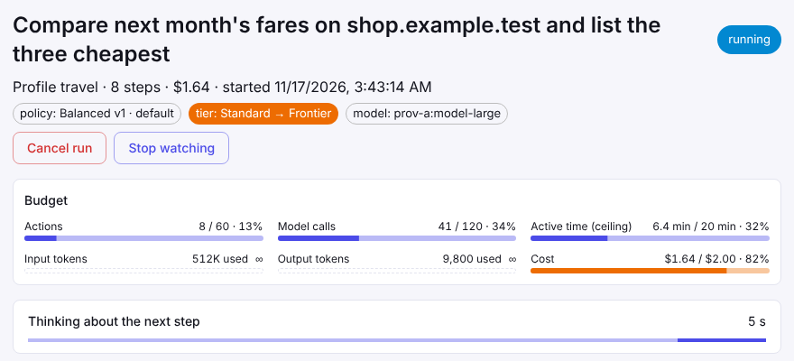

### CLI, SDK and MCP

The same policies are reachable from scripts and agents ([docs/mcp.md](docs/mcp.md#agent-policies), [apps/cli/README.md](apps/cli/README.md#agent-policies), [packages/sdk/README.md](packages/sdk/README.md)).

- **CLI:** `hexactra policies list|show|export|import|default`, and `--policy <id|name|builtin key>` on `runs start`, `tasks run|create|update` and `schedules create`. `runs list|show` and the terminal UI show each run's policy and cost (and tier, budget use and stop reason when the API reports them).
- **MCP:** `policies_list`, `policy_get`, `policy_create`, `policy_update`, `policy_set_default`, `policies_export`, `policies_import`, and `policy_id` on `run_goal`, `task_create`, `task_update`, `task_run` and `schedule_create`. Each tool calls the REST route as the caller, so `agent_policies:read` / `:write` apply: a read-only user is refused the write tools with `403`. Deleting a policy is not an MCP tool.
- **SDK:** `hx.policies.list|get|create|update|setDefault|export|import`, `hx.tasks.create|update|run` and `hx.runs.start` (each with `policyId`), and the exported `AgentPolicySpec` type.

Tasks, schedules and runs have the same reach: `hexactra tasks pause|resume` and `runs delete`, the MCP tools `schedule_preview`, `task_pause`, `task_resume`, `task_create` with `schedules` and a paged `runs_list`, and the SDK's `hx.runs.list|delete|deleteMany`, `hx.tasks.pauseSchedules|resumeSchedules` and `hx.schedules.preview`. What each client has and what it deliberately does not (an agent cannot delete runs) is in [docs/api-tasks-runs.md](docs/api-tasks-runs.md#client-parity).

## Using the console

What each page of the web app is for and how to use it, from a phone, a tablet or a desktop. The pages share one design: lists are searched, filtered and paged by the API, every destructive action asks first, and a table becomes cards on a phone.

| Page | What it is for |
|---|---|
| [Home](#home) (`/`) | What needs you, what is running, what runs next, what just happened. |
| [Chat](#chat) (`/chat`) | Say what you want done and follow it in one thread. |
| [Inbox](#inbox) (`/inbox`) | The questions your agents are waiting on. |
| [Tasks](#tasks) (`/tasks`), [a task's page](#a-tasks-page), [the task form](#create-a-task) | What your agents do, and when: create, schedule, pause, run. |
| [Schedules](#schedules) | The schedule editor inside the task form and the task's page. |
| [Runs](#runs-find-filter-and-delete) (`/runs`) | Every run: find, filter, open, delete. |
| [Run history](#run-history-and-retention) (Settings → Browser agent) | How long finished runs are kept. |

Models, tiers and budgets are [agent policies](#agent-policies): these pages show a policy where you choose one (the task form's **Model and budget**, a schedule's **Policy override**, **Run with…**) and show what it cost (the lists' cost and stop reason, spend on a task's page and on Home). The routes behind the pages are in [docs/api-tasks-runs.md](docs/api-tasks-runs.md); what the CLI, the SDK and MCP can do with them is in its [client parity](docs/api-tasks-runs.md#client-parity) table. The screenshots in this chapter are the production build with sample data, at 1440 px and 390 px.

### Home

`/` is the page to open first. It answers, from one request (`GET /api/home/summary`): is an agent waiting for me, what is running, what will run next, how did the recent runs go, are my machines up. And it starts a run.

| On a desktop | On a phone |
|---|---|
| 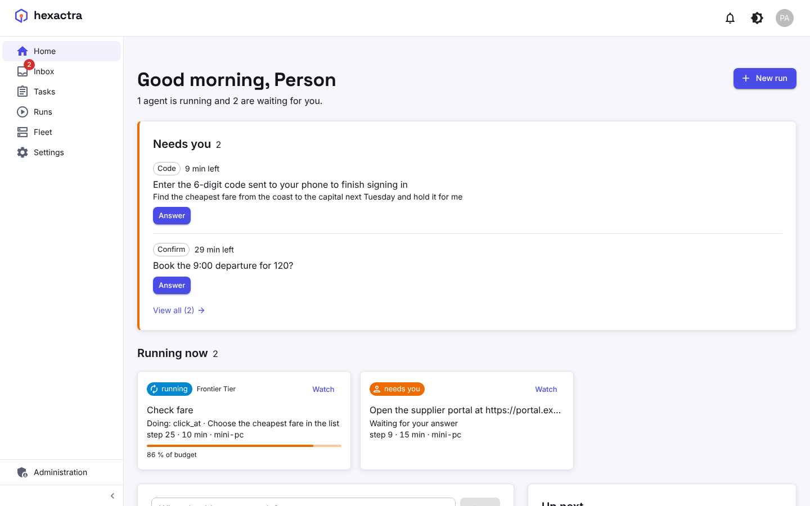 | 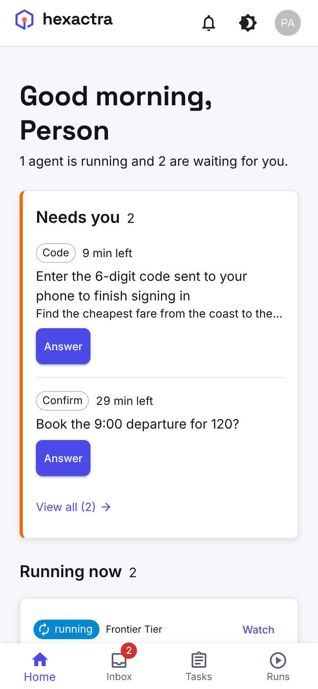 |

- **Greeting** and one status sentence ("2 agents are running and 1 is waiting for you.", "Nothing is running. Next: Morning report in 3 h.", "All quiet.").
- **Needs you** (only when a question is pending, always first): up to three questions, the ones that expire first, each with a countdown and an **Answer** link to the Inbox. A confirmation that is not high-risk can be approved or denied in place; a high-risk one, a secret and every other input go to the Inbox.
- **Running now**: a card per live run with what it is doing, its step and time, its machine, and a budget bar ("62 % of budget": orange from the policy's warning threshold, red at 100 %, absent for an unlimited run). A run on a stronger tier than its policy starts on says so.
- **Quick start** (with `runs:write`): a goal and **Run** (the default profile and policy), and a chip per task you ran most recently (the task's own policy). "More options" opens the Runs page with its **New run** dialog (profile, machine and policy).
- **Up next**: the next five firings, with the schedule in words (a task's name opens [its page](#a-tasks-page)), and how many tasks are paused or failing (links to the Tasks list with that filter).
- **Recent runs**: the eight most recently finished, with the stop reason, the duration and the cost.
- **This week**: runs, success rate, failed and spend over the last seven days of your profile time zone, a stacked bar per day (the chart is loaded on demand), and how many runs a budget or a stall stopped.
- **Machines**: how many are online, and each one's state in words.

A new account sees a **Get started** card instead of the dashboard blocks until it has a machine, a task and a run: three steps, ticked from the data, each only if you may do it. "Create a task" opens the [task form](#create-a-task).

The page reads the summary when it opens, when the window gets the focus, and every 10 seconds while the tab is visible (every 5 while an agent runs or waits for you). When a read fails, the last data stays on screen, dimmed, with when it was read and a Retry.

The route behind it, `GET /api/home/summary`, is one read that never fails because a part is slow: what each block needs, its limits and what it never carries are in [docs/api-tasks-runs.md](docs/api-tasks-runs.md#home).
### Chat

`/chat` is the quick way to get something done: say what you want, and follow it in one thread. A chat needs `chat:read`; writing in one needs `chat:write`. An administrator chooses the chat's model under Administration → AI (feature "Chat: understand the request and start browser runs"); until then the thread says no model is set up.

- **Start.** **New chat** opens an empty thread with three examples. Your first message creates the chat and names it. Enter sends on a desktop (Shift+Enter breaks the line); on a phone Enter breaks the line and the send button sends.
- **What comes back.** The assistant replies, asks one clarifying question with suggested answers you can tap, or starts a browser run. A run shows as a card with its goal and a link to the run; when it ends, a second card says how. Three dots show while the assistant is working, and the line under the title says what is happening ("Thinking…", "Working in the browser…", "Waiting for you").
- **The list.** Chats are listed with their last line, most recently active first; a green dot marks a chat whose run is live. **Active** and **Archived** switch the list. Each row's menu, and the menu of the open chat, has **Rename**, **Archive** (an archived chat is read-only until you unarchive it) and **Delete** (the chat, its messages and its runs; refused while a run is live).
- **Chat settings** (the open chat's menu): the machine, the browser profile, the agent policy, the sites its runs may visit, and **Ask me before a purchase or another step that is hard to undo**, which is on by default in a chat. They apply to the next run the chat starts.
- **Widths.** From 900 px the list is beside the thread; from 600 px it is a drawer behind the menu button; on a phone the list and the thread are two screens with a back arrow. The thread scrolls, the page does not, and the message field stays above the keyboard.

The Browser card with the live view, answering the agent's requests in the thread and "Save as task" arrive with the next parts of epic #482.

### Inbox

**Inbox** (`/inbox`) is where an agent's questions wait for you. The number of pending questions is on the Inbox entry of the navigation (rail, bottom bar and user menu) and in the tab's title ("(2) Hexactra Console"), and Home lists the first three under **Needs you**. A notification about a question opens the Inbox with that question first; `/inbox/q/:id` shows one question on its own.

| On a desktop | On a phone |
|---|---|
| 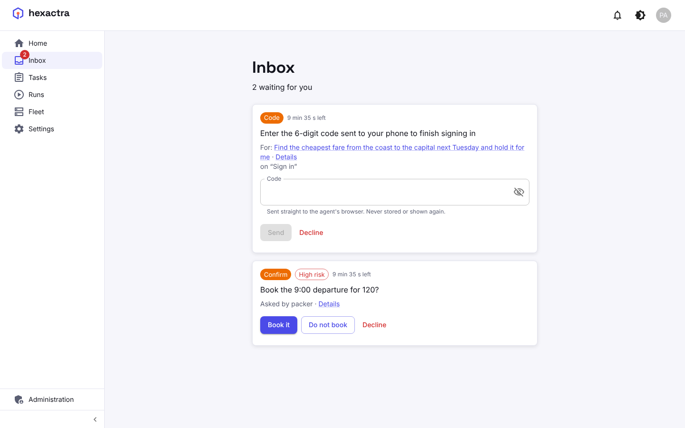 | 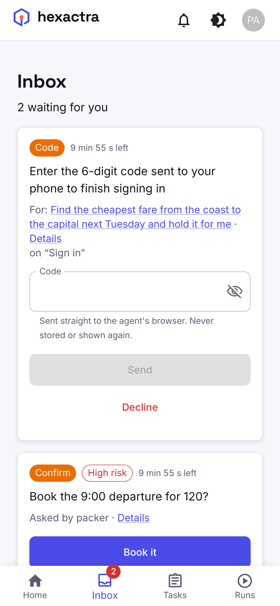 |

Each request is a card: what kind it is, how long you have ("4 min 05 s left", ticking; at zero the form is replaced by "This request expired."), the prompt, the run or agent that asked, and for a question from a browser a small picture of the page. What you answer with depends on the question:

| The agent asks for | You get |
|---|---|
| Text or a number | A field with its limits (length, range, unit) and a counter. |
| A choice, or several | Full-width rows; "2 of 3 selected" for several. |
| A confirmation | The two buttons the agent named. A high-risk one asks "Are you sure?" first. |
| A code, a password or another secret | One field with an eye button. See below. |
| You to do something in the browser (a CAPTCHA, a sign-in) | **Open the browser**, then **Done**. |

- **A secret is typed, sent and gone.** It goes straight to the agent's browser, which types it into the page; the console never stores it, logs it or shows it again, and the model never sees it. The field's label is "Code", "Password" or "Secret".
- **Show or hide what you type.** The eye button switches between dots and the characters. A one-time code starts shown (typing it blind causes retries); a password starts hidden. A shown value hides again when you send it, when you leave the tab, and after 30 seconds without a keystroke.
- **Decline** is always the last button. Declining a question from a run asks first, because the run cannot go on without an answer.
- **After you answer**, the card says "Sent." and folds away, and the run resumes. If the question was answered on another device or expired meanwhile, the card says so instead of showing an error.
- The list refreshes every 5 seconds without interrupting what you type. Answering needs `runs:write`; with `runs:read` alone you see the questions.

The reference for question types, channels (Android app, CLI, notification buttons, webhooks) and the REST routes is [docs/questions.md](docs/questions.md).

### Tasks

**Tasks** (`/tasks`) lists what your agents do, and when. Each row answers five questions without opening the task: what it does, whether it is scheduled, when it runs next, how the last run went and what it cost in the last 30 days. On a phone each task is a card with the same facts.

| On a desktop | On a phone |
|---|---|
| 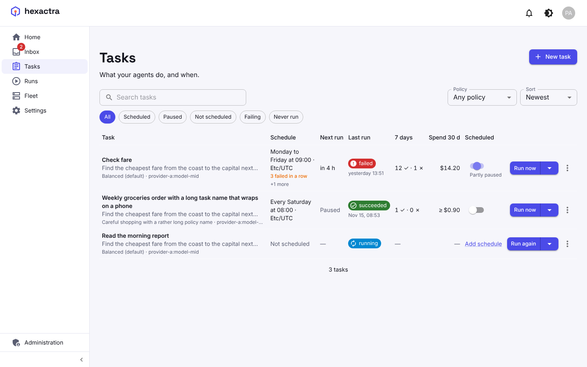 | 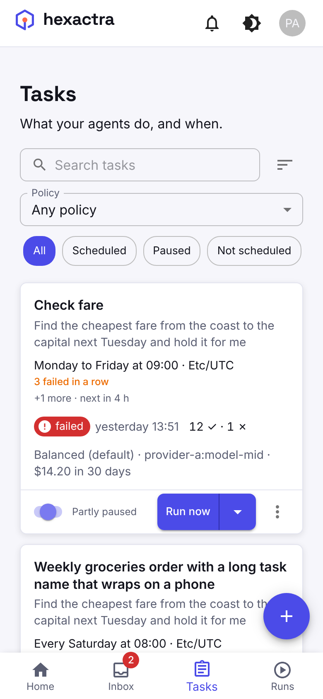 |

| On the row | What it tells you |
|---|---|
| **Schedule**, **Next run** | The first schedule in words ("Monday to Friday at 09:00", "+2 more" when there are several) and when the task fires next; "Paused" when its schedules are off, "Not scheduled" when it has none. A schedule that failed three times in a row says so. |
| **Last run**, **7 days** | The last run's status and time (a link to the run), the live run while one is going, and the last 7 days by outcome ("12 ✓ · 1 ✗"). |
| **Policy**, **Spend 30 d** | The agent policy and the model it starts on, and the cost of the task's runs in the last 30 days ("≥ $4.20" when a call could not be priced; the tooltip has the number of runs and the average per successful run). The policy shows only to someone who may read agent policies. |

- **Find a task.** Search by name or goal, filter with the chips (Scheduled, Paused, Not scheduled, Failing, Never run), sort by newest, name, last run, next run or spend, and filter by policy once your tasks use more than one. The search, filter and sort are in the address (`/tasks?q=…&filter=…&sort=…&policyId=…`), so a view can be bookmarked or shared. The list loads 50 tasks at a time (**Load more**) and keeps itself current while the page is open.
- **The Scheduled switch.** Off pauses every schedule of the task; on resumes them. That is all it does: a task that is off **still runs** when you press Run, or when it is started through the API, the CLI or MCP, and a run that is going when you switch it off finishes. "Partly paused" means some of the task's schedules are paused and some are not; switching it on resumes them all. A task without a schedule has an **Add schedule** link instead. The switch needs `tasks:write`; without it you see "Scheduled" or "Paused".
- **Run now and Run with….** **Run now** starts a run under the task's own policy. The arrow next to it lists the other policies: pick one to use it for that run only, without changing the task. The list stays where it is, so you can start several tasks; "Run started · View" links to the new run. While a task is running the button reads **Run again** and asks before starting a second run. Running needs `runs:write`.
- **New task** opens the form ([Create a task](#create-a-task)); **Edit** in a task's ⋮ menu opens the same form for that task.
- **The ⋮ menu.** Open ([the task's page](#a-tasks-page)), Edit, Duplicate (a new task that starts as a copy, with its schedules paused), View runs (the task's page, at its runs), and Delete. Delete asks first and says what happens: the task's schedules are deleted, and its runs stay in Runs as one-off runs.

### A task's page

`/tasks/:id` is a task's home: open it from the task's name in the list. It shows what the task does, how it is set up, when it runs next, how its runs have gone and what they cost. The page needs `tasks:read`.

| On a desktop | On a phone |
|---|---|
| 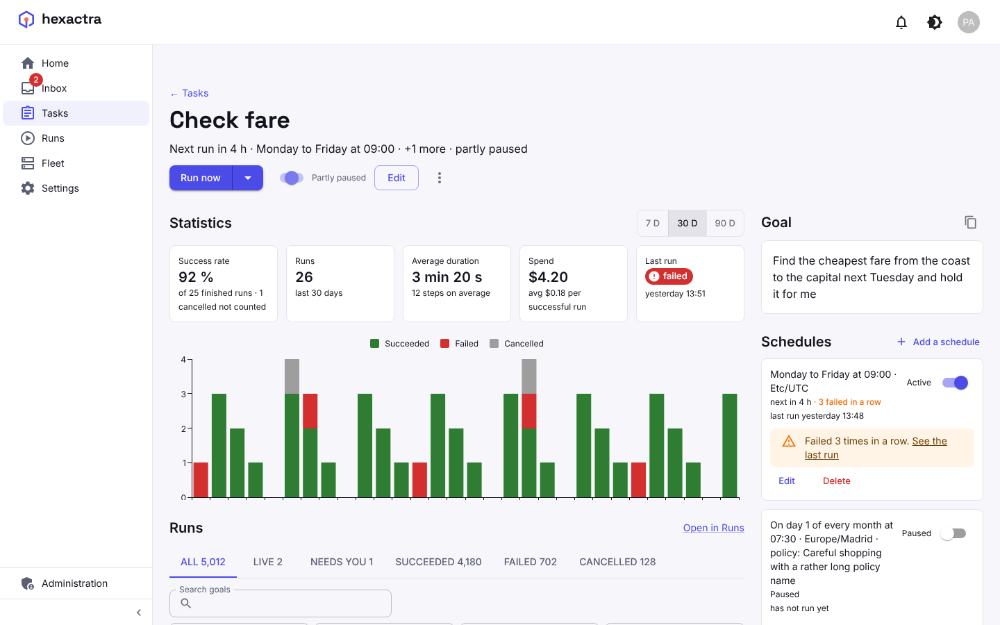 | 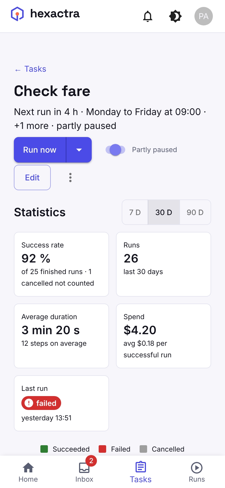 |

- **The header** says when the task runs next and on which schedule ("Next run in 3 h · Monday to Friday at 09:00"), "Schedule paused", or "Runs only when you start it".
  - **Run now** starts a run and opens it; the arrow is **Run with…** another policy for that run only. While a run is going it reads **Run again** and asks first. Needs `runs:write`.
  - The **Scheduled** switch pauses or resumes every schedule of the task, as on the list. **Edit** opens the form; the ⋮ menu has Duplicate and Delete (the page then returns to Tasks).
- **While a run is live**, a banner says what the agent is doing, with **Watch**; when the run waits for you it reads "Needs you", with **Answer** (your Inbox).
- **Statistics** (with `runs:read`) for the last 7, 30 or 90 days:

  | Tile | What it shows |
  |---|---|
  | **Success rate** | Succeeded runs out of those that succeeded or failed; "n/a" when none did. Cancelled runs are not counted. |
  | **Runs** | Runs started in the period. |
  | **Average duration** | Of the finished runs, with the average number of steps; the tooltip has the time 95 % of runs finish within. |
  | **Spend** | The period's model cost ("≥" when a call could not be priced) and the average per successful run. Absent when no run has a cost. |
  | **Last run** | Its status and time; "Stopped: cost budget" or "Stopped: stalled" when a budget or a stall ended it. |

  The chart under the tiles has one bar per day, stacked by outcome (succeeded, failed, cancelled). On a phone it shows the last 14 days. The same numbers are in a table for screen readers.
- **Runs** (`/tasks/:id#runs`) is the [Runs list](#runs-find-filter-and-delete) fixed to this task, with its status tabs, search, filters and delete. **Open in Runs** shows the same runs on the Runs page.
- **Goal**, with a button to copy it.
- **Schedules** (`/tasks/:id#schedule`): each schedule in words with its policy override, when it runs next and its last run.
  - The **Active** switch pauses one schedule; the others keep running.
  - **Edit** and **Add a schedule** open the [schedule editor](#schedules) and save at once, unlike the task form, which saves schedules with the task.
  - **Delete** asks first.
  - A schedule that failed three times in a row carries a warning with a link to its last run. The notification about it opens the page here.
- **Configuration**: the agent policy ("(default)" when the task follows your default; a link to the policy; its tiers and limits) and the model it starts on (both with `agent_policies:read`), the machine (with a warning while it is offline or disabled), the browser profile, the allowed sites, whether it asks before risky steps, and when the task was created and last edited.

On a phone the page is one column in this order: statistics, runs, goal, schedules, configuration. Goal and Configuration fold, and start folded when the goal is long.

### Create a task

A task is created at `/tasks/new` and changed at `/tasks/:id/edit`. Both are one form with five sections, read top to bottom, and **Save** stores everything in one step. Both pages need `tasks:write`.

| On a desktop | On a phone |
|---|---|
| 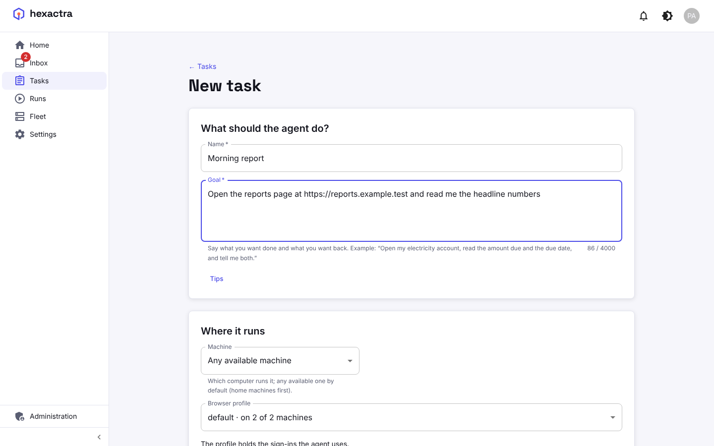 | 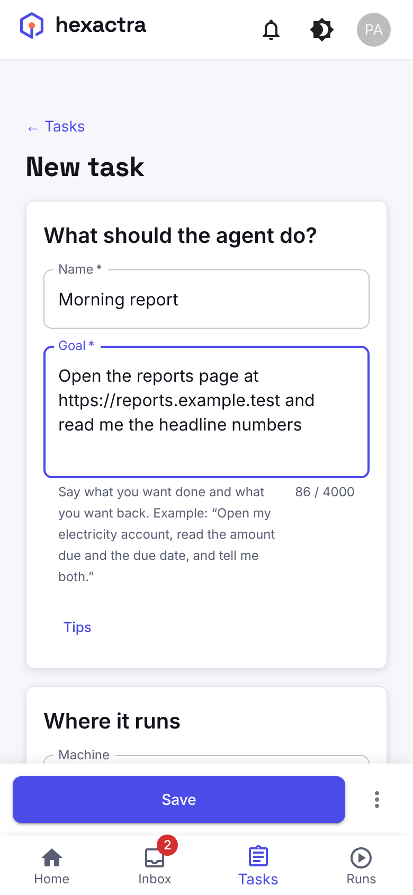 |

1. **What should the agent do?** A name (up to 200 characters) and the goal (up to 4,000). Say what you want done and what you want back; **Tips** has three reminders.
2. **Where it runs.**
   - **Machine**: any available machine, or one you name. For a named machine, the switch decides whether another machine may take the run when that one is unavailable; a warning shows while the machine is offline or disabled.
   - **Browser profile**: the sign-ins the agent uses. The list holds the chosen machine's profiles (or every profile in the fleet, with how many machines have it). A warning shows when the machine does not have the profile. Without `fleet:read` the profile is typed by name.
3. **Model and budget** (with `agent_policies:read`). The task's [agent policy](#agent-policies): *Default (name)*, a built-in or one of yours. The line under it shows the model the policy starts on and its limits. The policy controls the models and every limit of a run (actions, cost, time); the form has no step, minute or model field.
4. **Safety.** Both are off unless you turn them on.
   - **Allowed sites**: the agent may only visit these sites. Type or paste a site, then Enter, a comma or a space; a pasted address keeps its hostname; `*.example.test` covers every subdomain. Empty allows any site.
   - **Ask me before purchases and other irreversible steps**: the agent pauses and asks in your Inbox.
5. **Schedule.** **Add a schedule** opens the [schedule editor](#schedules) in the form (up to 10 per task). Schedules are saved with the task: a new task and its schedules are created together, and on an existing task an added, changed or removed schedule takes effect only when you save. A removed schedule shows "will be removed when you save" with **Undo**.

- **Save and run now** (with `runs:write`) saves, starts a run and opens it.
- A value the server refuses is shown on its field, and the form scrolls to it.
- Leaving the page with unsaved changes asks first.
- `/tasks/new?goal=<text>` starts with that goal; `/tasks/new?from=<task id>` starts from a copy of that task, with its schedules paused.
- On the edit page, **Danger zone** deletes the task (its schedules go with it; its runs are kept).

### Schedules

A task runs on a schedule you build in the schedule editor (in the [task form](#create-a-task) and on [a task's page](#a-tasks-page); a task without a schedule has an **Add schedule** link on the Tasks list). You do not need to know cron: choose how it repeats, and the editor says in words what that means and lists the next five runs before you save.

| On a desktop | On a phone |
|---|---|
| 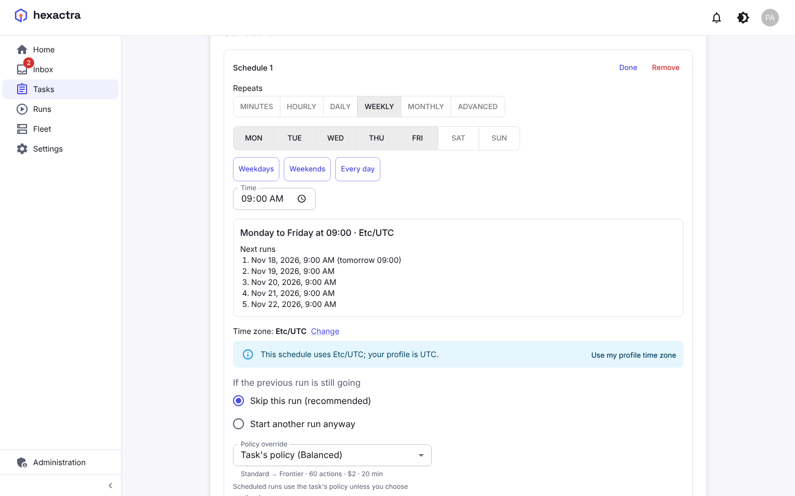 | 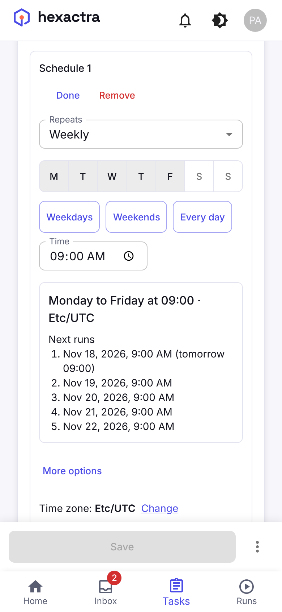 |

| Repeats | What you choose |
|---|---|
| **Minutes** | Every 5, 10, 15, 20 or 30 minutes. |
| **Hourly** | Every 1, 2, 3, 4, 6, 8 or 12 hours, at a minute of the hour. |
| **Daily** | One to four times a day. Times in one schedule share the same minute (09:00 and 17:00); for 09:00 and 17:30, add a second schedule. |
| **Weekly** | The days of the week (with the presets Weekdays, Weekends and Every day) and one time. |
| **Monthly** | Up to five days of the month and one time. A month without day 29, 30 or 31 is skipped; "last day of the month" is not available. |
| **Advanced** | Any 5-field cron expression (`minute hour day-of-month month day-of-week`), for what the builder cannot say. |

- **The 5-minute minimum.** A schedule cannot run more often than every 5 minutes; the editor does not offer less, and an Advanced expression that does is refused.
- **Time zone.** A schedule runs in your profile time zone (Settings → Profile). **Change** picks another zone for that schedule. Changing your profile later does not move the schedules you already have: the editor shows that a schedule's zone differs from your profile, with a button to use your profile's.
- **If the previous run is still going**, the schedule skips that run (the default) or starts another one anyway.
- **Policy override.** A schedule's runs use the task's agent policy unless you choose another for that schedule.
- **Active or Paused.** A paused schedule keeps its settings and does not run.

What is stored is always a 5-field cron expression, so the CLI, the SDK and MCP read and write the same schedules. An agent can check an expression before saving it with the `schedule_preview` MCP tool, and the SDK has `hx.schedules.preview`. A schedule the builder cannot show (for example one made with `hexactra schedules create`) opens in Advanced, unchanged.

### Runs: find, filter and delete

`/runs` lists every run, newest first, 50 at a time (**Load more**, or scroll to the end). It stays usable with thousands of runs: the API filters, searches and pages ([docs/runs.md](docs/runs.md)), and the page never loads everything.

| On a desktop | On a phone |
|---|---|
| 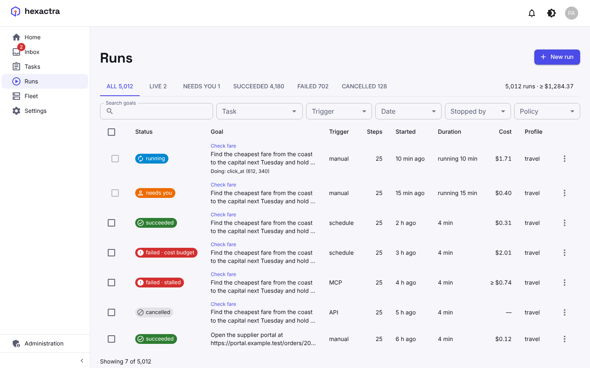 | 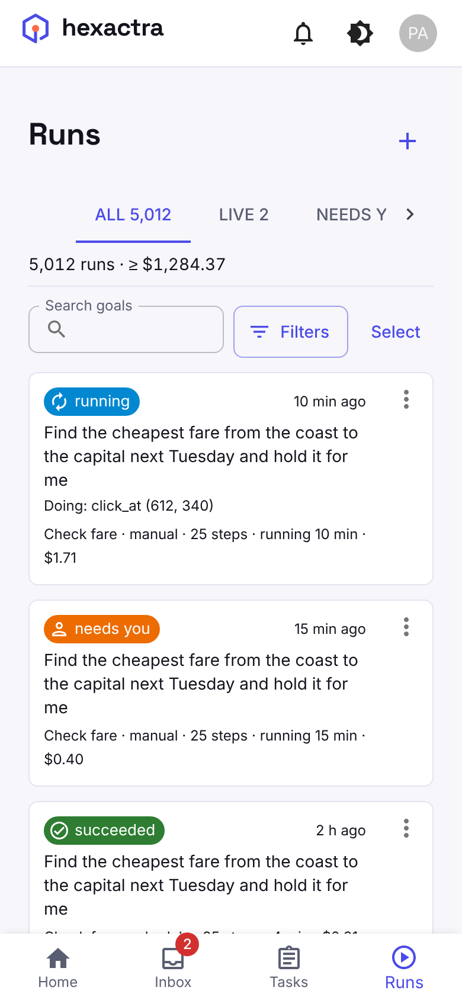 |

- **Status tabs** with the number of runs in each: All, Live, Needs you, Succeeded, Failed, Cancelled. Beside them, how many runs match and what they cost ("≥" when a call could not be priced).
- **Search** looks in the goal. **Filters**: task (or "One-off goals"), trigger, started by (Console, CLI, Schedule, any AI app, or one app), a date range (Today, 7, 30 or 90 days, or two dates, cut in your profile time zone), "Stopped by" (Budget, Stalled, Error, No model; on the All and Failed tabs) and policy. On a phone they are behind the **Filters** button.
- **Every filter is in the URL** (`?view=failed&q=invoice&trigger=schedule&from=2026-11-01`), so a filtered view can be bookmarked or sent, and survives a reload. Active filters show as chips; **Clear all** removes them.
- **Each run** shows its status (with the reason a failed run stopped), goal, task, trigger, steps, when it started, how long it took, its cost, and what a running one is doing right now. The list refreshes the live runs every 5 seconds while the tab is visible.
- **The ⋮ menu of a run:** Open, Run again, Run again with… (another policy), Cancel (a live run) and Delete (a finished run). "Run again" keeps the original policy only when it was chosen for that one run.
- **New run** (top right) starts a one-off goal: the goal, the browser profile, the machine and the policy. `/runs?new=1` opens the page with this dialog (Home's "More options").

**Deleting runs** needs the `runs:delete` permission (contributors and organization administrators have it).

1. Tick the runs (on a phone, press **Select** first). The box in the header ticks every loaded run.
2. To delete more than what is loaded, choose **Select all N finished runs that match**: the delete then goes by the current filter, not by a list.
3. Press **Delete** in the bar at the bottom and confirm. More than 100 runs asks you to type `delete`.

A run's steps and answers are deleted with it, and its cost and stop reason leave the task's spend and the alerts. This cannot be undone. A run that is queued, running or waiting for you is never deleted: cancel it first. More than 500 runs are deleted in the background; the page says so and refreshes when it is done. One run can also be deleted from its own page (`/runs/:id`, **Delete**).

For code: the list is `RunList` (`apps/web/src/components/RunList.tsx`) over the `useRunList` hook (`useRunList.ts`); `<RunList scope={{ taskId }} />` is the same list fixed to one task.

### AI apps

**Settings → AI apps** (`/settings/ai-apps`, `connected_apps:read`) lists ChatGPT, Claude and the other AI apps connected to your account with OAuth: what each may do (the scopes in words; the risky ones in warning colour), when it was connected and last used, its runs and spend over 30 days, and a **Paused** switch. An app's page has its limits (its default policy, the policies it may choose, the sites it may visit, runs at once, runs and spend per day, always ask before purchases), the runs it started, and **Disconnect**. Every run shows who started it (**Started by**: Console, CLI, Schedule, or the app by name), and the Runs page filters by it. Home links to the guide while no app is connected.

**Connect an AI app** (`/settings/ai-apps/connect`) first checks that an app can connect at all (sign-in for AI apps on, a public HTTPS address, the app's host allowed; each problem says who fixes it), then gives the console's MCP URL to copy and the steps for ChatGPT, Claude, Claude Code or another MCP client. Administrators cap every app in **Administration → AI app limits**. From the CLI: `hexactra apps list|show|pause|resume|disconnect|limits|check` and `hexactra runs list --app <app>`. Details: [docs/mcp.md, Per-app limits](docs/mcp.md#per-app-limits).

| On a desktop | On a phone |
|---|---|
| 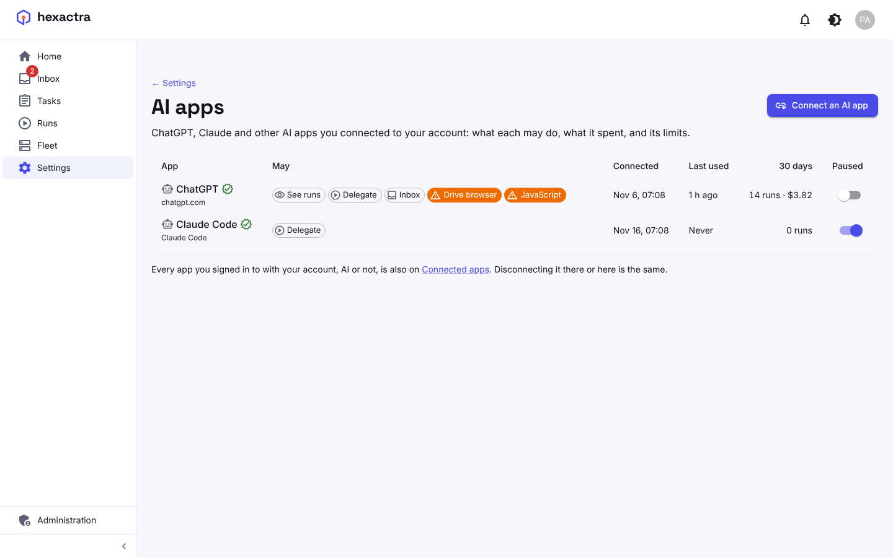 | 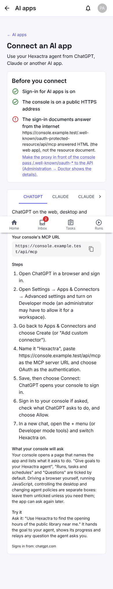 |

### Run history and retention

Run history does not grow without limit: each user has a retention rule, and a nightly job deletes the finished runs that fall outside it. Set it at **Settings → Browser agent → Run history**.

| On a desktop | On a phone |
|---|---|
| 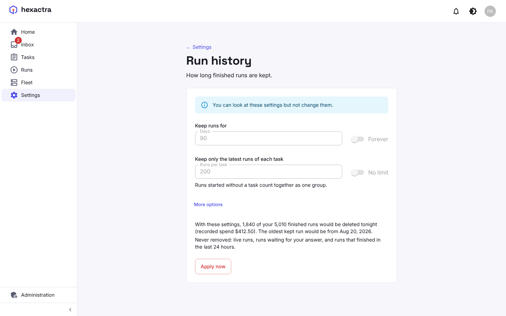 | 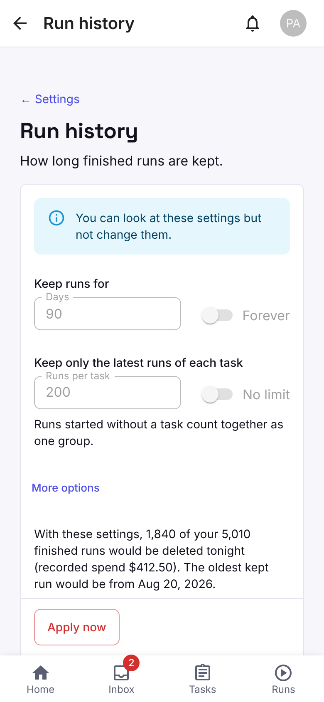 |

**By default, finished runs are kept for 90 days.** This applies to every user who has not chosen a rule, including users who existed before this feature.

The rule has three limits. A run is deleted when either of the first two says so:

| Limit | Meaning | Default |
|---|---|---|
| Keep runs for N days | A finished run is deleted N days after it finished. **Forever** switches this off. | 90 |
| Keep only the latest N runs of each task | Only the newest N finished runs of each task are kept. Runs started without a task count together as one group. | no limit |
| Keep failed runs longer | A separate number of days for failed runs. Empty: the same as the first limit. | empty |

What retention never deletes:
- a live run (queued, running or waiting for a person);
- a run with an unanswered question;
- a run that finished less than 24 hours ago. This floor is longer when an enabled alert rule looks further back at runs (its `windowHours`), so retention never empties a window an alert is counting.

How it runs:
- **Nightly.** The `browser.runs.retention` job is enqueued at 03:20 server time and deletes through the same service as [deleting runs](docs/runs.md#deleting-runs): steps, questions and stored screenshots go with the run.
- **The first-night notice.** A user who never chose a rule is told once, in a notification, before the default deletes anything. Nothing is deleted for them that night; deletion starts the next night. Saving a rule on the page counts as choosing: no notice is sent.
- **The preview.** The settings page shows how many runs the rule would delete, their recorded spend and the oldest run that would be kept, before you save.
- **Apply now.** Applies the saved rule at once, after a confirmation that names the count.
- **The administrator's limit.** Administration → Browser agent → **Run history limit** sets the most days any user's runs are kept. A longer rule, or Forever, is cut to it when the job runs; the user's page says "Capped at N days by your administrator".
- **Task spend.** A task's spend covers 30 days. With fewer than 30 days kept, it only reflects the runs that remain.
- **What goes with a run.** Deleting runs, by hand or by retention, removes their cost and stop-reason history from task spend and from alert counts. There is no undelete: a run that is gone comes back only from a [database backup](docs/runbooks/run-retention.md#recover-from-a-rule-that-deleted-too-much).
- **From the CLI.** `hexactra runs delete --older-than <days>` deletes once, by age; the standing rule is set on this page.

Operators: [docs/runbooks/run-retention.md](docs/runbooks/run-retention.md). The API: [docs/runs.md](docs/runs.md#retention).

### On a phone, a tablet and a desktop

Every page above works at any width, and none scrolls sideways. On a phone the bottom bar has Home, Chat, Inbox and **More** (Tasks and Runs; Fleet, Settings and Administration are in the user menu), tables are cards, a page's main action stays in reach, and filters fold behind a **Filters** button. The breakpoints, what is pinned where and how it is checked (`npm run ui:screens`) are in [Responsive rules](#responsive-rules).

## Layout

```
apps/api/          NestJS API: src/platform/ binds the packages (slices/ + one folder per optional slice), src/notes/ is the sample feature
  prisma/          fragments/ (your models), schema/ (GENERATED), migrations/, platform.lock, seed.ts
apps/web/          React app: App.tsx (routes, the packaged shell), slices/ (one file per optional slice), config/ (the two settings registries, the navigation), theme.ts, pages/, ui/ (the UI kit), types/ (the API shapes pages share)
apps/cli/          the CLI: createCli() with this app's identity
packages/shared/   identity.json: the ONE identity source (name, repository, CLI name, colours); slices.json: the ONE slice manifest
infra/             platform fragments GENERATED by platform-infra sync, plus your app.* overlays
scripts/rename.mjs rebrand this app (identity.json plus the few literal targets)
```

## UI kit

`apps/web/src/ui/` is the console's own set of building blocks (it never goes into a platform package). **Pages compose the kit; a new destructive action uses `useConfirm()`.** Import from `../ui`:

| Export | Use it for |
|---|---|
| `PageContainer` | The frame of every page: `width="narrow"` (forms, the inbox), `"default"` or `"wide"` (lists, dashboards). |
| `PageHeader` | The title (`h1`), an optional `back` link, `actions` and the `primary` action. Below 600 px the secondary actions collapse into one "More" menu and the primary stays visible. |
| `StatusChip` | A run status as colour, icon and words, with a budget or stall stop appended ("failed · cost budget"). `STOP_REASON_LABEL`, `isLive(status)`, `isTerminal(status)`. |
| `useConfirm()` | `if (await confirm({ title, body, confirmLabel, destructive: true })) ...`. Resolves `false` on Cancel, Escape and a backdrop click. `requireText` makes the user type a word first. `ConfirmProvider` is mounted once in `App.tsx`; a page test wraps the page in one. |
| `EmptyState`, `ErrorBanner`, `ListSkeleton`, `CardSkeleton` | Nothing to show, a failure (`role="alert"`), and the first load. |
| `ResponsiveList` | A table at 900 px and up, cards below. It renders the items it is given: paging stays with the API. `selection.disabledReason` disables one item's checkbox with a tooltip; a column marked `grow` takes the spare width instead of the first; `windowAfter={300}` replaces rows far from the viewport with a spacer once the list is longer than that. |
| `useBreakpoint()` | `{ isPhone, isTablet, isDesktop }` from the theme's breakpoints. |
| `aboveBottomBar()`, `BOTTOM_BAR_HEIGHT`, `APP_BAR_HEIGHT` | The offset of anything pinned above the phone's bottom bar or under the top bar ([Responsive rules](#responsive-rules)). |
| `formatDateTime`, `formatRelative`, `<RelativeTime iso />` | Dates in the **profile time zone** (the one `UserTimeZoneSync` stores), never `toLocaleString()`. An empty or invalid date renders `n/a`. |
| `useApiAction()` | `run(key, fn)` with `busy`, `error` and `clearError` around an API call. |
| `formatCost(usd, known)` | "$4.20", "≥ $4.20" when a call could not be priced, "<$0.01", or `null`. |

Rules:

- A page imports shared shapes from `apps/web/src/types/` (`runs.ts`, `tasks.ts`, `fleet.ts`), never from another page.
- No `window.confirm` or `window.alert`.
- Colours come from the theme; a status is never colour only.
- A test that needs a width mocks it with `mockViewport(390)` from `src/__tests__/matchMedia.ts`; without it the kit reads jsdom as a desktop.

## Responsive rules

Every page works on a phone, a tablet and a desktop. The breakpoints are MUI's and nothing reads the user agent:

| Width | Navigation | Layout |
|---|---|---|
| below 600 px (`xs`) | The bottom bar: **Home, Inbox, Tasks, Runs**. Fleet, Settings and Administration are in the user menu (the avatar). | One column. Secondary actions fold into a menu; tap targets are at least 44 px. |
| 600 to 899 px (`sm`) | The rail, collapsed, with every destination. | One column. |
| 900 to 1199 px (`md`) | The rail. | One column; a run's live frame is capped at 60% of the window height. |
| 1200 px and up (`lg`) | The rail, expanded. | A live run is two panes: the browser on the left, status, budget and timeline on the right. |

- **The phone bar is its own table.** The shell's bottom bar draws four tabs and turns the fourth into "More" when more destinations are visible, so `PHONE_NAVIGATION` (`apps/web/src/config/navigation.ts`) gives it exactly four. A new destination goes in `NAVIGATION`; it reaches a phone through the user menu.
- **The Inbox badge** is the pending-question count from `InboxCountProvider` (`apps/web/src/components/InboxCountProvider.tsx`): the rail, the bottom bar, the user menu and the tab title ("(2) Hexactra Console"). Read it with `useInboxCount()`; do not poll `GET /inbox` a second time.
- **Anything pinned to the bottom** (a sticky action bar, a floating button) takes its offset from `aboveBottomBar()` in `apps/web/src/ui/bottomBar.ts`, which knows the bar's height and the safe area. No page carries its own number. What sticks under the top bar uses `APP_BAR_HEIGHT` from the same file.
- **A page that fills the window** (the desktop viewer) calls `useShellMainVariant('full-bleed')` and lets the shell size it. The shell owns the window's height (`100dvh`); a page never sets its own `100vh`.
- **A table** becomes cards (`ResponsiveList`) or scrolls inside its own container. The page itself never scrolls sideways.

### Checking it: `npm run ui:screens`

`scripts/ui-screens.mjs` opens every route at 360, 390, 768, 1024 and 1440 px, in light and dark, saves a PNG of each under `.ui-screens/` (ignored by git) and fails when a page scrolls sideways (`scrollWidth > innerWidth`), naming the route and the width. It is a local, manual check and **not a CI step**: CI has no stack with data.

```bash
# Against the dev stack ("Run it"), signed in:
npm run ui:screens -- --login     # once: sign in in the window that opens; saves .ui-screens/state.json
npm run ui:screens                # http://localhost:3535; --base <url> to change

# Without a stack, against a build of the web app with a mocked API:
npm run build --workspace=web
npm run preview --workspace=web -- --port 4173 &
npm run ui:screens -- --mock --base http://localhost:4173
```

The saved sign-in holds your refresh cookie: never commit it. A route that needs an id (a run, a task, a host) takes the first one your account has, and a route with nothing to open is listed as not checked, never as passed (`--strict` makes that a failure). To add a page, append one line to `ROUTES` in the script; the enabled slices' routes are read from `apps/web/src/slices/`.

In `--mock` mode the answers come from `scripts/ui-screens.fixtures.mjs`, which has data for every page of this app (Home, Inbox, the task list, form and page, the runs list and a run, Fleet, Run history, the agent policy pages). A fixture is a value, or a function of the request when the answer depends on it (a list that is an array or a page, the schedule preview). A packaged page whose endpoint is not mocked renders its empty or error state, and the run lists those endpoints.

**Known overflows, all in packaged (platform) pages**, which this app does not edit: `/admin/settings/users` (below 600 px), `/admin/settings/jobs` (below 900 px), `/admin/settings/broadcasts` and `/admin/settings/db-backup` (below 1200 px). They are reported upstream ([EnterpriseAppBase#1176](https://github.com/marinoscar/EnterpriseAppBase/issues/1176), [#1177](https://github.com/marinoscar/EnterpriseAppBase/issues/1177)); until a platform release fixes them the script exits non-zero on those four routes. Every page of this app passes at the five widths in both themes.

## Run it

Needs Node 24 and Docker.

```bash
git clone https://github.com/marinoscar/hexactra.git
cd hexactra
npm install
npm run setup                    # builds the CLI and writes infra/compose/.env
docker network create devnet     # once per host
cd infra/compose && docker compose -f base.compose.yml -f dev.compose.yml -f devdb.compose.yml up
```

Then, with the same `-f` files, migrate and seed (the API never migrates on startup):

```bash
docker compose -f base.compose.yml -f dev.compose.yml -f devdb.compose.yml exec api npm run prisma:migrate
docker compose -f base.compose.yml -f dev.compose.yml -f devdb.compose.yml exec api npm run prisma:seed
```

Three values nothing can generate go in `infra/compose/.env`: `INITIAL_ADMIN_EMAIL` (your Google account; it is always allowed in and becomes the administrator), `GOOGLE_CLIENT_ID` and `GOOGLE_CLIENT_SECRET`. The application is at http://localhost:3535.

Checks, as CI runs them (`.github/workflows/ci.yml`):

```bash
npm run platform:check     # installed migrations, composed schema and infra fragments equal the packages'
npm run typecheck
npm test                   # API (with runPlatformConformance), web and CLI
npm run build
npm run test:db --workspace=api   # the whole app against a migrated, seeded PostgreSQL
```

## Add your first feature

`apps/api/src/notes/` is a complete feature in seven small files. Copy its shape; each step below names the package documentation it follows.

1. **A model.** Write it in `apps/api/prisma/fragments/<feature>.prisma`, with an `extend model User { ... }` block for the back-relation, then:

   ```bash
   cd apps/api
   npm run db:compose                                    # platform fragments + yours -> prisma/schema/
   npm run prisma:generate
   npm run prisma:migrate:dev -- --name add_<feature>    # your migration sorts after the installed ones
   ```

   A model with a foreign key to `User` is registered in the user-owned data registry with its purge and export policy, and classified in the model ownership registry (`notes.ownership.ts`, registered after the platform's own models by `src/platform/registrations.ts`); the conformance suite, which checks the whole composed schema, fails until it is. Catalog: [`platform-db` extension points](https://github.com/marinoscar/EnterpriseAppBase/blob/main/packages/platform-db/README.md#extension-point-catalog), [scoped data access](https://github.com/marinoscar/EnterpriseAppBase/blob/main/packages/platform-api/src/core/README.md#extension-point-catalog).
2. **A permission.** Declare it as data (`notes.permissions.ts`), add the map to `app.permissions` in `src/platform/permissions.ts` (the registry and the seed both read it, after the platform's), and put `@Auth({ permissions: [...] })` on every route: there is no global guard, so a route without `@Auth()` is public. Validate every body with zod (`notes.schemas.ts`). Catalog: [identity](https://github.com/marinoscar/EnterpriseAppBase/blob/main/packages/platform-api/src/identity/README.md#extension-point-catalog).
3. **A settings namespace and its card.** Register the namespace before `SettingsModule.forRoot()` (`notes.settings.ts`); append its card to `apps/web/src/config/adminSections.tsx` or `userSettingsSections.tsx` with the exact permission string its route enforces. Never add a settings page as a tab of another. Catalog: [settings (API)](https://github.com/marinoscar/EnterpriseAppBase/blob/main/packages/platform-api/src/settings/README.md#extension-point-catalog), [settings (web)](https://github.com/marinoscar/EnterpriseAppBase/blob/main/packages/platform-web/src/settings/README.md#extension-point-catalog).
4. **A job.** Anything that outlives a request is a registered job handler (`notes-archive.job.ts`); a `@Cron` only decides whether work is due and enqueues it. A job `type` is permanent once jobs of it exist. Catalog: [jobs](https://github.com/marinoscar/EnterpriseAppBase/blob/main/packages/platform-api/src/jobs/README.md#extension-point-catalog).
5. **A Doctor check.** One read-only provider that registers itself (`notes.doctor-check.ts`); it appears at `/admin/settings/doctor`. Catalog: [doctor](https://github.com/marinoscar/EnterpriseAppBase/blob/main/packages/platform-api/src/doctor/README.md#extension-point-catalog).

Then add the module to `apps/api/src/app.module.ts`, its page to `apps/web/src/App.tsx`, and tests beside the notes ones.

## Optional slices

The core is always mounted: the API host (the event bus, the platform's app metrics, maintenance mode at `/api/admin/maintenance`, the `{ data }` envelope, request ids, the API reference at `/api/docs`: [host](https://github.com/marinoscar/EnterpriseAppBase/blob/main/packages/platform-api/src/host/README.md)), identity, settings, worker-node credentials, jobs, the Doctor and the data resets (the user Danger Zone at `/settings/danger-zone`, the admin factory reset and organization offboarding: [user-data](https://github.com/marinoscar/EnterpriseAppBase/blob/main/packages/platform-api/src/user-data/README.md)). Everything else the platform ships is an **optional slice**, and **which slices this app mounts is one list**: `enabled` in [`packages/shared/slices.json`](packages/shared/slices.json). The API and the web app both read it, so they cannot disagree.

| Slice | What you get | Requires | Notes |
|---|---|---|---|
| `credentials` | The encrypted credential store (deployment, user and organization tiers) | none | No pages. Needs `SECRETS_ENCRYPTION_KEY`. [README](https://github.com/marinoscar/EnterpriseAppBase/blob/main/packages/platform-api/src/credentials/README.md) |
| `storage` | Uploads (`/api/storage`), profile pictures (Profile page), the storage admin page | `credentials` | Bucket, region and key are set at `/admin/settings/storage`, never in `.env`. [README](https://github.com/marinoscar/EnterpriseAppBase/blob/main/packages/platform-api/src/storage/README.md) |
| `email` | SES and SMTP transports, templates, the email settings page | `credentials` | Set at `/admin/settings/email`. [README](https://github.com/marinoscar/EnterpriseAppBase/blob/main/packages/platform-api/src/email/README.md) |
| `notifications` | The bell and live inbox, preferences, email delivery, **Web Push**, admin broadcasts; the identity notices stop being log lines | `email` | Web Push: an administrator generates a VAPID key pair at `/admin/settings/push`; the service worker is `apps/web/src/sw.ts`, served at `/sw.js`. [README](https://github.com/marinoscar/EnterpriseAppBase/blob/main/packages/platform-api/src/notifications/README.md) |
| `sharing` | Groups, members, invites, grants, link shares and the public `/s` page, and a sample shareable record (`/api/documents`) | `notifications` | A shareable record belongs to an organization, so the sample is a `Document`, not the personal `Note`; the README has the other shapes. [README](https://github.com/marinoscar/EnterpriseAppBase/blob/main/packages/platform-api/src/sharing/README.md) |
| `ai` | The provider gateway (keys at three tiers, models, usage) and its admin and key pages | `credentials`, `storage` | Off until an administrator enables it at `/admin/settings/ai`. Server-side only. [README](https://github.com/marinoscar/EnterpriseAppBase/blob/main/packages/platform-api/src/ai/README.md) |
| `db-backup` | Scheduled and on-demand `pg_dump` to object storage, retention, a guarded restore | `storage`, `notifications` | Needs a direct database connection (no transaction-mode pooler); the API image carries the pinned client. [README](https://github.com/marinoscar/EnterpriseAppBase/blob/main/packages/platform-api/src/db-backup/README.md) |
| `exports` | Signed, expiring exports of a user's or an organization's data | `storage`, `notifications` | The sample feature's notes source is the example. [README](https://github.com/marinoscar/EnterpriseAppBase/blob/main/packages/platform-api/src/exports/README.md) |
| `onboarding` | The welcome dialog, Get started, the administrator's Setup guide, activation metrics | none | A step shows only when the page it links to exists in the enabled slices. [README](https://github.com/marinoscar/EnterpriseAppBase/blob/main/packages/platform-api/src/onboarding/README.md) |
| `android-app` | Trusted-app asset links, hosted APK releases, the Android push channel | `storage`, `notifications` | The server half; the Kotlin shell is built by the CLI's `android` command. [README](https://github.com/marinoscar/EnterpriseAppBase/blob/main/packages/platform-api/src/android-app/README.md) |
| `telemetry` | The OpenTelemetry export gate, the GreptimeDB connection, the SQL Explorer (with an AI assistant when `ai` is on), the Telemetry Dashboard and its metric groups, the `telemetry.*` Doctor checks | `credentials` | Off until an administrator saves a connection and turns collection on at `/admin/settings/telemetry`; the SDK starts only with `OTEL_ENABLED=true`. [README](https://github.com/marinoscar/EnterpriseAppBase/blob/main/packages/platform-api/src/telemetry/README.md) |

Not in the starter yet: the web conformance call (`runPlatformWebConformance`); `src/__tests__/slices.test.ts` covers the registries.

**Turn a slice off** by deleting its line from `enabled`. Order does not matter, and a slice that requires one you removed fails at startup naming both, with the line to add or remove. Nothing else changes: its routes answer 404, its cards, pages, providers, banners and jobs are not mounted, its permissions are not seeded, and its `forRoot()` never runs. Its tables stay in the schema (the platform's migrations are one history), unused.

**Turn a slice on** by adding its id, then:

```bash
cd apps/api && npm run prisma:seed       # seeds the permissions its routes check (upserts only)
```

and restart. Nothing else is required in code: the slice's runtime configuration (a bucket, an email transport, an AI key, a VAPID key pair) is set in the admin UI, never in `.env`.

**Remove a slice's code for good** (not just switch it off): delete `apps/api/src/platform/<id>/`, `apps/web/src/slices/<id>.tsx`, their lines in `apps/api/src/platform/slices/definitions.ts` and `apps/web/src/slices/definitions.ts`, and the slice's entry in `catalog` and `enabled` of `slices.json`.

**Peer dependencies.** The platform packages mark every peer their always-mounted core does not need as *optional*, and npm never installs an optional peer, so this app declares the peers of the slices it imports itself (`apps/api/package.json`, `apps/web/package.json`). The lists come from [`packages/platform-slice-peers.json`](https://github.com/marinoscar/EnterpriseAppBase/blob/main/packages/platform-slice-peers.json) in the platform repository, and `node scripts/check-slice-peers.mjs --app apps/api` (the platform repository's check, run in CI against this starter) fails when an imported slice's peer is not declared. On the API every optional slice above runs on the peers of the always-mounted core (`@nestjs/*`, `fastify`, `passport`, `@prisma/client-runtime-utils`, `@opentelemetry/api`, `zod` and friends), so removing an API slice removes no dependency. On the web, two slices bring peers of their own, which you may remove together with the slice's code:

| Slice | Web peers only it needs |
|---|---|
| `ai` | `@mui/x-data-grid` (its lists use the packaged data table) |
| `telemetry` | `@mui/x-charts`, `@mui/x-data-grid`, `@uiw/react-codemirror`, `@codemirror/lang-sql` |

The root `package.json` carries `overrides: { "fastify": "^5" }` because `@nestjs/platform-fastify` pins one exact `fastify` and the API declares the peer range: without it npm installs two copies and the Fastify plugin types stop matching.

`@mui/x-data-grid` stays while either slice, or any other page of yours that uses the packaged data table, remains.

**Where a slice lives.** On the API, `src/platform/<id>/` holds `<id>.slice.ts` (what the slice mounts, replaces and contributes: its modules, host-port overrides, registrations, notifications, storage prefixes, settings namespaces), its `forRoot()` configuration (`*.config.ts`), its host-port adapters and its **minimal example**; `src/platform/slices/` is the loader. A slice definition runs nothing on import: everything lazy sits behind a function that is called for an enabled slice only. On the web, `src/slices/<id>.tsx` is the slice's routes, cards, providers and shell parts; `src/slices/manifest.ts` composes the enabled ones into `App.tsx` and the two registries in `src/config/`.

| Slice | Minimal example |
|---|---|
| `credentials` | `credential-purposes.ts`: a purpose the sample feature could keep a webhook secret under |
| `storage` | `storage-prefixes.ts`: the key prefix of files attached to a note |
| `email` | `templates/notes-archived.email.ts`: an app template, typed through `EmailTemplateDataMap` |
| `notifications` | `notes-archived.notification.ts`: an event raised by the sample archive job after its write commits |
| `sharing` | `documents/`: the `document` resource type (`document.resource-type.ts`), its service deciding every record with `AccessPolicy` and its controller; the `Document` model is an organization's row with row-level security (`prisma/fragments/documents.prisma`) |
| `ai` | `notes-summary.feature.ts`: a registered feature and a service calling `AiService.forUser` |
| `db-backup` | `restore-carry-over.ts`: a table whose rows survive a restore |
| `exports` | `notes.export-source.ts`: a shaped, filterable export of the notes |
| `onboarding` | `onboarding.manifest.ts`: a fact and a "write your first note" step |
| `android-app` | `device-source.ts`: the device source a native capability replaces |
| `telemetry` | `activity.metric-group.ts`: a Telemetry Dashboard section of the app's own (sign-ins and token refreshes by outcome), one option of `TelemetryModule.forRoot` |

**Tests.** `test/slices.spec.ts` and `src/__tests__/slices.test.ts` check the manifest rules; `test/slices-composition.spec.ts` and the web twin compose the core alone and each slice with only what it requires, and prove it mounts, the others are absent, its permissions are seeded only while it is on and the host ports it replaces are replaced; `test/slices.db.spec.ts` probes one route per slice against a real database, 404 when off. `test/conformance.spec.ts` runs the enabled slices' conformance suites; `test/ai-conformance.spec.ts` runs the five AI suites that boot the app (kill switch, RBAC matrix, secret egress, key policy, jobs server-only) over a mocked database, with the fixture in `test/ai-conformance/` (no PostgreSQL needed). `test/documents.db.spec.ts` proves the sharing slice's sample record end to end under row-level security.

## Rename

```bash
node scripts/rename.mjs --name "Kappa Hub" --repo kappa/kappa-hub --theme "#c62828" [--cli-name kappactl] [--dry-run]
```

It writes `packages/shared/identity.json`, edits the literal targets nothing can derive (the root `package.json` name, this README, `install.sh`, the two SVG fills, the CI test database, the CLI `bin` key), and re-renders `infra/` with `platform-infra sync`. It never commits.

## Upgrading the platform

Renovate (`renovate.json`) opens one pull request that moves every `@marinoscar/platform-*` package to the same version. After merging it:

```bash
npm install
cd apps/api && npm run db:sync && npm run db:compose && npm run prisma:generate   # new platform migrations and fragments
cd ../.. && npm run platform:infra:sync                                           # new infra fragments
npm run platform:check
```

Order matters for migrations: `db:sync` installs the package's new migrations first, then `prisma migrate dev` authors yours after them. Read each package's `CHANGELOG.md` for upgrade notes.

**The `next` channel.** Pre-releases are published under the `next` dist-tag. To try one, install it explicitly (`npm install @marinoscar/platform-api@next ...`, every platform package at the same version), or set `"followTag": "next"` on the platform rule in `renovate.json`.

## Changing the platform

The platform's code is not in this repository, on purpose: an app that edits a copy drifts from every other app. When you need something the packages do not offer (a port, a registry, an option):

1. [File a seam request](https://github.com/marinoscar/EnterpriseAppBase/issues/new?template=seam_request.yml) in the platform repository: what you need, where, and why the existing extension points do not cover it.
2. Work around it in your own code, behind your own interface, until the release that adds the seam.

## License

MIT — see [LICENSE](LICENSE).
