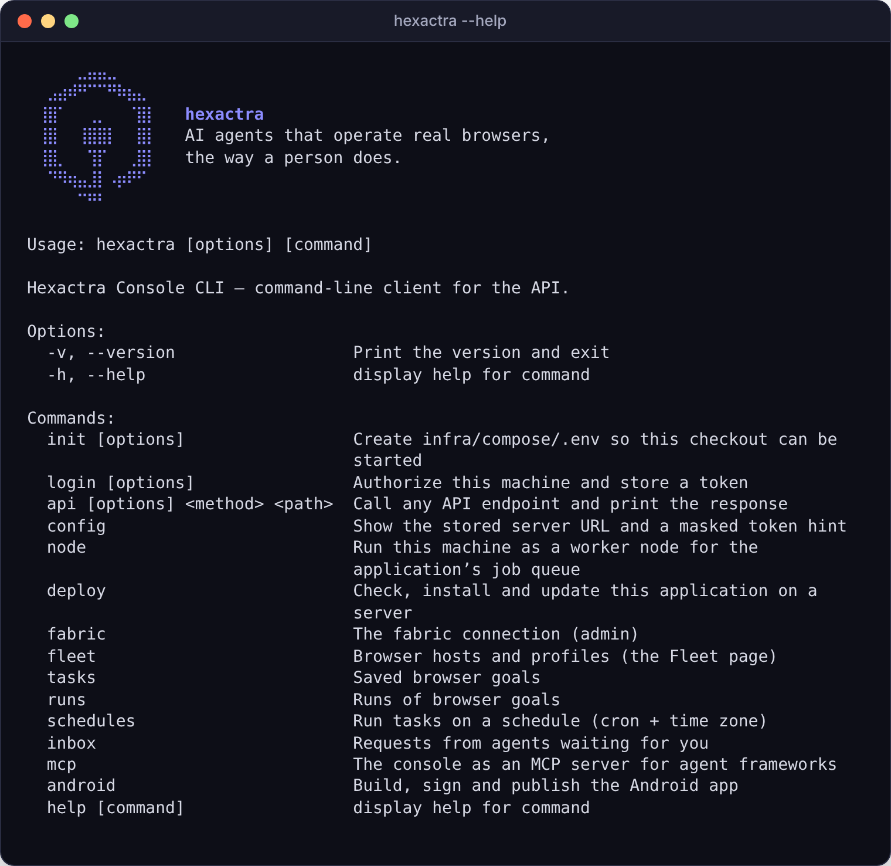
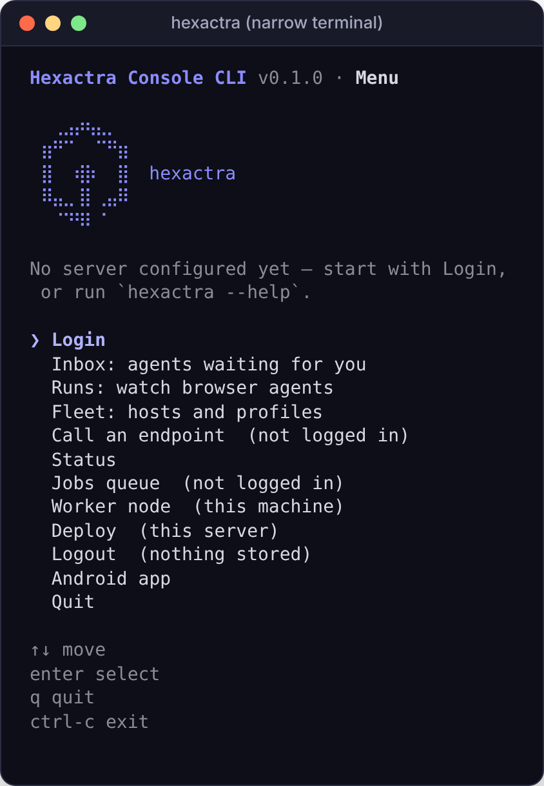

# hexactra CLI

The `hexactra` command-line client for the hexactra Console. Assign browser goals to AI agents, watch their runs, answer what they wait for, and manage the browser fleet, from a terminal or from scripts.

Run `hexactra` with no arguments to open the terminal UI:

<p align="center">
  
</p>

- **Every console capability, from a terminal:** tasks, runs, the handoff inbox, schedules, fleet, the fabric connection, and an MCP server for agent frameworks.
- **Interactive or scripted:** a full-screen terminal UI for people, and subcommands with `--json` output for scripts and CI.
- **The same rules as the web app:** it calls the console's REST API as you, with your permissions.

---

## Install

**Requirements:**
- Node.js 24 or later, with npm;
- git;
- Linux, macOS, or Windows through WSL.

```bash
curl -fsSL https://raw.githubusercontent.com/marinoscar/hexactra/main/install.sh | bash
```

**What the installer does:**
1. Sparse-clones only the console (`console/`, not the Rust fabric) into `~/.hexactra/app`.
2. Builds the CLI.
3. Puts a `hexactra` shim in `~/.local/bin`.

Re-running the same command updates it in place. If `~/.local/bin` is not on your `PATH`, the installer prints the line to add.

Check it:

```bash
hexactra --version     # 0.1.0 (platform 0.1.0-next.32)
hexactra --help
```

<p align="center">
  
</p>

### Install a specific branch or tag

Set the variable on `bash`, not on `curl`: a variable placed before a command in a pipeline only reaches that one command.

```bash
# Works: INSTALL_REF reaches the installer
curl -fsSL https://raw.githubusercontent.com/marinoscar/hexactra/main/install.sh | INSTALL_REF=v1.2.3 bash

# Does NOT work: this sets INSTALL_REF for curl only
INSTALL_REF=v1.2.3 curl -fsSL https://raw.githubusercontent.com/marinoscar/hexactra/main/install.sh | bash
```

### Install from a local clone

Already have the repository, or working offline? Point the installer at the clone. It installs the clone's current branch.

```bash
INSTALL_SRC=/path/to/hexactra bash /path/to/hexactra/install.sh
```

### Installer environment variables

| Variable | Default | What it does |
|---|---|---|
| `INSTALL_REF` | `main` (with `INSTALL_SRC`: the clone's current branch) | Branch or tag to install |
| `INSTALL_SRC` | — | Install from a local clone instead of GitHub |
| `INSTALL_REPO` | `https://github.com/marinoscar/hexactra.git` | Git URL to clone, e.g. a fork |
| `INSTALL_BIN_DIR` | `~/.local/bin` | Where the `hexactra` shim goes |
| `INSTALL_UNINSTALL` | — | `1` removes the CLI |

### Update

Run the install command again. The installer finds `~/.hexactra/app`, updates it, and prints the old and new version.

### Uninstall

```bash
curl -fsSL https://raw.githubusercontent.com/marinoscar/hexactra/main/install.sh | INSTALL_UNINSTALL=1 bash
```

This removes `~/.hexactra/app` and the shim. Your login in `~/.hexactra/config.json` is kept; delete `~/.hexactra` to remove that as well.

## Log in

```bash
hexactra login --server https://console.example.com
```

The device flow prints a code and opens your browser. Approve the machine there, and the CLI stores a token in `~/.hexactra/config.json` (mode `0600`). `hexactra config` shows the server and a masked token hint.

| Situation | How |
|---|---|
| A machine without a browser | `hexactra login --server https://console.example.com --no-browser`, then open the printed URL anywhere |
| Headless, with an existing personal access token | `hexactra login --server https://console.example.com --token pat_...` |
| CI or containers | Skip `login`. Set `HEXACTRA_SERVER_URL` and `HEXACTRA_TOKEN` |

Create personal access tokens in the web app, under your settings (Access tokens).

## The terminal UI

Run `hexactra` with no arguments in a real terminal. Use ↑ ↓ to move, Enter to select, Esc to go back, and `q` to quit.

| Screen | What it does |
|---|---|
| **Inbox** | What agents are waiting for: a CAPTCHA, a code, a sign-in or a confirmation. Type the answer and press Enter; a secret shows as dots. `x` declines. |
| **Runs** | Your runs and their status. Enter opens a run's steps, `c` cancels a run, `r` refreshes. |
| **Fleet** | Browser hosts and their profiles. `d` drains or undrains a host, `r` refreshes. |
| **Call an endpoint** | Any REST call, interactively. |
| **Status**, **Jobs queue** | The server's health and its background job queue. |
| **Worker node**, **Deploy** | Run this machine as a worker node, or install and update the console on a server. |
| **Android app** | Build, sign and publish the Android app (for maintainers). |

The UI adapts to the terminal width. On a narrow terminal it shows a smaller mark and drops the border:

<p align="center">
  
</p>

**Colors:**
- The UI uses the hexactra brand colors (see [docs/brand](../../../docs/brand/README.md#terminal-cli-and-tui)).
- Set `NO_COLOR=1` or pass `--no-color` for plain text.
- Set `HEXACTRA_NO_TUI=1` to keep a bare `hexactra` from opening the UI.

## Commands

Every command has `--help` with options and examples, e.g. `hexactra runs start --help`.

### Tasks and runs

A **task** is a saved goal: a browser profile, the sites the agent may visit, a step budget, and whether to confirm before purchases. A **run** is one execution of a goal by the AI goal runner.

```bash
# Save a task and run it, following it to the end
hexactra tasks create "Weekly report" "Download last week's invoices as PDF" \
  --profile work --allow billing.example.com --max-steps 40
hexactra tasks list
hexactra tasks run <task-id> --watch

# Or run a one-off goal
hexactra runs start "Find the cheapest flight to Lisbon next Friday" --watch

hexactra runs list --status running
hexactra runs show <run-id>
hexactra runs watch <run-id>
hexactra runs cancel <run-id>
```

`tasks run` and `runs show|watch|cancel` take an id or an id prefix. `--json` prints JSON for scripts.

### The inbox: answer what agents wait for

When a run needs a person (a CAPTCHA, a one-time code, a sign-in, a confirmation), it waits in the inbox. Your answer resumes it.

```bash
hexactra inbox list
hexactra inbox answer <run-id> --done            # "I solved it in the browser"
hexactra inbox answer <run-id> --value 123456    # a code
hexactra inbox answer <run-id> --choice yes      # a confirmation
hexactra inbox answer <run-id> --secret-stdin    # a password, read from stdin, never echoed
hexactra inbox answer <run-id> --decline
```

The model never sees a secret: the runner types it into the page.

### Schedules

```bash
hexactra schedules create <task-id> "0 9 * * 1-5" --tz Europe/Madrid   # weekdays at 9:00
hexactra schedules list
hexactra schedules pause <schedule-id>
hexactra schedules resume <schedule-id>
hexactra schedules delete <schedule-id>
```

### Fleet: browser hosts and profiles

```bash
hexactra fleet hosts                  # hosts and their profiles (* = browser running)
hexactra fleet enroll                 # a single-use token and the command to start a new host agent
hexactra fleet drain <host>           # stop placing new sessions on a host
hexactra fleet undrain <host>
hexactra fleet revoke <host>          # its credential stops working and its sessions end
hexactra fleet commands <host>        # recent host commands
hexactra fleet profile --help         # create, restart, close and delete profiles
```

### MCP for agent frameworks

Serve the console as an MCP server over stdio, as the logged-in user:

```bash
hexactra mcp serve
```

Agent frameworks can also use Streamable HTTP at `POST /api/mcp`. Setup and recipes: [docs/mcp.md](../../docs/mcp.md), [docs/agent-frameworks.md](../../docs/agent-frameworks.md).

### Administration

| Command | What it does | Who |
|---|---|---|
| `hexactra fabric show\|test\|set <url> --token-stdin\|clear` | The console's connection to the hexactra Fabric | Administrators |
| `hexactra api <METHOD> <path>` | Call any REST endpoint, e.g. `hexactra api GET /api/auth/me`; `--data @file.json`, `--raw` for piping to `jq` | Anyone, with the route's permission |
| `hexactra node ...` | Run this machine as a worker node for the console's job queue | Operators |
| `hexactra deploy ...` | Check, install and update the console on a server | Operators |
| `hexactra init` | Write `infra/compose/.env` in a console checkout | Developers |
| `hexactra android ...` | Build, sign and publish the Android app | Maintainers |

## Configuration and environment

| Name | What it does |
|---|---|
| `~/.hexactra/config.json` | The server URL and token that `login` stores (`0600`, in a `0700` directory) |
| `HEXACTRA_SERVER_URL`, `HEXACTRA_TOKEN` | Override the stored server and token, field by field (CI, containers) |
| `HEXACTRA_NO_TUI` | `1`: a bare `hexactra` never opens the terminal UI (for scripts and CI) |
| `HEXACTRA_NO_UPDATE_CHECK` | `1`: turn off the start-up update notice |
| `NO_COLOR`, `--no-color` | Plain text, without colors |

## Troubleshooting

| Symptom | Fix |
|---|---|
| `hexactra: command not found` | `~/.local/bin` is not on your `PATH`: add `export PATH="$HOME/.local/bin:$PATH"` to your shell profile and open a new shell |
| `Node.js 24 or later is required` | Install Node 24 (e.g. with `nvm install 24`), then re-run the installer |
| The mark in the banner shows as boxes | Your terminal font lacks Unicode Braille. Most modern fonts have it (DejaVu Sans Mono, JetBrains Mono, Cascadia Code, SF Mono) |
| `401` or `unauthorized` | The token expired or was revoked: run `hexactra login` again |

## Development

From a clone, in `console/`:

```bash
npm ci
npm run build --workspace=apps/cli && node apps/cli/dist/cli.js
npm run dev --workspace=apps/cli -- --help   # run from source with tsx
npm run test:run --workspace=apps/cli
npm run typecheck --workspace=apps/cli
```

Some notes for contributors:
- The CLI is the platform's [`@marinoscar/platform-cli`](https://github.com/marinoscar/EnterpriseAppBase/blob/main/packages/platform-cli/README.md) composed with this app's identity and commands (`src/app.ts`).
- The app's commands live in `src/*.command.ts` and their TUI screens in `src/*.screen.tsx`.
- `src/brand.ts` holds the terminal colors and the banner.
- The screenshots on this page are real captures of the CLI in an 84- and a 44-column terminal.
