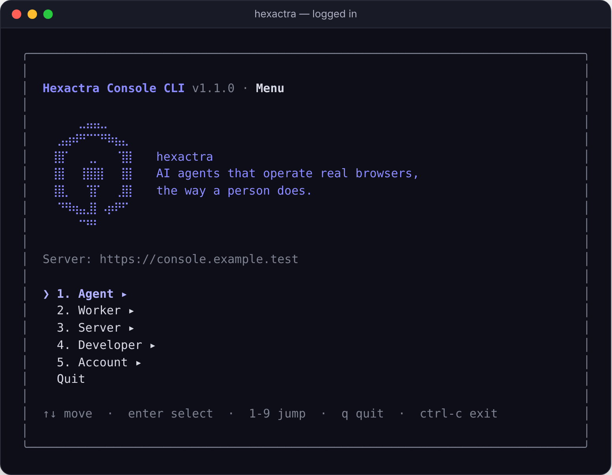
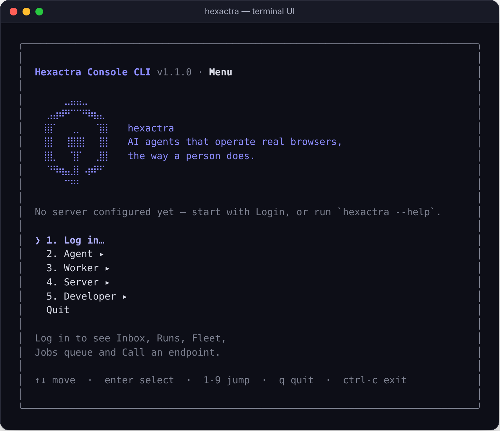
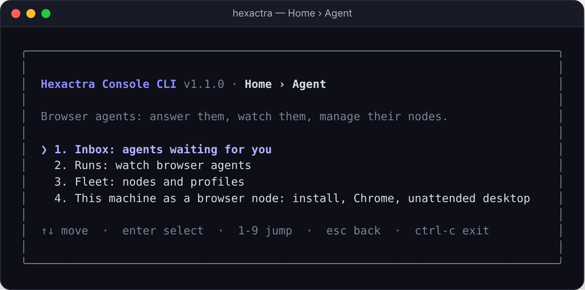

# hexactra CLI

The `hexactra` command-line client for the hexactra Console. Assign browser goals to AI agents, watch their runs, answer what they wait for, and manage the browser fleet, from a terminal or from scripts.

Run `hexactra` with no arguments to open the terminal UI. Its menu is grouped (Agent, Worker, Server, Developer, Account) and changes once you log in:

<p align="center">
  
</p>

- **Every console capability, from a terminal:** tasks, runs, the handoff inbox, schedules, fleet, the fabric connection, and an MCP server for agent frameworks.
- **Interactive or scripted:** a full-screen terminal UI for people, and subcommands with `--json` output for scripts and CI.
- **The same rules as the web app:** it calls the console's REST API as you, with your permissions.

---

## Install

**Requirements:**
- Node.js 24 or later, with npm;
- git;
- Linux, macOS, or Windows through WSL.

```bash
curl -fsSL https://raw.githubusercontent.com/marinoscar/hexactra/main/install.sh | bash
```

**What the installer does:**
1. Sparse-clones only the console (`console/`, not the Rust fabric) into `~/.hexactra/app`.
2. Builds the CLI.
3. Puts a `hexactra` shim in `~/.local/bin`.

Re-running the same command updates it in place. Before it builds, it prints the version you have and the one it is installing, each with its commit (`current version: hexactra 0.1.1 (0822b47)`, `new version: hexactra 0.1.2 (…)`); a first install prints `installing: …`. If `~/.local/bin` is not on your `PATH`, the installer prints the line to add.

Check it:

```bash
hexactra --version     # 0.2.0 (platform 0.1.0-next.34)
hexactra --help
```

<p align="center">
  
</p>

### Install a specific branch or tag

Set the variable on `bash`, not on `curl`: a variable placed before a command in a pipeline only reaches that one command.

```bash
# Works: INSTALL_REF reaches the installer
curl -fsSL https://raw.githubusercontent.com/marinoscar/hexactra/main/install.sh | INSTALL_REF=v1.2.3 bash

# Does NOT work: this sets INSTALL_REF for curl only
INSTALL_REF=v1.2.3 curl -fsSL https://raw.githubusercontent.com/marinoscar/hexactra/main/install.sh | bash
```

### Install from a local clone

Already have the repository, or working offline? Point the installer at the clone. It installs the clone's current branch.

```bash
INSTALL_SRC=/path/to/hexactra bash /path/to/hexactra/install.sh
```

### Installer environment variables

| Variable | Default | What it does |
|---|---|---|
| `INSTALL_REF` | `main` (with `INSTALL_SRC`: the clone's current branch) | Branch or tag to install |
| `INSTALL_SRC` | — | Install from a local clone instead of GitHub |
| `INSTALL_REPO` | `https://github.com/marinoscar/hexactra.git` | Git URL to clone, e.g. a fork |
| `INSTALL_BIN_DIR` | `~/.local/bin` | Where the `hexactra` shim goes |
| `INSTALL_UNINSTALL` | — | `1` removes the CLI |

### Update

Run the install command again. The installer finds `~/.hexactra/app`, updates it, and prints the old and new version.

### Uninstall

```bash
curl -fsSL https://raw.githubusercontent.com/marinoscar/hexactra/main/install.sh | INSTALL_UNINSTALL=1 bash
```

This removes `~/.hexactra/app` and the shim. Your login in `~/.hexactra/config.json` is kept; delete `~/.hexactra` to remove that as well.

## Log in

```bash
hexactra login --server https://console.example.com
```

The device flow prints a code and opens your browser. Approve the machine there, and the CLI stores a token in `~/.hexactra/config.json` (mode `0600`). `hexactra config` shows the server and a masked token hint.

| Situation | How |
|---|---|
| A machine without a browser | `hexactra login --server https://console.example.com --no-browser`, then open the printed URL anywhere |
| No browser on this machine, with an existing personal access token | `hexactra login --server https://console.example.com --token pat_...` |
| CI or containers | Skip `login`. Set `HEXACTRA_SERVER_URL` and `HEXACTRA_TOKEN` |

Create personal access tokens in the web app, under your settings (Access tokens).

## The terminal UI

Run `hexactra` with no arguments in a real terminal. Use ↑ ↓ to move, Enter to select, a digit (1-9) to jump, Esc to go up one level, and `q` to quit from the top menu.

The menu is grouped, and it changes with the login state (the tree is in `src/menu.ts`):

| Logged in | Logged out |
|---|---|
| Agent ▸, Worker ▸, Server ▸, Developer ▸, Account ▸, Quit | Log in…, Agent ▸, Worker ▸, Server ▸, Developer ▸, Quit |

Logged out, the entries that need a server are hidden, and a note under the menu says what logging in adds:

<p align="center">
  
</p>

Enter a group (or press its number) to see its entries. Esc goes back up. For example, **Agent**:

<p align="center">
  
</p>

| Group | Entry | What it does | Logged out |
|---|---|---|---|
| **Agent** | **Inbox** | What agents are waiting for: a CAPTCHA, a code, a sign-in or a confirmation. Type the answer and press Enter; a secret shows as dots. `x` declines. | hidden |
| | **Runs** | Your runs and their status. Enter opens a run's steps, `c` cancels a run, `r` refreshes. | hidden |
| | **Fleet** | Browser nodes and their profiles. `o` shows a node's desktop link, `d` drains or undrains a node, `r` refreshes. | hidden |
| | **This machine as a browser node** | A dashboard of the agent, the unattended node and Fleet, with a health line from the doctor; see [The Agent screen](#the-agent-screen). | shown (installing asks you to log in) |
| **Worker** | **Jobs queue** | The server's background job queue. | hidden |
| | **Worker node on this machine** | Run this machine as a worker for server jobs: dashboard, doctor, logs, register, enroll. | shown |
| **Server** | **Deploy** | Install, update and check the console on this server (doctor, install, update, status). | shown |
| | **Server status** | The server, the signed-in user and the token's expiry. | shown |
| **Developer** | **Android app** | Build, sign and publish the Android app (for maintainers): doctor, bump, build, publish, releases. | shown (publishing needs a login) |
| | **Call an API endpoint** | Any REST call, interactively. | hidden |
| **Account** | **Switch account or server**, **Log out** | Log in again (another account or server), or clear the stored login. | hidden (Log in is first instead) |

The UI adapts to the terminal width. On a narrow terminal it shows a smaller mark and drops the border:

<p align="center">
  
</p>

**Colors:**
- The UI uses the hexactra brand colors (see [docs/brand](../../../docs/brand/README.md#terminal-cli-and-tui)).
- Set `NO_COLOR=1` or pass `--no-color` for plain text.
- Set `HEXACTRA_NO_TUI=1` to keep a bare `hexactra` from opening the UI.


### The Agent screen

**Agent ▸ This machine as a browser node** manages this machine as a browser host without leaving the terminal UI (#374).

| View | What it shows and does |
|---|---|
| **Dashboard** | The agent (version, browser, service), the unattended node (desktop, graphics, each unit) and Fleet (online, extension connected), coloured by state and refreshed every 5 s. A health line counts the doctor's checks and names the first problems. The menu lists only what fits the current state, by arrow keys or hotkey: `i` install or repair, `u` update, `s` / `r` start, stop and restart the agent, `n` / `e` the unattended node, `l` logs, `d` doctor, `c` Google Chrome setup, `x` uninstall. `g` refreshes, `q` or Esc goes back. |
| **Install…** | 1) the mode: Default, Attended, Unattended or Both, each with what it does. 2) a review: the host name and resolution (editable) and every package the mode needs, installed or missing. Then it installs, showing the log live. |
| **Uninstall…** | What to remove (the agent, the unattended node, or both), whether to keep the browser profiles and whether to revoke the host in Fleet, then a confirmation. |
| **Logs** | The agent service's journal, or the unattended node's units (`a` / `n`), following live (`f` pauses). Errors are red, warnings yellow. Scroll with the arrows, `g` / `G` for the top and the bottom. |
| **Doctor and dependencies** | Every check with ✓ / ! / ✗ and its fix, then every package the installed modes need (`a`: every mode), with what it is for. `m` installs the missing ones; `r` re-runs. |

**sudo in the terminal UI.** Work that needs root (installs, uninstalls, the unattended node, Google Chrome setup, packages) asks for your password in a masked field first. The password goes only to `sudo -S -v` on its standard input, which unlocks sudo for this terminal for a few minutes. It is never stored, logged or shown, and the steps then run with `sudo -n`. When sudo is already unlocked, or passwordless, nothing is asked.

## Commands

Every command has `--help` with options and examples, e.g. `hexactra runs start --help`.

### Tasks and runs

A **task** is a saved goal: a browser profile, the sites the agent may visit, a step budget, and whether to confirm before purchases. A **run** is one execution of a goal by the AI goal runner.

```bash
# Save a task and run it, following it to the end
hexactra tasks create "Weekly report" "Download last week's invoices as PDF" \
  --profile work --allow billing.example.com --max-steps 40
hexactra tasks list
hexactra tasks run <task-id> --watch

# Or run a one-off goal
hexactra runs start "Find the cheapest flight to Lisbon next Friday" --watch
hexactra runs start "Find a fare" --policy builtin:economy   # run under an agent policy

hexactra runs list --status running
hexactra runs show <run-id>
hexactra runs watch <run-id>
hexactra runs cancel <run-id>
```

`tasks run` and `runs show|watch|cancel` take an id or an id prefix. `--json` prints JSON for scripts.

`runs list`, `runs show` and the Runs screen of the terminal UI show each run's policy and cost, and the tier, budget use and stop reason when the console reports them.

### Agent policies

An **agent policy** sets what a run may spend (actions, model calls, active minutes, tokens, cost; `unlimited` is a limit left empty) and which model tiers it uses. Four built-ins exist (`economy`, `balanced`, `thorough`, `unlimited`); you can add your own in the web app or by importing a file.

```bash
hexactra policies list                              # id, name, tiers (start -> highest), budget, flags
hexactra policies show balanced                     # one policy in full; --json for the spec
hexactra policies export -o policies.json           # the built-ins and your own policies as a portable file
hexactra policies export --ids "Fare lookups,thorough" --no-pins   # chosen ones, without model pins
hexactra policies import policies.json --on-conflict rename        # rename (default), skip or replace
hexactra policies default                           # show the default policy
hexactra policies default economy                   # choose it
hexactra policies default --reset                   # back to builtin:balanced
```

A policy is named by its id, an id prefix, its name or (for a built-in) its key, with or without `builtin:`. Pass one with `--policy` to `runs start`, `tasks run` (this run only), `tasks create`, `tasks update` (`--policy default` follows your default) and `schedules create`. Without it a run uses the schedule's, the task's, then your default policy. `policies export` writes to stdout without `-o`, so it pipes into `policies import -` on another console.

### The inbox: answer what agents wait for

When a run needs a person (a CAPTCHA, a one-time code, a sign-in, a confirmation), it waits in the inbox. Your answer resumes it.

```bash
hexactra inbox list
hexactra inbox answer <run-id> --done            # "I solved it in the browser"
hexactra inbox answer <run-id> --value 123456    # a code
hexactra inbox answer <run-id> --choice yes      # a confirmation
hexactra inbox answer <run-id> --secret-stdin    # a password, read from stdin, never echoed
hexactra inbox answer <run-id> --decline
```

The model never sees a secret: the runner types it into the page.

### Schedules

```bash
hexactra schedules create <task-id> "0 9 * * 1-5" --tz Europe/Madrid   # weekdays at 9:00
hexactra schedules list
hexactra schedules pause <schedule-id>
hexactra schedules resume <schedule-id>
hexactra schedules delete <schedule-id>
```

### Fleet: browser hosts and profiles

```bash
hexactra fleet hosts                  # hosts and their profiles (* = browser running)
hexactra fleet enroll                 # a single-use token and the command to start a new host agent
hexactra fleet drain <host>           # stop placing new sessions on a host
hexactra fleet undrain <host>
hexactra fleet revoke <host>          # its credential stops working and its sessions end
hexactra fleet commands <host>        # recent host commands
hexactra fleet profile --help         # create, restart, close and delete profiles
```

### Agent: run this machine as a browser host

One command turns a Linux x86_64 desktop into a browser host. You need no script, no source build and no VPN:

```bash
hexactra agent install                # needs `hexactra login` as someone with fleet:write
hexactra agent status                 # version, browser, service, and online/offline in Fleet
hexactra agent logs [-f]              # the service's log
hexactra agent update                 # latest agent and Chrome for Testing, missing packages, then a restart
hexactra agent stop | start | restart
hexactra agent uninstall --yes        # stops it and revokes the host in Fleet (profiles are kept)
hexactra agent chrome setup           # Google Chrome + the extension by policy + the native host (sudo once)
hexactra agent chrome status          # what is set up for Google Chrome
hexactra agent doctor                 # every check, and how to fix what fails (exit code 1 if any fails)
hexactra agent deps [--install]       # every package this machine needs, installed or missing (--install adds them)
```

**Desktop tools, installed for you (#373).** The agent also drives the computer's desktop for native file pickers, OS dialogs and other windows (VISION §27). It needs `xdotool` and `imagemagick`, and the install puts them in with sudo wherever the agent has an X11 desktop to drive:
- attended and unattended nodes, always;
- the default mode when you run it from your X11 desktop session.

Without a desktop session (a server, CI, `--no-desktop`) or on Wayland, the install skips them and says why. `agent update` installs whatever is missing on nodes set up earlier. `agent doctor` reports them as `desktop-input`.

**Attended (`--mode attended`).** The agent drives your own Google Chrome in your logged-in desktop, with the extension installed by policy and the native host registered for you.
- **Remote view on demand.** Your X11 desktop is shared only while someone views it from the console: x11vnc runs on a private socket, a notice names the viewer, and it stops 30 s after they leave.
- **X11 only for now.** Wayland is refused, with how to switch (**Ubuntu on Xorg**).
- **Same machine as a node.** On a machine that is also an unattended node, the attended host is named `<name>-attended`. `--mode both` installs both.

**Unattended node (`--mode unattended`).** It gives the machine its own desktop: it starts at boot with nobody logged in, and the agent drives its Google Chrome profiles (see [docs/nodes.md](../../../docs/nodes.md#set-up-an-unattended-node)).
- **Asks for sudo once.** It sets up Google Chrome and the extension policy (below) and installs TigerVNC, XFCE, fonts and the desktop tools (`xdotool`, `imagemagick`).
- **A dedicated user.** It creates the system user `hexactra` and copies the agent to `/opt/hexactra`. The host credential goes to `hexactra` only, with mode 0600; you keep no copy.
- **Three system units.** `hexactra-desktop` is the 1920x1080 display, served only on a 0600 Unix socket and never on TCP; `hexactra-session` runs XFCE; `hexactra-node-agent` runs the agent.
- **Graphics.** With Intel or AMD graphics, Chrome renders on the GPU. Without them, `agent doctor` warns that rendering is in software.
- **Other commands.** `status`, `doctor` and `update` cover it; `logs`, `start`, `stop`, `restart` and `uninstall` take `--mode unattended`. `uninstall` keeps the browser profiles unless you add `--purge-profiles`.
- **Options.** `--resolution 1920x1080` sets the screen size, and `--max-browsers` the number of profiles open at once.
- **TUI.** **Agent ▸ This machine as a browser node ▸ Install…** offers the same install (mode *Unattended*), with the resolution and a preview of the packages.

**Google Chrome (`--google-chrome`, or `hexactra agent chrome setup`).** Nodes run branded Google Chrome ([docs/nodes.md](../../../docs/nodes.md)). Chrome no longer loads unpacked extensions, so the CLI sets it up in three steps:
1. Installs Google Chrome from Google's official `.deb`, if it is missing. That also adds Google's apt repository, so the system keeps Chrome updated.
2. Writes one enterprise policy file, `/etc/opt/chrome/policies/managed/hexactra.json`, which force-installs and pins the Hexactra extension from the signed package each agent release publishes. Chrome then shows "Managed by your organization"; that refers to this one file.
3. Registers the native messaging host for your user (`~/.config/google-chrome/NativeMessagingHosts/`).

The first two steps need root. The CLI lists them, asks for your sudo password once, and changes nothing that needs root when everything is already current.
- **TUI:** it asks for your sudo password in a masked field (see [The Agent screen](#the-agent-screen)).
- **Uninstall:** removes the policy and the native host, never Chrome.
- **Debian and Ubuntu only** (x86_64).

**What `install` does:**
1. Downloads the agent bundle from the project's releases and verifies its sha256, and the sha256 of every file in it.
2. Downloads Chrome for Testing. It loads the Hexactra extension, which branded Chrome ignores, and it can start the native host, which the snap Chromium blocks.
3. On Ubuntu 23.10 and later, installs Chrome's sandbox helper with `sudo`, once (`hexactra agent sandbox` repeats this step).
4. Enrolls the machine through your console login.
5. Stores its credential in `~/.config/hexactra/host-credential.json` (mode 600). The credential appears in no command line, service file or log.
6. Starts a systemd user service that runs with your desktop session.
7. Waits until Fleet shows the host online.

It reaches the console over HTTPS at `https://<console>/fabric`. Re-running `install` repairs or reconfigures the agent and keeps the same host; `--reenroll` makes a new host.

**Options:**
- `--name`: the host's name in Fleet.
- `--max-browsers`: profiles open at once, 300–600 MB each.
- `--google-chrome`: use Google Chrome with the extension by policy (above).
- `--browser <path>`: your own Chromium or Chrome for Testing.
- `--version`: a specific agent release.
- `--no-service`: install without a service; then `hexactra agent run` runs the agent in the foreground.
- `--enrollment-token hxe_… --agent-url <url>`: join with a token an administrator made (Fleet → Enroll host), without logging in.

### MCP for agent frameworks

Serve the console as an MCP server over stdio, as the logged-in user:

```bash
hexactra mcp serve
```

Agent frameworks can also use Streamable HTTP at `POST /api/mcp`. Setup and recipes: [docs/mcp.md](../../docs/mcp.md), [docs/agent-frameworks.md](../../docs/agent-frameworks.md).

### Administration

| Command | What it does | Who |
|---|---|---|
| `hexactra fabric show\|test\|set <url> --token-stdin\|clear` | The console's connection to the hexactra Fabric | Administrators |
| `hexactra api <METHOD> <path>` | Call any REST endpoint, e.g. `hexactra api GET /api/auth/me`; `--data @file.json`, `--raw` for piping to `jq` | Anyone, with the route's permission |
| `hexactra node ...` | Run this machine as a worker node for the console's job queue | Operators |
| `hexactra deploy ...` | Check, install and update the console on a server | Operators |
| `hexactra init` | Write `infra/compose/.env` in a console checkout | Developers |
| `hexactra android ...` | Build, sign and publish the Android app | Maintainers |

## Configuration and environment

| Name | What it does |
|---|---|
| `~/.hexactra/config.json` | The server URL and token that `login` stores (`0600`, in a `0700` directory) |
| `HEXACTRA_SERVER_URL`, `HEXACTRA_TOKEN` | Override the stored server and token, field by field (CI, containers) |
| `HEXACTRA_NO_TUI` | `1`: a bare `hexactra` never opens the terminal UI (for scripts and CI) |
| `HEXACTRA_NO_UPDATE_CHECK` | `1`: turn off the start-up update notice |
| `NO_COLOR`, `--no-color` | Plain text, without colors |

## Troubleshooting

| Symptom | Fix |
|---|---|
| `hexactra: command not found` | `~/.local/bin` is not on your `PATH`: add `export PATH="$HOME/.local/bin:$PATH"` to your shell profile and open a new shell |
| `Node.js 24 or later is required` | Install Node 24 (e.g. with `nvm install 24`), then re-run the installer |
| The mark in the banner shows as boxes | Your terminal font lacks Unicode Braille. Most modern fonts have it (DejaVu Sans Mono, JetBrains Mono, Cascadia Code, SF Mono) |
| `401` or `unauthorized` | The token expired or was revoked: run `hexactra login` again |

## Development

From a clone, in `console/`:

```bash
npm ci
npm run build --workspace=apps/cli && node apps/cli/dist/cli.js
npm run dev --workspace=apps/cli -- --help   # run from source with tsx
npm run test:run --workspace=apps/cli
npm run typecheck --workspace=apps/cli
```

Some notes for contributors:
- The CLI is the platform's [`@marinoscar/platform-cli`](https://github.com/marinoscar/EnterpriseAppBase/blob/main/packages/platform-cli/README.md) composed with this app's identity and commands (`src/app.ts`).
- The app's commands live in `src/*.command.ts` and their TUI screens in `src/*.screen.tsx`.
- `src/brand.ts` holds the terminal colors and the banner.
- The screenshots on this page are real captures of the CLI in an 84- and a 44-column terminal.
