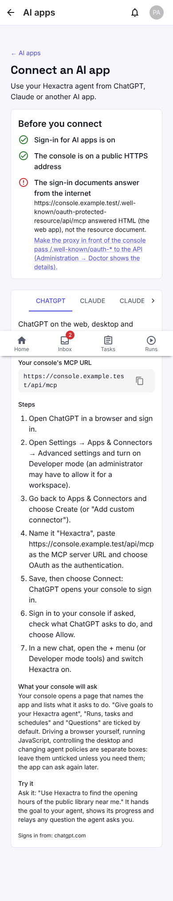
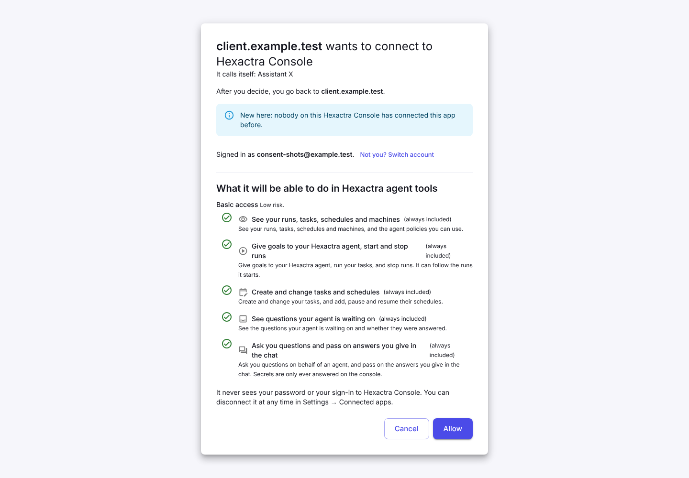
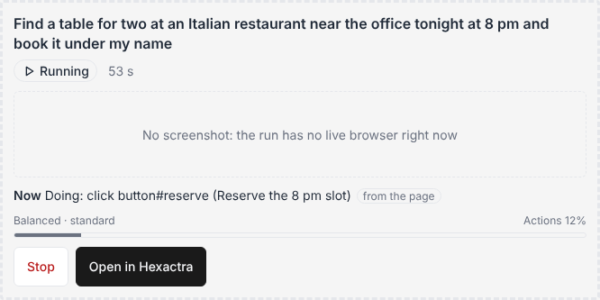
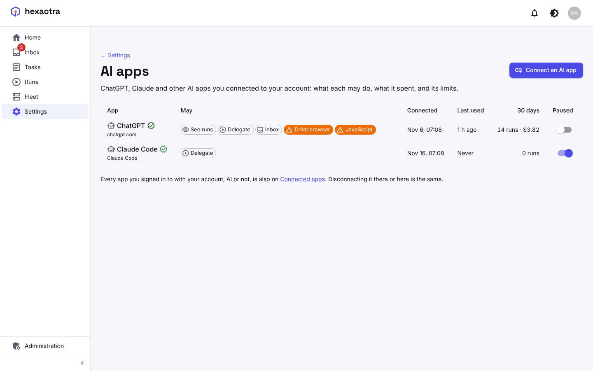

# Hosted AI clients: ChatGPT, Claude and Claude Code

How to use your Hexactra agent from ChatGPT, Claude (web, desktop and phone), Claude Code or any other OAuth MCP client. The client signs in to your console with OAuth: nobody copies a token. Your console asks you which things the app may do, and you can take any of them back later.

> **Status.** The steps below were written from the vendors' published documentation (Anthropic's connector documentation, read on 2026-11-18; OpenAI's could not be read when this was written, so the ChatGPT labels are marked *verify on screen*). Every recipe says **Version checked: docs as of 2026-11-18; not yet verified on the live client**. The manual run that checks them against the real clients is [hosted-clients-acceptance.md](hosted-clients-acceptance.md); until it is recorded on [#468](https://github.com/marinoscar/hexactra/issues/468), expect a label or a menu to differ. What *is* checked on every change is the console's side: a scripted client that behaves the way these clients are documented to runs the whole journey in CI ([What CI checks](#what-ci-checks)).

The protocol details (scopes, step-up, limits, revisions) are in [mcp.md](mcp.md); agent frameworks with a personal access token (Hermes Agent, OpenClaw, Pi) are in [agent-frameworks.md](agent-frameworks.md); the threat model is [security-hosted-clients.md](security-hosted-clients.md).

## Before you start

The administrator's checklist (public address, sign-in paths, OAuth clients, allowed hosts, replicas, guardrails, verification) is [Enable it](../README.md#enable-it-deployment-owner-or-administrator) in the console README; the short version for each person connecting an app:

1. **The console is on a public HTTPS address.** ChatGPT and Claude call from their own servers, so `https://<console>/api/mcp` and the sign-in paths (`/.well-known/oauth-*`, `/api/oauth/*`, `/oauth/consent`) must answer from the internet, and `APP_URL` must be exactly that public address. The three supported shapes (VPS, tunnel, split) are in [runbooks/public-exposure.md](runbooks/public-exposure.md). Claude Code is the exception: it runs on your computer, so a console your computer can reach is enough.
2. **An administrator turned on sign-in for AI apps.** Administration → Access → **OAuth clients**: **Let other apps connect with OAuth** is on, and under **Allowed client hosts** the hosts the apps sign in from are allowed:

   | Client | Host to allow | Why (as documented) |
   |---|---|---|
   | Claude (web, desktop, phone) | `claude.ai` | Claude's client metadata document and its callback `https://claude.ai/api/mcp/auth_callback` are on `claude.ai`. |
   | Claude Code | `claude.ai` | It identifies itself with a metadata document on `claude.ai` and is sent back to a loopback page (`http://localhost:<port>/callback` or `http://127.0.0.1:<port>/callback`) on your computer. With **Accept client metadata documents** turned off it registers itself instead, and **Allow apps that run on the person's own computer** must be on. |
   | ChatGPT | `chatgpt.com` | Its callback is on `chatgpt.com` (as recorded in the epic, #458; *verify during acceptance*). |
   | Other OAuth client | its own host | The host of its `client_id` document, or of its redirect URIs. |

   The acceptance run records the exact hosts each client used; this table is corrected from it.
3. **You can add a custom connector on the vendor's side.** Each recipe says who can ("Who can add it"), as the vendor documents it; see the vendor's page for plans, not this one.
4. **Check before you connect.** Settings → **AI apps** → **Connect an AI app** runs a preflight (sign-in on, public HTTPS address, discovery documents reachable, the client's host allowed) and shows the same steps as this page.

   

## The consent page: which boxes to tick

Every client sends you to the same page on your console. It names the app and the host it signs in from, then lists what it asks to do.



| You want the app to… | Tick | Leave unticked |
|---|---|---|
| **Delegate only**: hand goals to your agent, follow runs, answer its questions, manage tasks and schedules | the five boxes ticked by default (runs, goals, tasks and schedules, questions) | browser control, JavaScript, desktop control, agent policies |
| **Let it drive**: open a browser on your machines and click and type itself, step by step | the defaults **and** "Control a browser on your machines directly" | JavaScript, desktop and policies, unless you need them |

You do not have to decide everything now. When the app later needs something you did not tick, it asks again (a *step-up*): the same page opens with your earlier choices already allowed and only the new one to decide. Codes and passwords are never typed into the chat: the agent asks you for them in your console's Inbox.

## Steps per client

The section below is generated from the file the in-app guide reads (`apps/web/src/content/connect-ai-apps.ts`), so the app and this page say the same thing; `npm run docs:hosted-clients` rewrites it and a web test fails when they differ.

<!-- connect-guides:start (generated from apps/web/src/content/connect-ai-apps.ts by `npm run docs:hosted-clients`; do not edit) -->

### ChatGPT

ChatGPT on the web, desktop and phone, through a custom MCP connector (developer mode).

Version checked: docs as of 2026-11-18; not yet verified on the live client.

**Who can add it:** A plan and role that may use developer mode and create custom connectors; in a workspace, an administrator may have to allow it first. See OpenAI's help pages for the current list.

**Signs in from:** chatgpt.com

1. Open ChatGPT in a browser and sign in.
2. Open Settings → Apps & Connectors → Advanced settings and turn on Developer mode (labels: verify on screen; an administrator may have to allow it for a workspace).
3. Go back to Apps & Connectors and choose Create (or "Add custom connector"; verify on screen).
4. Name it "Hexactra", paste `https://<console>/api/mcp` as the MCP server URL and choose OAuth as the authentication.
5. Save, then choose Connect: ChatGPT opens your console to sign in.
6. Sign in to your console if asked, check what ChatGPT asks to do, and choose Allow.
7. In a new chat, open the + menu (or Developer mode tools) and switch Hexactra on (verify on screen).

**What your console will ask.** Your console opens a page that names the app and lists what it asks to do. "Give goals to your Hexactra agent", "Runs, tasks and schedules" and "Questions" are ticked by default. Driving a browser yourself, running JavaScript, controlling the desktop and changing agent policies are separate boxes: leave them unticked unless you need them; the app can ask again later.

**First prompts to try:**

- "What can you do with Hexactra?" A good answer: It lists giving goals to your agent, following runs, tasks and schedules, and answering the agent's questions. With the default boxes it does not offer to click or type in a browser itself.
- "Use Hexactra to find the opening hours of the public library in &lt;your town>." A good answer: It starts a run, reports what the agent is doing, shows or describes a screenshot, relays a question if the agent asks one, and ends with the hours and a link to the run in your console ("Started by" names the app).
- "Which of my Hexactra tasks run on a schedule, and when do they run next?" A good answer: A short list of your tasks with their next run times, read from your console; nothing is started or changed.

### Claude

Claude on the web, the desktop app and the phone app: one connector, added on the web or the desktop app, serves all of them.

Version checked: docs as of 2026-11-18; not yet verified on the live client.

**Who can add it:** Free (one custom connector), Pro, Max and Ultra: you add it to your own account. Team and Enterprise: an Owner adds it under Organization settings → Connectors, then each member connects.

**Signs in from:** claude.ai

1. Open claude.ai (or the Claude desktop app) and sign in.
2. Go to Customize → Connectors, choose Add, then "Add custom connector". (Team and Enterprise: an Owner goes to Organization settings → Connectors, chooses Add, then Custom, and Web if asked.)
3. Name it "Hexactra", paste `https://<console>/api/mcp` as the remote MCP server URL, then choose Continue.
4. Keep the authentication settings Claude marks Detected ("Sign in now" or "Sign in when needed", and "Use Claude's published identity" as the OAuth client). Leave Request headers empty.
5. Choose Add, then Connect: Claude opens your console to sign in.
6. Sign in to your console if asked, check what Claude asks to do, and choose Allow.
7. In a chat, choose + → Connectors and make sure Hexactra is on.

**What your console will ask.** Your console opens a page that names the app and lists what it asks to do. "Give goals to your Hexactra agent", "Runs, tasks and schedules" and "Questions" are ticked by default. Driving a browser yourself, running JavaScript, controlling the desktop and changing agent policies are separate boxes: leave them unticked unless you need them; the app can ask again later.

**First prompts to try:**

- "What can you do with Hexactra?" A good answer: It lists giving goals to your agent, following runs, tasks and schedules, and answering the agent's questions. With the default boxes it does not offer to click or type in a browser itself.
- "Use Hexactra to find the opening hours of the public library in &lt;your town>." A good answer: It starts a run, reports what the agent is doing, shows or describes a screenshot, relays a question if the agent asks one, and ends with the hours and a link to the run in your console ("Started by" names the app).
- "Which of my Hexactra tasks run on a schedule, and when do they run next?" A good answer: A short list of your tasks with their next run times, read from your console; nothing is started or changed.

### Claude Code

Claude Code in your terminal. It signs in through a page on your own computer and identifies itself with a document on claude.ai, so claude.ai must be allowed.

Version checked: docs as of 2026-11-18; not yet verified on the live client.

**Who can add it:** Anyone who runs Claude Code; no administrator on the vendor side.

**Signs in from:** claude.ai (its client document) and your computer (a loopback page)

```bash
claude mcp add --transport http hexactra https://<console>/api/mcp
```

1. Run the command below in a terminal (add --scope user to use it in every project).
2. Start Claude Code and type /mcp, choose hexactra, then Authenticate: your browser opens your console.
3. Sign in to your console if asked, check what Claude Code asks to do, and choose Allow.
4. Back in the terminal, /mcp shows hexactra as connected. Without OAuth, use a personal access token instead: claude mcp add --transport http hexactra `https://<console>/api/mcp` --header "Authorization: Bearer &lt;token>".

**What your console will ask.** Your console opens a page that names the app and lists what it asks to do. "Give goals to your Hexactra agent", "Runs, tasks and schedules" and "Questions" are ticked by default. Driving a browser yourself, running JavaScript, controlling the desktop and changing agent policies are separate boxes: leave them unticked unless you need them; the app can ask again later.

**First prompts to try:**

- "What can you do with Hexactra?" A good answer: It lists giving goals to your agent, following runs, tasks and schedules, and answering the agent's questions. With the default boxes it does not offer to click or type in a browser itself.
- "Use Hexactra to find the opening hours of the public library in &lt;your town>." A good answer: It starts a run, reports what the agent is doing, shows or describes a screenshot, relays a question if the agent asks one, and ends with the hours and a link to the run in your console ("Started by" names the app).
- "Which of my Hexactra tasks run on a schedule, and when do they run next?" A good answer: A short list of your tasks with their next run times, read from your console; nothing is started or changed.

### Other MCP client

Any client that speaks MCP over Streamable HTTP: with OAuth when it supports it, or with a personal access token.

Version checked: docs as of 2026-11-18; not yet verified on the live client.

**Who can add it:** Whoever configures the client.

**Signs in from:** the client's own host

1. With OAuth: give the client `https://<console>/api/mcp` and nothing else. It finds the sign-in on its own, opens your console and asks you to allow it. An administrator must allow the host it signs in from (Administration → OAuth clients).
2. With a personal access token: create one in Settings → Access tokens, then configure the client with `https://<console>/api/mcp` and the header "Authorization: Bearer &lt;token>". A token has all of your permissions and every tool; keep it secret.
3. Agent frameworks (Hermes Agent, OpenClaw, Pi) have ready-made recipes in docs/agent-frameworks.md.

**What your console will ask.** Your console opens a page that names the app and lists what it asks to do. "Give goals to your Hexactra agent", "Runs, tasks and schedules" and "Questions" are ticked by default. Driving a browser yourself, running JavaScript, controlling the desktop and changing agent policies are separate boxes: leave them unticked unless you need them; the app can ask again later.

**First prompts to try:**

- "What can you do with Hexactra?" A good answer: It lists giving goals to your agent, following runs, tasks and schedules, and answering the agent's questions. With the default boxes it does not offer to click or type in a browser itself.
- "Use Hexactra to find the opening hours of the public library in &lt;your town>." A good answer: It starts a run, reports what the agent is doing, shows or describes a screenshot, relays a question if the agent asks one, and ends with the hours and a link to the run in your console ("Started by" names the app).
- "Which of my Hexactra tasks run on a schedule, and when do they run next?" A good answer: A short list of your tasks with their next run times, read from your console; nothing is started or changed.

<!-- connect-guides:end -->

## Once connected

**What a good first answer looks like.** The app runs the goal through your agent and shows its progress. In Claude and ChatGPT, where the client renders MCP Apps, a live run card shows the screenshot, the activity line and a Stop button ([mcp-apps.md](mcp-apps.md)); Claude Code shows the same as text.



Every run the app starts shows **Started by** with the app's name in your console's run list.

**Allow more later (step-up).** Ask for something the app may not do yet ("Open example.test and click Sign in" with only the default boxes): the client opens your console's consent page again, with only the new box to tick. In Claude Code, `/mcp` → hexactra → **Authenticate** does the same if the prompt does not appear on its own.

**Pause or disconnect.**

| Where | Pause | Disconnect |
|---|---|---|
| Your console | Settings → **AI apps** → the app → **Paused**: it cannot start runs or browser sessions; runs already working continue. Switch it off to resume. | Settings → **AI apps** → the app → **Disconnect**. Its next call fails and the client offers to sign in again. |
| An administrator | Administration → **External AI apps** → **Kill switches**: stop every OAuth app (or every personal access token over MCP) at once; `hexactra mcp disable`. | Administration → **External AI apps** → connected apps → **Disconnect** (any user's app), or Administration → **OAuth clients** → the client → **Details** → **Connections** → **Revoke** (one user's connection to that client). |
| Claude | + → **Connectors** in a chat turns it off for that conversation. | Customize → **Connectors** → Hexactra → **Remove** (or the three-dot menu). |
| ChatGPT | Switch Hexactra off in the chat's tools menu (*verify on screen*). | Settings → Apps & Connectors → Hexactra → disconnect or delete (*verify on screen*). |
| Claude Code | — | `claude mcp remove hexactra` |



## Troubleshooting

| Symptom | Cause | Fix |
|---|---|---|
| "Couldn't reach the MCP server" (Claude) or the connector cannot be created | The console is not reachable from the internet, or answers on `http://`. | Serve it on a public `https://` address ([public-exposure.md](runbooks/public-exposure.md)); `curl -i https://<console>/api/mcp` from outside must answer `401`. |
| The same, while `/api/mcp` answers `401` | The well-known paths return HTML (the web app), `404`, or are blocked by a WAF or a tunnel's access policy. | `curl -i https://<console>/.well-known/oauth-protected-resource/api/mcp` and `…/.well-known/oauth-authorization-server` must return JSON. Exempt `/api/mcp`, `/api/oauth/` and `/.well-known/oauth-*` from the access policy; allow the vendor's egress range in a WAF (Anthropic publishes `160.79.104.0/21`). The preflight's third line and the Doctor check `oauth.well_known` say which. |
| The same, from Claude only, while Claude Code works | The host name resolves to a private address from outside (split DNS, CGNAT, a home address). | Use the VPS stack or a tunnel with a public address. |
| "Authorization with the MCP server failed" | The client's host is not allowed. | Administration → OAuth clients: allow the host from [Before you start](#before-you-start). Administration → OAuth clients lists the refused hosts of the last 30 days. |
| The same, after the consent page | `APP_URL` differs from the public URL (another host, `http`, a trailing path), so the issuer or the resource does not match what the client expects. | Set `APP_URL` to the exact public URL and restart the API; the preflight's second line must pass. |
| The same, with a redirect error on the consent page | The redirect URI the client sent is not one it registered (a vendor changed its callback). | Note the redirect host on the consent page and the refused host in Administration → OAuth clients; report it on #468. |
| The URL redirects (apex to `www.`, a vanity domain) | Clients drop the `Authorization` header on a redirect to another host. | Give the client the URL the console answers on, with no redirect. |
| Tools are missing | The scope was not granted, or your role lacks the permission (a **viewer** sees read tools only). | Ask for the task: the client asks for more (step-up). Or disconnect and connect again with the box ticked; ask an administrator for a role. |
| Only some tools are listed, and browser tools never appear | Administration → External AI apps → **Show apps the tools they need more permission for** is off. | Turn it on, or connect with "Control a browser" ticked. |
| "Tool timed out" or the chat stops waiting | A call waited longer than the client allows. OAuth calls wait at most 200 s and answer by 220 s; the run keeps going. | Ask "How is my Hexactra run doing?": the app calls `run_wait` again. |
| A refusal saying the app is paused, a limit, or "External AI apps are turned off" | The app is paused, reached a per-app limit, or a kill switch is on. | Settings → AI apps → the app; Administration → External AI apps. |
| The run card does not render | The client or the plan does not support MCP Apps (Claude Code never does), or it cached an older card. | The text answer is the same information. Remove and re-add the connector to refresh a cached card. |
| A code or password is requested | Secrets are never answered in a chat. | Open the link the app gives you (your console's Inbox) and type it there. |

## What CI checks

Hosted clients cannot run in CI, so `apps/api/test/mcp-hosted-client.db.spec.ts` runs a scripted client (`apps/api/test/helpers/hosted-mcp-client.ts`) that knows only the MCP URL, in five profiles that imitate the documented behaviours: a client metadata document with a fixed callback (Claude), dynamic registration on every connection, a loopback redirect on a random port (Claude Code), the stateless 2026-07-28 revision with forms, and a client that reads per-tool `securitySchemes` and signs in with ChatGPT's redirect URI (as ChatGPT is documented to), so its step-up comes as a tool error carrying `_meta["mcp/www_authenticate"]` while the others get the HTTP `403`. Each runs discovery, consent, `tools/list`, a delegated run with a question and a screenshot, a step-up, token expiry and refresh (a faked clock), refresh-token reuse, and disconnection, with every OAuth endpoint under 2 s. `apps/api/test/agent-clients.db.spec.ts` runs the real Claude Code CLI (`claude mcp add --transport http …` then `claude mcp list`) and the MCP Inspector CLI against the console with a personal access token, pinned versions, in CI's db tier.

The differences between clients that the console handles, and the test that pins each, are in [mcp.md, Client differences we handle](mcp.md#client-differences-we-handle).
