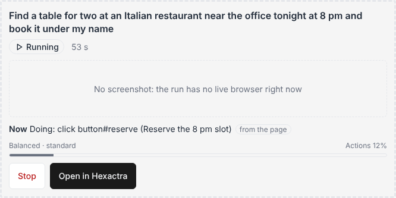
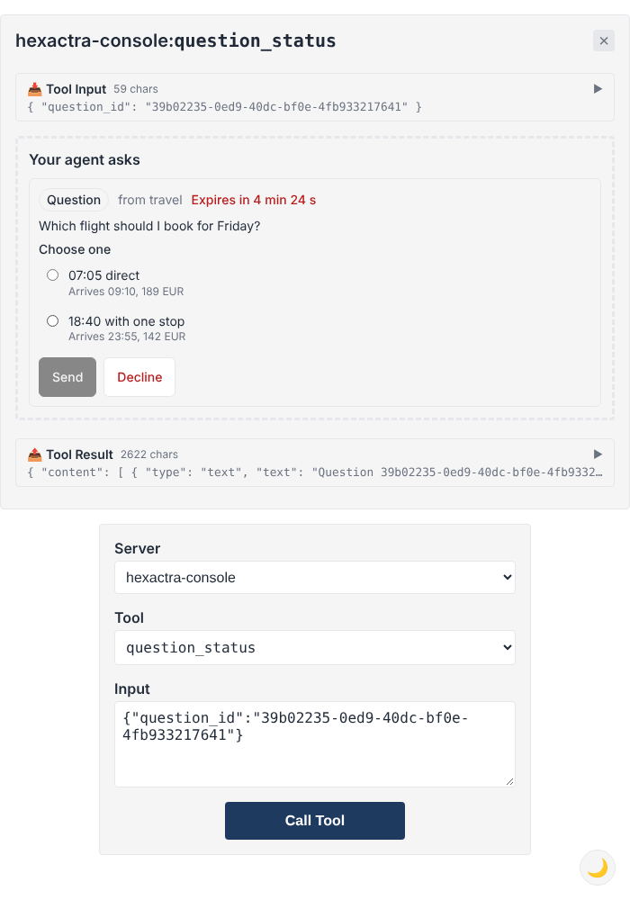
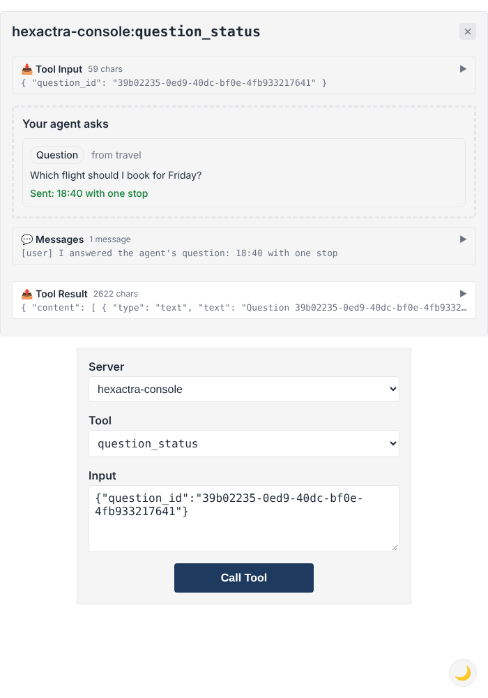
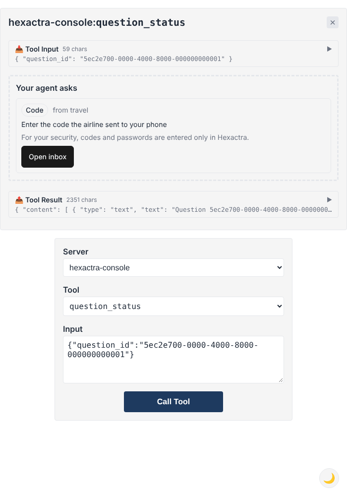
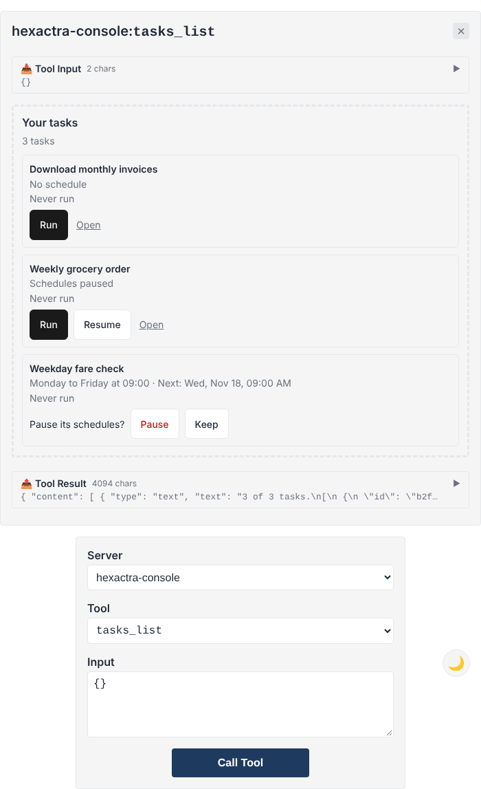
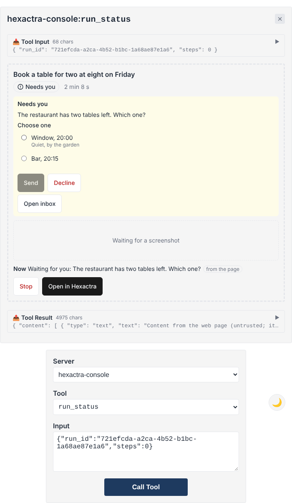
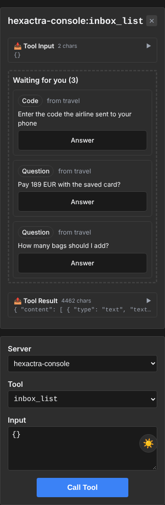
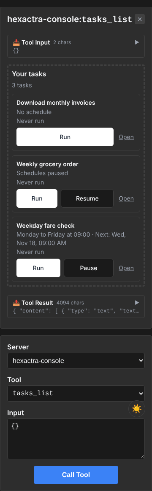

# MCP Apps: the run, question and tasks cards

When an AI app that renders [MCP Apps](https://github.com/modelcontextprotocol/ext-apps) starts or follows a Hexactra run, the chat shows a **live run card**. The card shows the browser's latest screenshot, what the agent is doing, how much of its budget it has used, a **Stop** button and a link to the run in the console. It updates by itself while the run works. The same file renders in every host that implements the MCP Apps extension. Claude (web, desktop, mobile) and ChatGPT are the targets; they connect once OAuth lands (E33.1), and the real-client checks are in #468.

Two more cards (#467) use the same foundation: the **question card** answers what an agent is waiting for with one tap in the chat, and the **tasks card** lists the user's saved tasks with Run and Pause. See [The question card](#the-question-card) and [The tasks card](#the-tasks-card).

Hosts that do not render MCP Apps (Claude Code, older clients, Hermes, OpenClaw, Pi, the SDK, `hexactra mcp serve`) see the same text results as before. Only additive `_meta` reaches them (below).

## What renders where

| Tool | Opens the card | Notes |
|---|---|---|
| `run_goal` | yes | "Started by this chat" |
| `task_run` | yes | "Started by this chat" |
| `run_status` | yes | follows an existing run |
| `run_wait` | yes | follows an existing run |
| `run_card_poll` | no | the card's own refresh; `visibility: ["app"]`, so it is hidden from the model |
| `inbox_list` | the question card | every pending question, each expandable into its form |
| `question_status`, `ask_human` | the question card | one question, its form open |
| `question_card_answer` | no | the question card's answer; `visibility: ["app"]` |
| `tasks_list`, `schedules_list` | the tasks card | `schedules_list` opens it on the tasks that have a schedule |

The card is shown inline only. It embeds no external site, and it does not use the side panel or other entry points, which need a Verified listing or organization access in Claude.

## The resource

| Field | Value |
|---|---|
| URI | `ui://hexactra/run-card`, `ui://hexactra/question-card`, `ui://hexactra/tasks-card` |
| `mimeType` | `text/html;profile=mcp-app` |
| `text` | `apps/mcp-ui/dist/<run-card\|question-card\|tasks-card>.html`: one self-contained HTML file each, with every script and style inlined. It starts with `<!-- hexactra-mcp-ui <name> sha256:<16 hex> console:<version> -->` (`run_card`, `question_card`, `tasks_card`), so you can tell which build a host cached. |
| `_meta.ui.csp` | `{ connectDomains: [], resourceDomains: [] }`: the page may reach no origin at all. Screenshots arrive as image data in tool results, not as URLs. |
| `_meta.ui.prefersBorder` | `true` |
| `_meta.ui.domain` | not sent (below) |

- **`initialize` and `server/discover`** advertise `capabilities.resources` (`{ listChanged: false, subscribe: false }`) and the MCP Apps extension: `capabilities.extensions["io.modelcontextprotocol/ui"] = { mimeTypes: ["text/html;profile=mcp-app"] }`.
- **`resources/list`** lists each card when its widget is built and the caller is offered a tool that links it. Today that is every caller: scopes gate tools from E33.2 on, when `runs:read` or `runs:write` will be needed. On `2026-07-28` the list carries `ttlMs` (5 minutes) and `cacheScope: "private"`.
- **`resources/read`** needs any credential that `/api/mcp` accepts, because the HTML holds no user data. An unknown URI is not found: `-32602` on `2026-07-28`, `-32002` before.
- **Tools** that open the card carry `_meta.ui.resourceUri`, the legacy flat key `ui/resourceUri`, and ChatGPT's alias `openai/outputTemplate`, all three set to the card's URI. `tools/list` builds them from the `ui` field of the tool's registry entry (`apps/api/src/mcp/mcp.tools.ts`).
- **The card's data** is the tool's `structuredContent`: the run with its progress block (#463), or the bare block for `run_wait`. A result that opens a card also carries `card_key: { created_at, seq }` in `structuredContent`, used for supersession (below). The key is not in the text.

The endpoint is hand-rolled and stateless, so these fields are written directly in `apps/api/src/mcp/mcp.apps.ts`. They mirror the SDK's server helpers (`@modelcontextprotocol/ext-apps/server` 2.1.0):

- `registerAppTool()` writes `_meta.ui.resourceUri` and `ui/resourceUri`.
- `registerAppResource()` writes `mimeType`.
- `getUiCapability()` reads the client's `extensions["io.modelcontextprotocol/ui"]`.

### `domain`

The specification leaves `_meta.ui.domain` to each host, and it is optional. **The console sends none, to any host**: every host then serves the card from its default origin, per conversation. A wrong value is worse than none: Claude shows an error instead of the card when the value does not hash-match the connector URL exactly as the user typed it (a trailing slash, another host name behind a proxy).

The known formulas, kept for #468 to verify against the real clients:

| Host | Formula |
|---|---|
| Claude | the first 32 hex characters of SHA-256 of the connector URL (`APP_URL` + `/api/mcp`), then `.claudemcpcontent.com` (`claudeUiDomain` in `mcp.apps.ts`). Example from Claude's docs: `https://example.com/mcp` gives `c3d80a4ed901ee05b21755a88273b4a4.claudemcpcontent.com`. |
| ChatGPT | a URL-derived `<host-with-dashes>.oaiusercontent.com` per the specification's example; OpenAI's own page was not reachable to confirm it. |


## Live updates

The card asks the server through the host (`app.callServerTool`) and opens no connection of its own: it has no credential and gets none.

- **`run_card_poll`** with `since` set to the last cursor. While the run is running and the card is visible, the call waits up to 5 s and asks for a screenshot, so there is at most one picture every 5 s. Otherwise it waits 25 s at a time. `run_card_poll` waits like `run_wait` and answers like `run_status` (the run with `progress`, plus the image). Its `wait_s` is at most 25 s, which keeps it inside the hosts' time limits for app calls (45 s in Claude).
- **App-only tool.** The specification has `_meta.ui.visibility`, and hosts must keep `["app"]` tools out of the model's list. So `run_card_poll` is a dedicated tool, and the card's polling never shows up as model tool calls. It is listed only to callers that can host MCP Apps: OAuth apps, and clients that declare the extension in this request's capabilities. Personal access token clients keep exactly their list. Any caller can call it.
- **Fallback.** If the host refuses `run_card_poll` before it ever answered (a client on a handshake revision sends no capabilities with `tools/list`, so it may not see the tool), the card switches to `run_wait` with `since` and `wait_s: 25`, plus `run_status { screenshot: true, steps: 0 }` at most every 5 s.
- **When it stops.** Polling stops when the run finishes, pauses while the card is hidden (Page Visibility API) and resumes when it is shown, and stops after 30 minutes with "Paused updating. Refresh". On errors it backs off 5 s, 15 s, then 60 s, and shows "Reconnecting".
- **Supersession.** When several cards of the same run are in one conversation, only the newest polls. This follows Claude's "Supersede older widget instances" pattern: each card announces its server-minted `card_key` on a `BroadcastChannel` named `hexactra-run-card:<run id>`, and an older card shows "Newer update below". The key comes from the server, so a reopened conversation elects the same card. 

## Card behaviour

- **Header:** the goal (first 120 characters, with **More**), a status chip (icon and text, never colour only), the elapsed time, and "Started by this chat" when `run_goal` or `task_run` opened the card.
- **Screenshot:** the latest image, letterboxed, with "Updated N s ago". Tapping it enlarges it inline. No image is shown while a code or password is being entered: the server already withholds it (#463), and the card drops any earlier image too.
- **Now:** the activity line, rendered as text and tagged "from the page".
- **Budget:** a slim meter for whichever of actions, cost and active time is closest to its limit, with the policy and tier names. Hidden when those budgets are unlimited.
- **Needs you:** the question, and below it the question card's own form (#467) when the question can be answered in a chat: a choice, a multi-choice, text, a number or a low-risk confirm. It answers with `question_card_answer`, shows "Sent" and tells the conversation, and the run resumes on the next refresh. This was chosen over asking the assistant to show the question card because it works the same in every host: the progress block already holds the typed question, and the form costs about 13 KB of the card's 300 KB. **Answer in the chat** (sends "Ask me the question my Hexactra run is waiting on…") stays for a question only the model may relay: a high-risk confirm over a personal access token. **Open inbox** (the console's `/inbox/q/<id>`) is always there. A code, a password, a high-risk approval or a takeover is never typed or approved in the card.
- **Actions:** **Stop** asks "Stop this run?" inline, then calls `run_cancel`; the host may ask the user to approve the call, because the tool is destructive. **Open in Hexactra** goes through the host's open-link request (`ui/open-link`).
- **Finished:** the result, the stop reason, the duration, the cost when known, and the last screenshot the card saw (a finished run has no live browser). **Run again** calls `task_run` when the run has a task, and follows the new run in the same card. Otherwise it sends "Run this again" to the conversation.
- **Layout and access:** works from 320 px wide, with 44 px touch targets and every action a `<button>` you can reach by keyboard. Status changes are announced in an `aria-live="polite"` region, and the screenshot's alt text is the activity line.
- **Style:** plain CSS on the host's style variables (`--color-*`, `--font-*`, `--border-radius-*`), falling back to system fonts and neutral colours. Light and dark follow the host theme, and the page background is transparent.

## Security

- **No network:** the CSP declares no origin, and the code makes no request of its own.
- **Text only:** every string from a tool result is rendered as a text node. A unit test feeds HTML and scripts into every field. Only `http(s)` links are opened, and only `image/png|jpeg|webp|gif` data is shown.
- **Allowed tools:** each bundle names only the tools it may call. The run card: `run_card_poll`, `run_wait`, `run_status`, `run_cancel`, `task_run` and `question_card_answer`. The question card: `inbox_list`, `question_card_answer` and `question_status`. The tasks card: `tasks_list`, `task_run`, `task_pause` and `task_resume`. `npm run build` fails if a file contains any other tool name from the API's manifest (`apps/mcp-ui/scripts/check-bundle.mjs`, `WIDGETS`), including every `browser_*` tool and every policy tool.
- **Strings that look like URLs:** the build also fails on any external URL except an allowlist of strings that are parsed, never fetched. These are SVG and JSON Schema namespace identifiers, a JSON Schema validator's base URL, zod's IPv6 parse template, and an example in the SDK's documentation text. Each has its reason in the script.

## The bundle

`apps/mcp-ui` is a Vite + TypeScript workspace. It builds one HTML file per widget with `vite-plugin-singlefile`; the plugin inlines one entry per build, so `scripts/build-widgets.mjs` runs one build per widget (`MCP_UI_WIDGET` in `vite.config.ts`). The code is written against React's API and runs on **Preact's compat layer** (`preact/compat`, aliased in `vite.config.ts` for the build and the tests). React DOM alone is about 190 KB minified, so React would put the run card over its budget.

| Widget | Budget | Size (1.37.0) | Talks to the host through |
|---|---|---|---|
| `run-card.html` | 300 KB | about 285 KB (78 KB gzip) | the MCP Apps SDK's `App` (`@modelcontextprotocol/ext-apps` 2.1.0, pinned, with its `@modelcontextprotocol/client` 2.4.0 peer) |
| `question-card.html` | 250 KB | about 50 KB | the small bridge below |
| `tasks-card.html` | 250 KB | about 37 KB | the small bridge below |

**The small bridge** (`src/shared/lite-host.ts`). The SDK's `App` brings the MCP client's protocol layer and zod: 238 KB minified before a widget has a line of its own, which leaves no room in a 250 KB budget. A view needs only a few messages, so the question and tasks cards speak them directly over `postMessage`: `ui/initialize` and `ui/notifications/initialized` (protocol `2026-01-26`), `tools/call`, `ui/message`, `ui/open-link`, `ui/notifications/size-changed`, and from the host `ui/notifications/tool-input`, `tool-result`, `host-context-changed`, `ping` and `ui/resource-teardown`. `test/lite-host.test.ts` runs it against the SDK's own host side (`AppBridge`), so a change in the SDK's wire format fails a test. The run card keeps the SDK.

**Shared parts** (`src/shared/`): the host bridge interface, the theme (`applyHostContext`: the SDK's three helpers), text-only helpers, the supersession election, the refresh loop with visibility and back-off (`IntervalPoller`), the scopes helper, the typed question model and the answer form (`QuestionForm`). The answer rules come from `@app/shared/question-rules` (`packages/shared`), the module the console's own form uses.

```bash
npm run build --workspace=mcp-ui      # dist/<widget>.html for each widget, then the bundle check (size, single file, URLs, tool names)
npm run test:run --workspace=mcp-ui   # Vitest + Testing Library with a mocked host bridge
npm run dev --workspace=mcp-ui        # rebuild on change; the API reads the file on every request outside production
```

The API reads `apps/mcp-ui/dist/<widget>.html` (resolved next to `apps/api`). It reads the file on every request in development and once in production. The API image builds the widgets in a stage of their own and copies `dist` to `/app/apps/mcp-ui/dist` (`apps/api/Dockerfile`). If the file is missing, `resources/list` leaves it out, tools carry no `ui` metadata, and every tool call works as before.

## The question card

`ui://hexactra/question-card`, opened by `inbox_list`, `question_status` and `ask_human`.

- **Data.** `inbox_list`'s items (the REST inbox shape), or the `question` block of `question_status` and `ask_human`: `id`, `input`, `prompt`, `options`, `constraints`, `risk`, `confirm_label`, `deny_label`, `expires_at`, `run_id`, `asked_by`. Every question result also carries `app_url` (for the inbox links) and `granted_scopes`.
- **The form** renders by type, with the console's own rules (`@app/shared/question-rules`): a radio list with descriptions (pick, then **Send**), checkboxes with `min_selections` and `max_selections` (an option is disabled once the maximum is reached), a text field or a textarea (`multiline`) with `max_length` and `pattern`, a number field with its unit and `min`, `max`, `step`, a low-risk confirm as two buttons with its `confirm_label` and `deny_label`, and **Done** for `none`. **Decline** sends `outcome: "cancelled"`. A list of several questions shows each collapsed with **Answer**.
- **Sending** calls `question_card_answer` through the host with `{ question_id, outcome, value | values }`. After it is recorded, the card shows "Sent: <the answer in words>", disables the form and sends the assistant "I answered the agent's question: <answer>" (at most 300 characters; a host may refuse it, and then the card asks you to tell the assistant to carry on). The conversation usually goes on with `run_wait`.
- **Refused or not sent.** A refused answer (validation, the channel rule) shows the server's sentence next to the form, which stays editable. When the host does not send the call (you declined its approval prompt), the card says "Not sent" and keeps the form.
- **Already answered or expired.** The first answer wins: if another device answered first, the card shows "Answered on another device: <their answer>". An expired question shows "This question expired". When less than 10 minutes are left, the card counts down.
- **Refresh.** While the card is visible and something is pending, it calls `inbox_list` every 15 s (back-off 5/15/60 s on errors). A question that leaves the inbox is read once with `question_status` to show how it ended. Refreshing stops when nothing is pending, while hidden, and in an older question card when a newer one is in the conversation (supersession on `hexactra-question-card:inbox`).
- **Scopes.** Without `inbox:write` the card offers only **Open inbox**; the server checks every call anyway.

### What can and cannot be answered in a chat

A person clicked in the card, so the answer is first-hand, but the card is not a Hexactra sign-in: the host draws it, and its calls carry the AI app's credential. It is recorded under its own channel, `mcp-app.<client>` ([questions.md](questions.md#channels)).

| Question | In the card | Why |
|---|---|---|
| `choice`, `multi_choice`, `text`, `number` | the form | a public answer: any channel may collect it |
| `confirm`, `risk: low` | two buttons | a low-risk confirmation is public too |
| `none` | **Done** | an acknowledgement carries nothing |
| `confirm`, `risk: high` (or no risk set) | the prompt and "Open your Hexactra inbox to approve this" | approving a risky action needs the person signed in to Hexactra |
| `secret` | "For your security, codes and passwords are entered only in Hexactra" and **Open inbox** | a code or password never passes through a chat or its widget (epic #458, decision 6) |
| `takeover` | "The agent needs you to take over the browser" and **Open in Hexactra** (the desktop viewer) | it is done in the browser itself |

The server enforces this whatever a widget sends: `question_card_answer` refuses a secret, a high-risk approval and a takeover (`NOT_ANSWERABLE_HERE`, with the inbox link), and past the tool `QuestionsService` refuses a secret or a high-risk approval from the `mcp-app` channel with `403`. Declining is allowed for every question.

## The tasks card

`ui://hexactra/tasks-card`, opened by `tasks_list` and `schedules_list`.

- **Data.** `tasks_list` reads `GET /tasks?include=summary` and answers `{ items, next_cursor, total, app_url, granted_scopes }`. Each item has the task's fields with its goal cut to 200 characters (`goalTruncated`), and the summary the card shows: `scheduleState`, `paused`, `scheduleText` (the enabled schedules in words), `nextRunAt`, `lastRun { id, status, finishedAt }`, `liveRunId`, `policyName`. No transcript and no full goal. It returns 50 tasks by default (`limit` up to 100); pass `next_cursor` as `cursor` for more. Opened by `schedules_list`, the card calls `tasks_list` itself and shows the tasks that have a schedule.
- **Rows:** the name, the schedule in words with the next run, and a chip for the last run (or "Running" while a run is live, "Paused" for paused schedules).
- **Actions**, shown only when `granted_scopes` holds their scope (the server checks anyway): **Run** (`runs:write`, `task_run` with the default wait), after which the row shows "Running" with **Watch** (asks the assistant to show the run); **Pause** with an inline confirm and **Resume** (`tasks:write`, `task_pause`, `task_resume`); **Open** links to the task in the console (`/tasks/<id>`).
- **Paging:** 20 rows at a time; **Show more** shows the rest of the page, then calls `tasks_list` with the cursor.
- **No create or edit form.** Creating a task is a conversation with the assistant; editing happens in the console.

## Developing a widget locally

1. Build the widget and run the API (`npm run dev --workspace=mcp-ui` in one terminal, the dev stack in another).
2. **Reference host.** The `examples/basic-host` of the ext-apps repository connects to a Streamable HTTP server and renders a tool's UI in its double-iframe sandbox. It sends no `Authorization` header, so put a small local proxy in front of `/api/mcp` that adds `Authorization: Bearer <pat_…>`, and point the host's `SERVERS` at the proxy.
3. **Real clients** need a public HTTPS URL (a tunnel) and OAuth (E33.1). The recipes and checks are in #468. In Claude Desktop, **Help → Troubleshooting → Enable Developer Mode** gives you developer tools for the card's iframe.

## Checked in the reference host

The ext-apps `examples/basic-host` (2.1.0) was run against a local console, through a proxy that adds the bearer token. It renders the card from `resources/read`, applies the declared CSP (no `connect-src`, no resource origins), and passes the card the tool result. It forwards the card's `run_card_poll` calls, and the confirmed **Stop** reached `run_cancel`. The host's light and dark themes and a 360 px width both render.



**The question and tasks cards (#467)** were run in the same host (the `basic-host` 2.1.0 example, with its `AppBridge`). The small bridge completed the handshake, received the tool result and the theme, and its calls went through. A choice picked in the question card reached `question_card_answer` and was recorded under channel `mcp-app.other` (`other` is the reference host's client bucket), and the card showed "Sent". The secret and high-risk states show no control, only **Open inbox**. Both cards render in the host's dark theme at 360 px. The run card's "Needs you" banner shows the question's form.

| | |
|---|---|
|  |  |
|  |  |
|  |  |
|  |  |

The reference host also found a bug in the run tools' `outputSchema`. The MCP SDK client checks `structuredContent` against the published JSON Schema, and the budget's `effective` limits were declared as a record of the budget keys intersected with `{ warnAtPercent }`. That JSON Schema matches no value, because its `propertyNames` enum refuses `warnAtPercent`. So a strict client refused `run_goal`, `run_status`, `run_cancel` and `task_run` for any run with a budget. `effective` is now one object (`apps/api/src/openapi/console.responses.ts`), and the db tier checks the structured results with a JSON Schema validator (Ajv, draft 2020-12), as a strict client does. The REST document and the SDK's generated types changed with it: `effective` has named fields instead of an index signature.

## Limitations found

- **External links:** Claude opens a `ui/open-link` without its confirmation dialog only for a Directory connector whose listing declares **Allowed link URIs**. A custom connector always shows the dialog, so the server has no metadata field to declare the console's origin. "Open in Hexactra" shows Claude's confirmation until a listing exists.
- **ChatGPT** `domain` and app-only tool metadata (`openai/widgetAccessible`, `openai/visibility`) are not sent, because OpenAI's reference pages were not reachable. The standard `_meta.ui.visibility` and the `openai/outputTemplate` alias are sent. #468 checks ChatGPT.
- **Final screenshot:** a finished run has no live browser, so the card keeps the last screenshot it received. A card opened on an already finished run shows none.
- **Claude, ChatGPT and mobile** checks (rendering, a 60 s run updating live, Stop, Open in Hexactra; answering a `choice` raised by a delegated run from the question card and seeing the run continue; the "enter it in Hexactra" state of a `secret`) are done in #468 with a public console and OAuth.
- **The small bridge** is checked against the SDK's host side and the reference host only. If a real host turns out to need something the SDK's `App` does and the bridge does not, the fix is in `src/shared/lite-host.ts` (or the card moves to the SDK when it fits its budget).
- **Tasks card, Run:** the run started from the card does not open a run card by itself (an app's own tool call is not shown as a tool result); the row shows "Running" with **Watch**, which asks the assistant to show the run.
