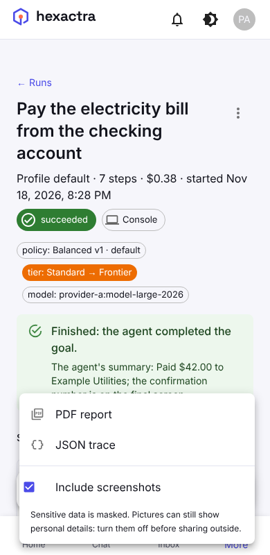
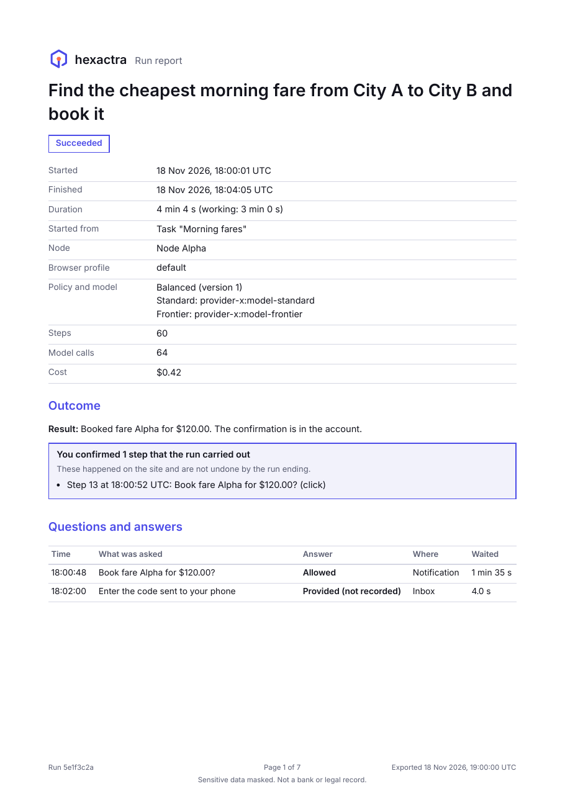

# Runs: list, filter, search, count, delete, export and retention

How a client reads a user's runs when there are thousands of them, and how it deletes them. Every answer is inside the platform's `{ data }` envelope. The two read routes need the `runs:read` permission; [deleting](#deleting-runs) needs `runs:delete`. A user only ever sees, and deletes, their own runs.

## `GET /api/runs`

Without `envelope` the answer is an array: the newest `limit` runs (default 50, at most 200). This is the shape the CLI, the MCP `runs_list` tool and earlier SDK code read.

With `envelope=1` the answer is one page:

```json
{ "data": { "items": [ { "id": "…", "status": "failed", "taskName": "Check fares", "…": "…" } ], "nextCursor": "eyJjIjoi…" } }
```

To read the next page, send the same request with `cursor=<nextCursor>`. `nextCursor` is `null` on the last page, also when the result is empty.

**The cursor is opaque. Do not parse it, build it or store it for long.** It marks a position in one user's list under one order; send it back unchanged, with the same filters and the same `order`. Anything else answers `400 INVALID_CURSOR`: start again from the first page.

Paging is by keyset on `(createdAt, id)`, so a page costs the same at any depth, and a run created while you page never shifts the rows you have not read yet.

### Parameters

All of them work with and without `envelope`.

| Parameter | Value | Meaning |
|---|---|---|
| `envelope` | `1` | Answer `{ items, nextCursor }` instead of an array. |
| `cursor` | string | The previous page's `nextCursor`. |
| `limit` | 1 to 100 with `envelope` (1 to 200 without), default 50 | Rows per page. |
| `order` | `desc` (default) or `asc` | By creation time, then id. `desc` is newest first. |
| `status` | one or more of `queued`, `running`, `waiting_human`, `paused`, `succeeded`, `failed`, `cancelled` | Any of them. |
| `state` | `live` or `finished` | `live` = `queued`, `running`, `waiting_human`, `paused`; `finished` = `succeeded`, `failed`, `cancelled`. Not together with `status`. |
| `taskId` | a task's UUID, or `none` | `none` is the runs without a task (ad-hoc and external runs). A task that is not yours is an empty list. |
| `trigger` | one or more of `manual`, `schedule`, `api`, `mcp`, `external` | Any of them. |
| `from`, `to` | ISO 8601 date-time with a zone (`2026-06-01T00:00:00Z`) | On the creation time: `from` inclusive, `to` exclusive. |
| `q` | 1 to 200 characters | Case-insensitive substring of the goal. Plain text: `%` and `_` are not wildcards. Empty is ignored. |
| `stopReason` | one or more stop reasons (`finished`, `budget_cost`, `stalled`, …), or `budget` | Any of them. `budget` is every `budget_*` reason. |
| `policyId` | an agent policy id: a UUID or `builtin:<key>` | The runs that ran under that policy. |
| `origin` | one or more of `web`, `android`, `cli`, `api`, `mcp`, `schedule`, `system` | Where the runs were started from (#464; see [Who started a run](#who-started-a-run)). |
| `clientId` | an AI app's OAuth client id (`client.id` of a run, `clientId` of `GET /api/connected-apps`) | The runs that app started. |

A list parameter (`status`, `trigger`, `stopReason`, `origin`) is repeated (`status=failed&status=cancelled`) or comma-separated (`status=failed,cancelled`).

Errors are `400` with a typed `code`:

| Code | When |
|---|---|
| `BAD_REQUEST` | An unknown status, trigger or stop reason, a malformed date or id, `limit` out of range. `details.issues` names the parameter. |
| `INVALID_FILTER` | `status` together with `state`, or `from` after `to`. |
| `INVALID_CURSOR` | A cursor that no page returned. |

### What a list row carries

A row is the run as `GET /api/runs/{id}` returns it, without its steps, plus `taskName` (null for a run without a task). It includes `startedAt`, `finishedAt`, `policy { id, name, version, source, builtin }`, `costUsd`, `costKnown`, `modelCalls`, `stopReason` and `currentTier`.

A list row never carries the run's transcript or its policy snapshot, so 50 rows stay well under 100 KB. `budget` is present while a run is live and `null` on a finished run: read a finished run's budget from `GET /api/runs/{id}`.

### Who started a run

Every run carries `origin` and `client` (#464). The server sets them from the request's credential, **never** from a request body or a header a network caller sends (a `clientName` or `origin` in a body is ignored):

| `origin` | Set when |
|---|---|
| `web` | A signed-in session in the console (the Runs page, a task, Home, a chat). |
| `android` | The Android app's own client (a User-Agent with `HexactraAndroid`). The Android app's web view is Chrome and reads as `web`. |
| `cli` | The CLI (`hexactra/<version>` User-Agent). |
| `api` | Any other personal access token caller: the SDK, a script, an agent framework over REST. |
| `mcp` | A call through `POST /api/mcp`: an AI app signed in with OAuth, or any MCP client with a personal access token or a session. |
| `schedule` | A task's schedule. |
| `system` | A worker node or the server itself. |

`client` is `{ id, name, verified }`, or `null` when no AI app started the run:

- An app signed in with **OAuth**: `id` is its OAuth client (`oauth_clients.id`), `name` the client's host at the time (`chatgpt.com`, `claude.ai`; a local app such as Claude Code: its own name), `verified: true`. The run also records the grant (server-side only). An app an administrator removes keeps its name on its runs.
- An MCP client with a **personal access token**: `id: null`, `name` is the MCP `clientInfo.name` it sent (at most 64 characters), `verified: false`. The console shows it with a "?".

Existing runs were backfilled from `trigger` (`manual` and `chat` → `web`, `schedule` → `schedule`, `api` and `external` → `api`, `mcp` → `mcp`). External browser sessions and questions carry the same client fields. A list row carries `origin` and `client`, never the grant or the limits that applied.

## `GET /api/runs/counts`

The number of runs per status, and what they cost, in one query:

```json
{ "data": { "total": 5000, "live": 0, "byStatus": { "queued": 0, "running": 0, "waiting_human": 0, "paused": 0, "succeeded": 3433, "failed": 1139, "cancelled": 428 }, "costUsd": 512.4, "costKnown": false } }
```

It takes the same filter parameters as the list except `status` and `state` (the counts are per status): `taskId`, `trigger`, `from`, `to`, `q`, `stopReason`, `policyId`. `live` is `queued + running + waiting_human + paused`. `costUsd` is the sum over the counted runs, `null` when none of them made a model call; it is a lower bound ("at least") while `costKnown` is false.

## Deleting runs

Deleting is permanent: the run, its steps, its questions and the stored screenshots of its steps. There is no trash and no undo. All three forms need the `runs:delete` permission (contributors and organization admins have it; a viewer does not). It is separate from `runs:write`, so a role can start and answer runs without being able to erase history.

**A live run is never deleted.** A run that is `queued`, `running`, `waiting_human` or `paused` must be cancelled first (`POST /api/runs/{id}/cancel`). The status is checked again inside the transaction that deletes.

**Deleting runs also removes their cost and stop-reason history from task spend and from alert counts.** A task's `spend30d` and the run-budget, stalled-runs and expensive-run alerts are computed from run rows, so they drop when the rows go. The AI usage report (**Administration → AI Usage**, `/admin/settings/ai/usage`) is not affected: it reads the AI gateway's own records (`ai_usage_events`), never the `runs` table.

| Route | Body | Answer |
|---|---|---|
| `DELETE /api/runs/{id}` | none | `204`. `404 RUN_NOT_FOUND` for an id that is not yours (missing or another user's: the two are not told apart). `409 RUN_LIVE` while the run is live. |
| `POST /api/runs/delete` | `{ "ids": ["…"] }`: 1 to 500 unique ids | `200 { deleted, costUsd, skippedLive, notFound }` |
| `POST /api/runs/delete` | `{ "filter": { … }, "expectedCount": 120 }` | `200 { deleted, costUsd, skippedLive, notFound }` when at most 500 finished runs match; else `202 { jobId, matched, costUsd }` |

Send exactly one of `ids` or `filter`; neither, both, or an unknown key is a `400`.

- **`ids`.** Live runs are skipped and listed in `skippedLive`; ids that are not your runs are listed in `notFound`. Neither fails the call.
- **`filter`** is the list's filter: `status`, `state`, `taskId`, `trigger`, `from`, `to`, `q`, `stopReason`, `policyId` ([parameters](#parameters)), as JSON (a list is an array or a comma-separated string). The server always narrows it to the finished statuses (`succeeded`, `failed`, `cancelled`), so it deletes exactly what `GET /api/runs` lists for the same filter with `state=finished`. A live status in the filter is ignored, not an error. A misspelt filter key is a `400`, never ignored.
- **`expectedCount`** is the number of runs you expect to delete: the count you showed in your confirmation. When the finished runs that match differ from it by more than 5 %, nothing is deleted and the answer is `409 COUNT_CHANGED` with the real count in `details.matched`. Read the count from `GET /api/runs/counts` (the sum of `byStatus.succeeded`, `failed` and `cancelled`).
- **A filter that selects every finished run** (`{}`, `{ "state": "finished" }` or all three finished statuses with nothing else) is accepted only with `expectedCount`.
- **`costUsd`** is the recorded model spend of the deleted runs (of the matched runs in a `202`); `null` when none of them made a model call.

```json
{ "data": { "deleted": 120, "costUsd": 14.2, "skippedLive": [], "notFound": [] } }
```

### More than 500 runs: a queue job

When a filter matches more than 500 finished runs the request deletes nothing and answers `202`:

```json
{ "data": { "jobId": "0b0c…", "matched": 1200, "costUsd": 96.4 } }
```

The `browser.runs.delete` job ("Delete runs by filter" under **Administration → Jobs**) deletes them 200 at a time. It only deletes runs created at or before the request, so a run that starts afterwards is never swept in. If it fails part-way the batches already deleted stay deleted and the retry (three attempts) continues. The same request sent again while the job is pending returns the same `jobId`. To see when it is done, read `GET /api/runs/counts` with the same filter.

### What else changes

- A schedule whose last run was deleted forgets it (`lastRunId` becomes `null`). The deleted run's failure is then not counted towards the schedule's "failing" notice.
- Notifications that link to a deleted run stay; the run page answers "not found".
- A policy's usage counts tasks and schedules, not runs: deleting runs neither blocks nor unblocks deleting a policy.
- Each call writes one line to the API log (`runs.delete user=… mode=single|ids|filter matched=… deleted=… skippedLive=… job=… ms=…`), adds to the `app.runs.deleted` counter (label `mode`) and writes an audit event (`runs.deleted`, or `runs.delete_queued` for a `202`) with the counts and the names of the filter keys. None of them holds goal text, results or step content.
- If a screenshot cannot be removed from object storage, the run is deleted all the same and the API logs how many objects were left.

## Stop (E38.1)

`POST /api/runs/{id}/cancel` is the brake. The agent stops acting within about two seconds, and nothing it had decided but not yet done is carried out.

- **How the worker hears it.** The API sets `runs.cancel_requested` and `runs.cancel_requested_at` (the first press only; a second press changes nothing), then publishes a `run.cancel` event on the run event bus. The worker holding the run has one stop signal per job (`runner/stop-signal.ts`): it hears the event at once (the bus is cross-process with the postgres adapter) and also reads the flag every second, so Stop works when the API and the worker are different processes or an event is lost (within 3 seconds at worst). A job that is not running when Stop is pressed (a hop delay between two jobs) cancels at the start of its next job.
- **Before every action.** One wrapper around tool execution checks the signal before every tool (`act`, `look`, the coordinate tools, the handoff tools, `finish`). A tool the model chose before Stop and that has not started is not carried out: it records nothing, the fabric is not called, and the chunk ends. The run ends `cancelled` with `stop_reason: cancelled`; the memory is saved, usage of the interrupted chunk is recorded, the session is released and the closing screenshot is attempted for at most 2 seconds (a failure there never delays the stop).
- **A model call in flight.** The runner passes the signal to `AiService.forUser(...).runTools`, which aborts the provider request (the platform records the aborted call as a `cancelled` usage row); a run that was in a model call ends within the time of the abort, not the time of the call. The platform rejects an aborted call with an `AiError` (`AI_PROVIDER_UNAVAILABLE`, `details.aborted: true`); the runner treats it as the stop, never as a provider failure to fall back from.
- **A wait or an action in flight.** The fabric request is aborted, so a `wait_for` (up to 15 s) returns at once. The fabric has no operation cancel: the host finishes the action it was running by itself, within `ACTION_TIMEOUT_MS`, and the step is recorded as failed with "Stopped by the owner while this was running; its effect on the page is not known". Nothing after it starts. A tool that is itself several fabric calls (signing in from a saved login, typing a saved card) finishes the field it is typing; the next tool does not start.
- **While waiting for a person, between jobs, during a wrap-up.** A run in `waiting_human` is cancelled in the same request (its question is withdrawn, the handoff is cancelled and the session ends). A budget wrap-up call is aborted like any model call and the run ends `cancelled`, not `failed`.
- **What the result says.** "Stopped by the owner. The last completed step was: 2. navigate …", masked. If a confirmed action was already carried out, its note comes first (#540).
- **What is measured.** `runs.cancel_requested_at` is the time of the first press. When the run reaches a terminal status the API records the histogram `app.runs.stop_latency_ms` (label `status`, no run, user or goal) and writes one log line, `run <id>: Stop took <n> ms (cancelled)`. A run that finished by itself just after Stop is counted too, with its own status.
- **The interface.** The Stop button of the chat browser pane, the run page (Cancel run), the runs list and the MCP run card say "Stopping…" at once and cannot be pressed twice; the run page's activity bar says "Stopping…" instead of the step in progress.

## Pause and Resume (E38.2)

Stop ends a run; **Pause holds it.** The owner freezes a running job from the chat, the run page or the phone, looks at what it is doing, and resumes it. While it is paused the agent does nothing, the browser stays as it is, and no budget time runs.

| Route | Effect |
|---|---|
| `POST /api/runs/{id}/pause` (`runs:write`) | From `running` or `queued`: sets `pause_requested` and answers the run (`pauseRequested: true`); the status becomes `paused` within about a second. From `waiting_human`: sets it; the run becomes `paused` when the question is answered, **before the agent acts on the answer** (the answer is already in its memory). Already paused: the run, unchanged. Finished: `409 RUN_FINISHED`. An external agent's run: `409 RUN_NOT_PAUSABLE` (the console does not drive it). |
| `POST /api/runs/{id}/resume` (`runs:write`) | From `paused`: clears the flag, moves the run to `queued` and enqueues `browser.goal.run` with the reason `resumed`. Not paused: `409 RUN_NOT_PAUSED`. |

Another user's run is `404` on both.

- **The status.** `paused` is a **live** status, not a finished one: `GET /api/runs?state=live`, the counts' `live`, the list chips, the `Needs you` group and the paused tab all include it; a paused run is never deleted (`RUN_LIVE`) and retention never touches it. Transitions: `queued | running | waiting_human → paused → queued (resume) | cancelled | failed`.
- **How the worker hears it.** The same stop signal as Stop (`runner/stop-signal.ts`) carries the pause: the API publishes `run.pause` on the run event bus and the worker also reads `runs.pause_requested` every second. The one wrapper around tool execution checks it before every tool, beside Stop: a tool chosen before the pause and not yet started is not carried out (the model reads "The owner paused the run. This was not done."), and the chunk ends. **An action already sent is never aborted by a pause** (only Stop does that): the host finishes it, and the run pauses after it. A model call in flight is aborted, since nothing was done with its answer.
- **What a pause saves.** After the chunk the memory and the usage are saved (budgets are unchanged: the pause costs nothing and its time is not counted), the status becomes `paused`, `active_since` is cleared (active time stops, as for `waiting_human`) and `paused_at` is set. **The fabric session is kept**: the browser stays where it is, with its tabs and what is typed into forms. A job hop that finds `pause_requested` pauses instead of continuing, and a job that starts on a flagged run (queued, or the next job of a hop) pauses before any model call.
- **Resume.** `advance` starts as after a handoff: it reads the memory, takes a fresh screenshot (the page may have changed while paused) and adds one line to the log: "The owner paused the run and resumed it after N minutes. Look at the page again before acting." If the owner took over the browser while paused, the fabric's takeover rules apply as always (actions wait for the release). A resumed run is not a crashed run: it carries no "interrupted" note, and the `started` notification is not sent again. Guidance typed in the chat while paused is queued and read at the first chunk after resume.
- **A dead session.** The fabric has **no idle limit for sessions** (`crates/hexactra-control/src/runtime/`: a session ends only when it is deleted, or when its host is lost), so no idle limit needs raising for a pause of any length. If the session is gone anyway (the host restarted), resume opens a new one on the same profile and the log says "The browser session was restarted while paused."
- **No automatic resume.** A paused run stays paused until the owner resumes or stops it. After **one hour** the owner gets one notification ("Still paused: <goal>", event `runs.still_paused`); none before. A run paused longer than `runs.maxPausedHours` (the `runs` namespace of the system settings, default **72**, `null` for no limit) is cancelled with the reason "Paused too long: more than 72 hours without being resumed" and the usual finished notification. Both are done by `browser.runs.paused_sweep`, an enqueue-only cron every 5 minutes.
- **Stop while paused** cancels at once (no job holds the run): the browser session is released and the run ends `cancelled`.
- **The interface.** The chat's browser pane and the run page show **Pause** beside Stop while the run works ("Pausing…" until the status changes), and while paused a banner "Paused. Nothing happens until you resume." with **Resume** and **Stop**; the live browser view and Take over stay available. The runs list has a `paused` chip, a **Paused** tab and includes paused runs under **Needs you**. Home lists a paused run under Running now with **Resume**. CLI: `hexactra runs pause <id>` and `runs resume <id>` (the Runs screen: `p` and `u`). MCP: `run_pause` and `run_resume` (`runs:write`, not destructive, idempotent); `run_status` and `run_wait` report `paused`.
- **Chat.** The orchestrator has `pause_run` and `resume_run`, so "hold on" and "ok, continue" work in words. A paused run still counts as the chat's live run: no second run is started.

## Retention

Each user has a retention rule; a nightly job deletes the finished runs outside it. What the rule means, its defaults and what is never deleted: [README, Run history and retention](../README.md#run-history-and-retention). Operating it: [runbooks/run-retention.md](runbooks/run-retention.md). All three routes need `runs:delete` and only ever touch the caller's runs.

| Call | Answer |
|---|---|
| `GET /api/runs/retention` | `200 { keepDays, keepPerTask, keepFailedDays, saved, maxKeepDays, floorHours }` |
| `GET /api/runs/retention/preview?keepDays=&keepPerTask=&keepFailedDays=` | `200 { wouldDelete, finished, oldestKept, costUsd, maxKeepDays, capped, floorHours }` |
| `POST /api/runs/retention/apply` | `202 { jobId }` |

- **Reading the rule.** `saved` is `false` while the user never saved one: the values are then the defaults (`keepDays: 90`, the others `null`). `maxKeepDays` is the deployment limit (`null`: none) and `floorHours` the age below which no run is deleted.
- **Saving the rule.** It is the `runs` namespace of the user's settings: `PATCH /api/user-settings` with `{ "runs": { "keepDays": 30, "keepPerTask": 50, "keepFailedDays": null } }`. `keepDays` and `keepFailedDays` are whole numbers from 1 to 3650 or `null`; `keepPerTask` is 1 to 10000 or `null`. `{ "runs": null }` goes back to the defaults.
- **The preview.** A limit left empty or out means none. It counts with the query the job uses, applies the deployment limit to the values given (`capped` is `true` when that shortened one) and deletes nothing. `costUsd` is the recorded spend of the runs that would go, `null` when none of them made a model call. `oldestKept` is when the oldest run that would remain finished.
- **Apply now.** Enqueues `browser.runs.retention.apply` for the caller, which applies their **saved** rule. Sent again while that job is pending, it answers the same `jobId`.
- **The deployment limit.** The `runs` namespace of the system settings: `PATCH /api/system-settings` with `{ "runs": { "maxKeepDays": 180 } }` (`system_settings:write`).

The nightly job (`browser.runs.retention`, 03:20 server time) reads each user's rule, applies the limit and deletes through `RunDeleteService.deleteByIds` with `mode: 'retention'`, at most 20,000 runs per user per night.

## The run trace (epic #536)

The sections below are one chapter: what a run records and when it keeps a picture ([What a run records](#what-a-run-records)), how the run page shows it ([The run page](#the-run-page)), what is masked and what is not ([What is masked](#what-is-masked)), the file and its route ([Exporting a run](#exporting-a-run)), the PDF ([The PDF report](#the-pdf-report)), and how it all is removed ([Retention](#retention); pictures go with their run). In short:

- **Masked always.** Screenshots are masked in the page before they are taken (the extension, `screenshot` with `mask: true`); text is masked when it is read and exported. There is no unmasked image and no unmasked export, for any role.
- **Not masked:** names, addresses, balances and amounts (they are not patterns), and anything inside an image, a canvas or a video that is not a recognised field or text pattern. Reports say "masked", never "anonymised"; export **without screenshots** before sharing a trace outside.
- **Never recorded or exported:** a secret's or a sign-in's value, the model's working memory (`runs.transcript`), tokens, an AI app's grant or limits, object keys.
- **Storage:** 5 to 15 pictures per run, at most 40, about 150 kB each (≈ 1.5 MB per run kept).
- **The trace is not the audit trail.** The durable audit events stay that ([VISION.MD §13.5](../../VISION.MD)).

## What a run records

Every run keeps a trace a person can follow afterwards (#541): its steps (`run_steps`), the questions it asked and the answers given, the owner's guidance from the chat, and **masked screenshots of the key moments**. `GET /api/runs/{id}` returns it; the run's live stream sends the same step fields.

| Step | What it is | An action? |
|---|---|---|
| `action`, `handoff`, `finish`, `error`, `note` | What the agent did, asked, or ended with | yes (counts toward `stepCount` and the actions budget) |
| `handoff` with `action: "answered"` | The owner's answer: "The owner allowed it", "declined", "provided the sign-in", or "answered: …" (masked). A secret, a sign-in or a withheld value never appears. | no |
| `guidance` | A message the owner typed in the chat while the run worked (#490), masked | no |
| `routing` | A tier change or a provider fallback (#405) | no |
| `end` | The closing step; it holds the final screen | no |

**Questions.** A step that asked a person carries `questionId`, and the API adds `question: { id, kind, input, prompt, options, risk, status, answer: { outcome, value?, valueWithheld, channel, answeredAt } | null }`. `prompt`, the option labels and `value` are masked when they are read; `value` is absent for a secret, a sign-in or a withheld answer.

**Screenshots: the key moments.** A masked picture is stored when the agent asks a person (`question`; for a confirmation, `before_confirmed`: the screen the owner was asked about), after a confirmed action succeeded (`after_confirmed`), when a stall is signalled (`failure`, on the latest step), and at the end of every run (`final`, on the `end` step). Expect 5 to 15 per run; at most 40, past which only `before_confirmed`, `after_confirmed` and `final` are kept.

- **Masked at capture, in the page.** The trace asks the fabric for `{ type: "screenshot", mask: true }` (#539): the extension covers password and code fields and text that looks like a card, account or identity number before the picture is taken, so no unmasked trace image exists anywhere. It never reuses the model's own (unmasked) screenshot. A page that cannot be masked gives no picture at all, never an unmasked one.
- **Never during a secret.** No picture is taken for a `secret` or `credentials` request (the fabric refuses them then anyway, #525).
- **Best effort.** A capture is bounded to 10 seconds and is not an action: it never counts toward `stepCount`, the actions budget or the stall detector. A step without its picture says why in `screenshotNote`: `no_storage` (the storage slice is off), `capped`, `masked_failed` or `unavailable`.
- **Where.** Object storage, key `runs/<userId>/<runId>/<seq>-<moment>.jpg` (prefix `run-traces`), about 150 kB each. Steps return `hasScreenshot` and `screenshotMoment`, never the key. The picture: `GET /api/runs/{id}/steps/{seq}/screenshot` (`runs:read`, the owner only: `404` for another user's run, a missing step or a step without a picture; `Cache-Control: private, max-age=3600`).
- **Removed with the run** by a delete and by the nightly retention; a storage failure never keeps a run.
- **Metrics.** `app.runs.trace_screenshots` (labels `moment`, `result`: `stored`, `skipped`, `failed`) and `app.runs.trace_screenshot_bytes`. The Doctor's `runs.trace_storage` warns when storage is off. No image, key or prompt text is ever logged.

## Crash safety (E38.3)

A run survives its worker dying (a crash, a deploy, a lost lease): it carries on from the last action that really happened, and **a step the owner confirmed (a payment, an order, a message) is never carried out twice.** Code: `console/apps/api/src/runner/` (`lease.ts`, `harness/intent.ts`, `harness/reconcile.ts`, and `record` in `harness/steps.ts`).

- **Progress is saved after every action.** `record` writes the step row, `runs.step_count` and the memory (`runs.transcript`, which holds the log the model is shown and `memory.lastSeq`, the highest step it already tells the model about) **in one transaction**. It is one write more than the step row alone cost before: none, because the memory rides on the `step_count` update. Rebuilding the log from `run_steps` was not done: the log also holds lines no step has (the owner's answers, chat guidance, budget and tier notes), so the two are not the same text. The log is cut to its last 200 lines at each write.
- **Reconcile on start.** A job that finds the run `running` and not cleanly handed on (the last job's `runs.worker_token` was never cleared) compares `memory.lastSeq` with the step rows. Steps the memory lacks are appended to the log and counted as actions; the model is told "The run was interrupted and continued. Look at the page before acting." and the next round starts with a fresh screenshot. This is saved at once, so a second crash finds the same state.
- **Intent records.** An action that can commit something is written as a step in phase `intent` before it is sent, and updated to `done` with its result afterwards. These are: a click the gate classified as risky (a purchase, a payment, a send), every mutating action after an approved confirmation, `type_handoff_secret`, and any tool that declares `commits: true` (`defineRunTool` in `intent.ts`; E37 provider fills and E39 connection tools that send or create use it). `run_steps.phase` is `done` for every other step.
- **A step left in `intent` is `unknown`.** The process died between sending the action and recording its result. The next job marks it `unknown`, **clears the confirmed-target marker and any pending confirmation**, and tells the model: "Step N (press 'Pay') may or may not have happened. Do not repeat it. Check the page and the account's recent activity; if you cannot tell, ask the owner." The gate asks the owner again for that target whatever the model does, and **a saved approval (#555) does not apply to a target whose last attempt is `unknown` in this run** (`memory.unknownSteps`). The owner's fresh approval of the same target ends that.
- **Idempotent fabric calls: not available.** The fabric's `POST /v1/sessions/{id}/actions` takes no client-supplied operation key and cannot answer "that operation already ran", so `unknown` is resolved by the model and the owner, not by the fabric. Follow-up: marinoscar/hexactra#633.
- **One job per run.** `runs.worker_token` is set when `advance` starts and cleared when it ends cleanly. Each action asks "do I still hold the run?" before it is sent, and every step and memory write is conditional on the token. The job that claimed **last** owns the run; a job that finds another token ends as `superseded` without sending or writing anything. A queue retry reclaims a dead job's run this way. The `browser.goal.run` job now has `maxAttempts: 3` so the queue retries a worker that died; a job that reports a failure is still recorded on the run and not retried. A continuation job (`run_continued`) keeps its delay.
- **Answers.** A question answered while no job runs enqueues one job; folding the answer is idempotent (one `answered` step per question, and the answer reaches the memory in the same write that moves the run out of `waiting_human`).
- **Observability.** Counter `app.runs.recovered` (label `unknown_steps`: `0` or `1+`), a warning log per recovery (`run <id>: recovered after an interruption, <n> step(s) reconciled, <m> unknown`), `runs.recoveries`, and the alert rule `hexactra.run_recovered` (kind `hexactra_run_recovered`: one run recovered more than three times in a day).

Not covered: an external site's action cannot be made transactional, and a browser profile lost with its node is not recovered.

## The run page

The console shows the trace on the run's page (#544; README, "A run's page"): each question with its full masked prompt, its kind and the answer line built from `question.answer` (the outcome, where it was given from `channel`, the time, and how long the agent waited since the question step), the `guidance` steps as "You added: …", the "Confirmed by you" marker from `confirmedActions`, and a lazy thumbnail per step with `hasScreenshot`, fetched with the session from `GET /api/runs/{id}/steps/{seq}/screenshot` and shown through an object URL. A lightbox pages through the run's pictures; a **Pictures** filter keeps only those steps. The captions per `screenshotMoment`:

| `screenshotMoment` | Caption |
|---|---|
| `question`, `before_confirmed` | The screen when the agent asked |
| `after_confirmed` | After the confirmed step |
| `failure` | When it stopped |
| `final` | Final screen |

**Export.** The run page, the chat's result card and the run list download `GET /api/runs/{id}/export?format=json|pdf&screenshots=embed|none` (PDF also `paper=a4|letter`, from the browser's locale) through the signed-in client, as a blob saved under the name of `Content-Disposition`. "Include screenshots" is remembered per browser (`localStorage`, `hexactra.runs.exportScreenshots`); `413 EXPORT_TOO_LARGE` shows the server's message and suggests turning it off. In the Android app the console runs in Chrome (a Trusted Web Activity, no WebView), so the download goes to Chrome's own download manager.

| The Export menu on a phone |
|---|
|  |

## Traces (OpenTelemetry)

With the telemetry slice on, every job of a run is one OpenTelemetry trace (E38.4, #585): the job, its chunks, each model call, each tool call, each fabric action and each question, in the deployment's own collector. The run keeps the ids: `GET /api/runs/{id}` has `traceId` (the latest job's; null before the first job and with the slice off), the run page shows it as a copyable **Trace id**, and the JSON export lists every job's in `run.traceIds` (the newest 100). A queued chat run holds the chat turn's trace id until its first job starts. The span tree, the attributes, how to find a run by id and what a trace never holds are in the operations runbook, [Reading a run's trace](runbooks/operations.md#reading-a-runs-trace). A trace is telemetry, not the audit trail: the durable record is the steps above.

## What is masked

A run's trace, its JSON export, its PDF report and the extension's screenshot masking hide sensitive text with one pattern table, so they cannot disagree. The table is `console/packages/shared/sensitive-patterns.js` (`@app/shared/sensitive-patterns`, version `SENSITIVE_PATTERNS_VERSION`); the API applies it with `maskSensitive(text)` and `maskValue(value)` (`apps/api/src/tasks/mask.ts`), and the extension reads a generated copy, `packages/contracts/sensitive-patterns.json` at the repository root (`node scripts/gen-sensitive-patterns.mjs` writes it; CI fails when it is stale). Masking hides text in what is shown and exported; it does not change what the model sees during a run.

The patterns are applied in this order, most specific first. A pattern with a check masks a match only when the checksum passes; a number that fails it can still be masked by a later pattern (a 9-digit number with no banking word nearby is masked by `digits`).

<!-- masked-patterns:start -->
| Order | Pattern | What matches | Check | Shown as |
|---|---|---|---|---|
| 1 | `token` | The console's and the fabric's credentials (`pat_`, `oat_`, `hxs_`, …), `Bearer …` values, JWTs, and `sk-…`, `key-…` style API keys | — | `[redacted token]` |
| 2 | `urlSecret` | The query and fragment of an `http(s)` URL (they can carry tokens); origin and path stay | — | `https://example.test/path (query removed)` |
| 3 | `email` | An email address | — | `o•••@example.test` |
| 4 | `iban` | An IBAN: country code, two check digits, 11 to 30 letters and digits (grouped by four or not), passing the mod-97 check | `mod97` | `GB•• •••• 3456` |
| 5 | `card` | A payment card number: 13 to 19 digits, plain or in groups split by spaces or dashes, passing the Luhn check | `luhn` | `•••• 4242` |
| 6 | `ssn` | A US Social Security number `ddd-dd-dddd`, and 9 digits after the words SSN or Social Security | — | `•••-••-6789` |
| 7 | `routing` | A US routing number: 9 digits passing the ABA checksum, after the words routing, ABA or RTN | `aba` | `•••••6789` |
| 8 | `account` | An account number: 6 to 17 digits after the words account, acct, checking, savings or IBAN, or after a "#" | — | `••••0659` |
| 9 | `phone` | A phone number: US forms (`(555) 123-4567`, `555-123-4567`, `+1 555 123 4567`) and international forms with a leading `+` | — | `•••-•••-6020` |
| 10 | `digits` | Any other run of 9 or more digits | — | `••••1234` |
<!-- masked-patterns:end -->

- Text a page already shortened, such as "checking ending 0659" or "phone ending 6020", is left as it is.
- Dates, times, prices, step numbers, CSS selectors and ids, UUIDs and run ids, and pixel sizes are not masked.
- **Names, addresses, balances and amounts are not patterns** and are not masked. Reports therefore say "masked", never "anonymised".
- Masking is deterministic and idempotent: masking masked text changes nothing.

The table above is generated from the pattern table; after changing a pattern (and bumping `SENSITIVE_PATTERNS_VERSION`), rewrite it and the extension's copy:

```bash
cd console/apps/api && UPDATE_MASK_DOCS=1 npx jest --config ./test/jest.config.js mask
node scripts/gen-sensitive-patterns.mjs   # from the repository root
```

## Exporting a run

One JSON file holds everything about a run that is safe to share (#542): for your own records, or to hand to a developer or a coding agent when something went wrong. It is always masked; there is no unmasked export, for any role.

```
GET /api/runs/{id}/export?format=json&screenshots=embed|none
```

(`format=pdf` answers the same run as a PDF report: [The PDF report](#the-pdf-report).)

- **Permission** `runs:read`, the owner only: `404 RUN_NOT_FOUND` for a run that is not yours, exactly as for one that does not exist.
- **Answer** the file itself, not the `{ data }` envelope: `Content-Type: application/json`, `Content-Disposition: attachment; filename="hexactra-run-<first 8 of id>-<yyyymmdd>.json"`, `Cache-Control: no-store`.
- **`screenshots=embed`** (the default) puts each stored trace picture in `steps[].screenshot.data` as base64; the pictures are already masked ([What a run records](#what-a-run-records)). **`screenshots=none`** keeps the picture facts (`moment`, `masked`, `note`, `contentType`) and leaves the images out.
- **Size.** A file over 50 MB answers `413 EXPORT_TOO_LARGE`: export it again with `screenshots=none`.
- **Rate limit.** 10 exports a minute per user, JSON and PDF together; the next answers `429 EXPORT_RATE_LIMITED` with `details.retryAfterS`.
- **A live run** (queued, running, waiting for you) exports what it has so far, with `partial: true`.
- **Recorded.** The audit event `runs.exported` (`runId`, `format`, `screenshots`, `bytes`, `partial`), the counter `app.runs.exported` (labels `format`, `screenshots`) and one log line `runs.export user=… run=… format=json screenshots=… bytes=… ms=…`. None of them carries the goal, the result or any step text.

The same file from the other clients: `hexactra runs export <id> [--no-screenshots] [-o <file>]` (writes the console's file name in the current directory and prints the path and size), `hx.runs.export(id, { screenshots })` in the SDK (example: `packages/sdk/src/examples/run-export.ts`), and the MCP tool `run_export` (below).

### The file

`type: "hexactra.run-trace"`, `formatVersion: 1`. Its JSON Schema is `packages/sdk/run-trace.schema.json`, generated from the API's zod schema (`apps/api/src/tasks/run-trace.schemas.ts`); `apps/api/test/run-trace-export.spec.ts` fails when the two differ (`UPDATE_RUN_TRACE_SCHEMA=1` rewrites it), and `apps/api/test/run-export.db.spec.ts` validates a real export against it.

| Key | What it holds |
|---|---|
| `exportedAt`, `partial`, `console.version` | When, whether the run was live, and which console wrote it |
| `masking` | `applied: true`, the pattern table's `patternsVersion`, and `hits`: how many matches of each pattern were masked (patterns with none are left out) |
| `run` | `id`, `goal`, `status`, `stopReason`, `result`, `error`, `trigger`, `origin`, `client` (the AI app's name, never its grant), `taskId`, `taskName`, `conversationId`, `profile`, `traceIds` (the OpenTelemetry trace ids of the run's jobs, oldest first: [Traces](#traces-opentelemetry)), `host: { id, name }`, the three times, `confirmedActions` (#540) and `usage` (steps, model calls, tokens, cost, active time) |
| `policy` | The agent policy as snapshotted at the run's start: `id`, `name`, `version`, `builtin`, `source`, `spec` |
| `budget` | The run budget: effective limits, use, percent, source, enforcement, `over` |
| `models` | The tiers the run used, in order, with their model; `calls` is the run's model calls when it used one tier, `null` when it used several (calls are counted per run) |
| `steps` | Every step: `seq`, `at`, `kind`, `action`, `args`, `ok`, `summary`, `reasoning`, `durationMs`, `question` (the question it asked or answered, with the answer's outcome, channel and time) and `screenshot` (`moment`, `masked`, `note`, `contentType`, `bytes`, and `data` with `screenshots=embed`) |
| `chat` | The messages of the run's conversation (a chat run): `seq`, `role`, `kind`, `text`, `at`; the newest 1,000. Empty for any other run |

**Masked at export time.** Every string in the file goes through `maskValue` ([What is masked](#what-is-masked)) when the file is built, so a run recorded before masking existed is masked too. Step arguments are the stored, already redacted ones, masked again.

**Never in the file:** `runs.transcript` (the model's working memory), any token or cookie, the value of a `secret` or `credentials` answer or of a withheld answer, the grant or the limits of an AI app (#464), a screenshot's object key, another user's data, and the node's enrollment data (the host is its id and name only).

### From an AI assistant: `run_export`

The MCP tool `run_export` (title "Export a run's trace", scope `runs:read`, read-only) returns the same file **without images** as structured content. To fit the tool result size limit ([mcp.md](mcp.md)), it first sets every step's `reasoning` to `null`, then leaves out the oldest steps, and only once no step is left the oldest chat messages, and says so: `truncated: true` and `truncation: { reasoningDropped, stepsOmitted, chatOmitted }`. The result is marked untrusted (step summaries and the result come from web pages) and passes the same secret redaction as every tool.

### For code in this repository

`RunTraceService.build(userId, runId, { screenshots, maxBytes? })` (`apps/api/src/tasks/run-trace.service.ts`, exported by `TasksModule`) is the one builder of the trace: the JSON file here and the PDF report read it. It returns a `RunTrace` (`run-trace.schemas.ts`), reads the run through `prisma.forUser`, and refuses with `413 EXPORT_TOO_LARGE` as soon as the embedded images pass `maxBytes`. `exportJson` adds the rate limit, the audit event, the counter and the log line.

## The PDF report

A clean, printable record of one run (#543): what was asked, what the agent did step by step, what it asked you and what you answered, the screens at the key moments, and how it ended. Keep it, or send it to someone. It is masked exactly like the JSON file, always.

```
GET /api/runs/{id}/export?format=pdf&screenshots=embed|none&paper=a4|letter
hexactra runs export <id> --pdf [--no-screenshots] [--paper letter] [-o <file>]
```



- **Same route, same rules** as the JSON file: permission `runs:read`, the owner only (`404 RUN_NOT_FOUND` otherwise), the same rate limit, `413 EXPORT_TOO_LARGE` past 50 MB of screenshots, the audit event `runs.exported` (`format: "pdf"`, `screenshots`, `paper`, `partial`), the counter `app.runs.exported` with `format=pdf` and the log line `runs.export user=… run=… format=pdf screenshots=… paper=… bytes=… ms=…` (written when the file has been sent).
- **Answer** `Content-Type: application/pdf`, `Content-Disposition: attachment; filename="hexactra-run-<first 8 of id>-<yyyymmdd>.pdf"`, `Cache-Control: no-store`, streamed.
- **One source.** The report is rendered from the masked trace that `RunTraceService.build` returns for the JSON file. There is no second query and no second masking: what the JSON hides, the report hides.
- **`screenshots=none`** renders the report without any image. **`paper`** is `a4` (the default) or `letter`; margins are 18 mm.
- **A live run** prints a "Run in progress: partial report" banner at the top.

What it holds, in order:

1. **Cover block** (top of page 1): the Hexactra mark and "Run report", the goal as the title, an outcome chip (Succeeded, Failed, Stopped, Ended after a confirmed step, In progress) and the facts: started, finished, duration (and working time), started from (chat, a task, a schedule, an AI app, the console), node, browser profile, policy and models, steps, model calls and cost ("at least" when part of the run could not be priced).
2. **Outcome**: the stop reason, the result and the error in full; a boxed note listing every step you confirmed that the run carried out (#540).
3. **Questions and answers**: every request to you in order, with its time, what was asked, the answer (Allowed, Declined, Provided, the chosen option; a secret or withheld value prints "Provided (not recorded)"), where it was answered (console, notification, inbox) and how long it waited.
4. **Budget**: used, limit and percent of each budget; a chat run's limits are marked "not enforced (chat run)" (#537).
5. **Timeline**: every step with its number, time, the step's summary and its duration. Failed steps are red and start with "✗ Failed:", so they read in greyscale too; two or more page observations in a row fold into one line ("54–55. Observed the page (2 steps)"), as on the run page; the agent's stated reason is a smaller "Why:" line; your guidance is a call-out. A key-moment screenshot follows its step with a caption ("Step 57 · the screen when the agent asked for confirmation · 2 areas masked"), scaled to the page width and never split across pages; a key moment without a picture says why in the caption.
6. **Footer on every page**: the run id (first 8), "Page x of y", the export time and "Sensitive data masked. Not a bank or legal record."

Times are UTC. The PDF's metadata is title "Run report: <goal, 80 characters>" and author "Hexactra" (never your email); text is selectable, and each section is a bookmark in the reader's outline.

**How it is made.** `apps/api/src/tasks/run-report.pdf.ts`: `buildReportDefinition(trace, { paper, screenshots })` is pure and returns the [pdfmake](https://github.com/bpampuch/pdfmake) document (snapshot-tested in `apps/api/test/run-report-pdf.spec.ts`); `renderPdf(definition)` lays it out and returns a stream. pdfmake is pure JavaScript (on pdfkit): no browser in the API image. The font is Inter (the web app's text face; SIL Open Font License 1.1, which allows embedding), vendored in `apps/api/assets/fonts/` with its licence; every URL and local file access is refused at render time, so nothing is fetched. A JPEG wider than 1,600 px is re-encoded at 1,600 px before it is embedded (jpeg-js); a PNG is embedded as stored. A run of 500 steps with 40 pictures renders in about 1.5 s in the test suite (bound: 10 s, 300 MB). Glyphs Inter lacks (for example CJK text copied from a page) print as empty boxes: the report is English only.

## Sample data for development

```bash
npm run seed:runs --workspace=api -- --user you@example.test --count 5000
```

Creates five tasks ("Seed task 1" to "Seed task 5", reused on the next call) and that many finished runs for an existing user: mixed statuses and stop reasons, spread over 120 days, each with 3 to 10 steps, a cost and an agent policy (mostly `builtin:balanced`). It reads the database from `POSTGRES_*` like the `prisma:*` scripts and refuses to run with `NODE_ENV=production`.

## For code in this repository

`runFilterSchema` (`apps/api/src/tasks/runs.schemas.ts`) is the one definition of "which runs", and `runWhere(filter)` (`apps/api/src/tasks/runs.query.ts`) turns it into the database condition. Anything that acts on "the runs this filter shows" builds its condition with `runWhere` and runs it through `prisma.forUser({ userId })`, so a list and an action on it cannot disagree.

`RunDeleteService` (`apps/api/src/tasks/run-delete.service.ts`, exported by `TasksModule`) is the one place runs are deleted. `deleteMatching(userId, filter, { createdAtOrBefore?, mode? })` deletes every finished run that matches, with no size limit: call it from a queue job. `deleteByIds(userId, ids, { mode? })` takes any number of ids. Both skip live runs and are safe to repeat. A new table or column that holds a run id must cascade or be cleared there; `apps/api/test/run-relations.spec.ts` fails until it is.

## In the OpenAPI document and the SDK

`GET /api/runs` is documented with its array answer, so code typed against the earlier contract keeps compiling. The page shape is the `RunPageResponseDto` schema (`components['schemas']['RunPageResponseDto']` in `@hexactra/console-sdk`): cast the data to it when you send `envelope=1`. The counts are `RunCountsResponseDto`.

`POST /api/runs/delete` documents both answers: `RunsDeletedResponseDto` (200) and `RunsDeleteQueuedResponseDto` (202); its body is `DeleteRunsDto`. The SDK wraps them as `hx.runs.delete(id)` and `hx.runs.deleteMany(...)`, and a page of runs as `hx.runs.list(...)`; the CLI has `hexactra runs delete <id>` and `runs delete --older-than <days>`. An MCP tool that deletes runs does not exist, on purpose ([api-tasks-runs.md](api-tasks-runs.md#client-parity)).

The retention routes answer `RetentionSettingsResponseDto`, `RetentionPreviewResponseDto` and `RetentionApplyResponseDto`. `RunRetentionService` (`apps/api/src/tasks/run-retention.service.ts`, exported by `TasksModule`) holds the one query that decides which runs a rule deletes; `preview` and `apply` both use it.
