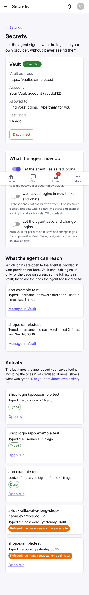
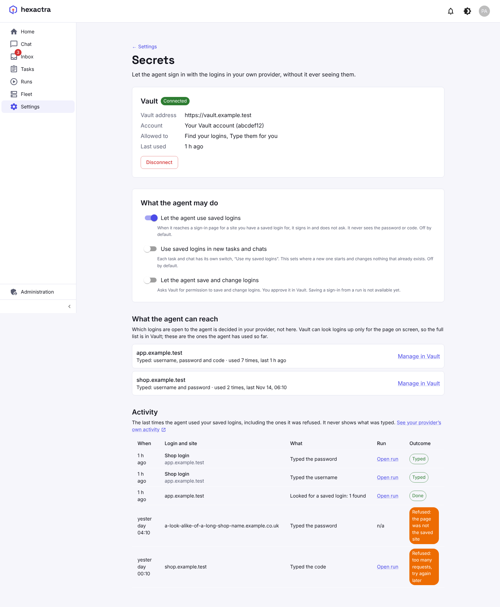
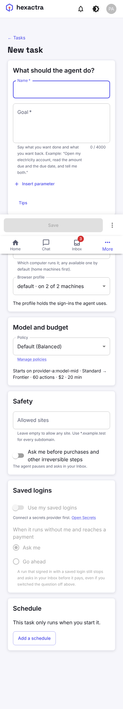

# Secrets: connecting a Vault or the built-in store, and signing in from a saved login

Epic E37 (#579) lets an agent use the owner's saved logins and one-time codes **without ever seeing them**. This page is the console's half of the Vault provider (E37.2, #591): how an owner connects their Vault, what Hexactra stores, the kill switches, and what happens when the connection breaks. Looking up a login and typing a field is the fabric's job (E37.1, E37.3); **the console never receives a login, a password or a code**, and there is no console route that returns one.

Vault's own contract is `docs/agent-credential-api.md` and its operator runbook is `docs/runbooks/agent-access.md` in the `marinoscar/vault` repository. The shapes the console mirrors (and the version they follow: agent contract 1.2, beta) are in `apps/api/src/secrets/vault-contract.ts`.

## Register Hexactra as an OAuth client in Vault (administrator of the Vault)

Hexactra is a **confidential client** that runs OAuth 2.1 authorization code with PKCE (`S256`). Follow Vault's runbook, "Register an agent runtime":

1. In Vault, switch the OAuth server on (`/admin/settings/oauth-clients`) and **Agent access** on (`/admin/settings/agent-access`). Both are off by default; with Agent access off every call answers `403 AGENT_ACCESS_DISABLED`.
2. Create a client named "Hexactra" with these **redirect URIs** (the status route shows the exact value, `GET /api/secrets/status`, `redirectUri`):

   ```
   https://<your console>/api/secrets/vault/callback
   ```

3. Grant types: authorization code and refresh token. Allowed scopes: `vault:items_read`, `vault:items_fill`, `offline_access`, and `vault:items_write` only if the owner will let the agent save and change logins (the switch on the Secrets page asks for it with a new consent).
4. Copy the client secret (shown once). The client authenticates with `client_secret_post`; a client registered for `client_secret_basic` also works (the console retries once with Basic and remembers it).
5. If Vault refuses the console's host, add it to Vault's client host allowlist.

Then, in Vault, each owner opens the logins the agent may use (**Allow agents to use this login**). Hexactra reaches only those.

## Connect (the owner)

1. **Set the client** (once): `PUT /api/secrets/vault/client` with the Vault's address (`https://vault.example.test`, its `APP_URL`), the client id and the client secret. The secret is write-only. An administrator may instead set a **deployment default** (`PUT /api/secrets/vault/default-client`, `system_settings:write`), so owners only press Connect; an owner's own entries take precedence.
2. **Connect**: `POST /api/secrets/vault/connect` returns `authorizeUrl`; the browser goes to Vault's own consent screen (the owner sees "Hexactra" and the scopes). Scopes asked: `vault:items_read vault:items_fill offline_access`. `{ "allowWrite": true }` adds `vault:items_write` and `{ "allowIdentity": true }` adds `vault:identity_read vault:identity_fill`: each a **new consent**.
3. Vault redirects to `GET /api/secrets/vault/callback`; the console exchanges the code, calls `whoami`, stores the grant and sends the browser back to `/settings/secrets?vault=connected` (or `vault=<reason>`: `denied`, `expired`, `state_invalid`, `binding_invalid`, `issuer_mismatch`, `exchange_failed`, `no_refresh_token`, `whoami_failed`).
4. `GET /api/secrets/status` shows the connection.

How the flow is protected:

- The PKCE verifier is kept on the server (encrypted); `state` and a browser-binding value are kept only as SHA-256 hashes. The flow is **bound to the browser that started it** by an HttpOnly, `SameSite=Lax` cookie set on the `connect` response, so the callback must arrive in that browser within 10 minutes; a copied link is not enough. The pending fields are claimed atomically, so a code is used once.
- The `resource` indicator, `<Vault APP_URL>/api/agent/v1`, is sent on both the authorize and the token requests. If Vault announces `iss` on the authorization response (RFC 9207), it must be the Vault the flow started with.
- Discovery (`/api/oauth/.well-known/authorization-server`) may not point the console at another host: every endpoint must be on the Vault's own origin.
- The callback is a deliberate `@Public()` route (the browser arrives from Vault without our bearer token). It never answers with data, only a redirect. Its query (`code`, `state`) is kept out of the request log, out of traces and out of nginx's access log (`infra/nginx/app.d/locations/secrets-callback.conf`).

## What Hexactra stores

| What | Where | Notes |
|---|---|---|
| The OAuth **refresh token** | The encrypted credential store, user tier, purpose `secrets_vault_grant`, name `refresh` | Only the console ever holds it. Rotated on use. **Never sent to the fabric.** |
| The short-lived **access token** | Same purpose, name `access` | The only token the fabric is handed. |
| The PKCE verifier of a Connect in progress | Same purpose, name `pending` | Deleted when the callback arrives or the flow expires. |
| The **client secret** | User tier, purpose `secrets_vault_client`, name `default`; the administrator's default is the system tier of the same purpose | Write-only. |
| The connection | `secrets_connections`: the address, client id, granted scopes, status, Vault user id, whether Vault's agent access is on, connected / last used / last success times, the last error **code** | Never a token or a message. Deleted with the user and part of the data export. |

**Never stored: a login, a password, a one-time code or a seed.** Hexactra holds no secret of the owner's Vault items. The credential purposes `secrets_vault_client` and `secrets_vault_grant` are permanent: add one, never rename one.

## Tokens: rotation, and what the fabric gets

Vault's refresh tokens **rotate on use**, and replaying a used one **revokes the whole grant**. So the console, not the fabric, owns the refresh token, and it never lets two refreshes of one connection run at once:

- one refresh at a time per process (callers share it) **and** per connection across API instances (a database lease on the row, taken with a compare-and-set, so a second instance waits for the first's result instead of calling Vault);
- the new refresh token is stored (replacing the old) **before** the new access token is used; if it cannot be stored the connection is marked `needs_reconnect` rather than carrying on with a token Vault already retired;
- a Vault that cannot be reached changes nothing (status stays, nothing is consumed); the caller is told it is unavailable.

The fabric is handed, per owner, `{ kind: 'vault', baseUrl, accessToken, expiresAt }` through the `FabricSecretsRegistry` port (`src/secrets/fabric-secrets-registry.ts`) and keeps it in memory only. The port is bound to `FabricSessionSecretsRegistry`, which calls the fabric's `PUT/DELETE /v1/secrets-providers/{owner}/vault` (`kind: "vault"`, `base_url`, `access_token`, `expires_at`); a fabric that is not configured, not reachable or that refuses is reported as `unavailable` and never carries the token. The fabric (`hexactra-control`) holds the token in memory only, calls the owner's Vault itself and drops the registration at `expires_at`. The console replaces it before it expires while a run is live: the queue job `secrets.vault.keep_fresh` (server-only; a per-minute cron only decides whether to enqueue it) renews the token for every owner with a live run. `SecretsProviderRegistrar.ensureRegistered(userId)` is what the runner calls when a run starts (E37.3).

## The kill switches

There are three, and each alone stops the agent:

| Switch | Where | Default |
|---|---|---|
| Vault's agent access | Vault, `/admin/settings/agent-access` | off (`403 AGENT_ACCESS_DISABLED`) |
| **The deployment's** | system setting `secrets.agentUse.enabled` (`PATCH /api/system-settings`, `system_settings:write`) | **off** |
| **The owner's** | user setting `secrets.agentUse.enabled` (`PATCH /api/user-settings`) | **off** |

A third setting, `secrets.defaultUseSavedLogins` (owner, default off), is not a switch: it only sets where new tasks and chats start. Each task, chat and AI app still has its own opt-in ([How the agent signs in](#how-the-agent-signs-in)).

With either of Hexactra's two off, `secrets_lookup` answers "not enabled", the fabric is told to hold nothing for the owner, and nothing is released, whatever Vault allows. Both are read on every registration (the deployment's with a five-second cache).

## How the agent signs in

E37.3 (#592). When a run reaches a sign-in page and the owner has a saved login for **exactly** that site, the agent signs in without asking: the username, the password, and an authenticator code when the site wants one. With no match, several matches or a provider that says no, it falls back to the sign-in card ("Sign-in needed"), as before. This is what lets a scheduled task run with nobody there.

**Who may use it.** A run uses saved logins only when all of these hold: the deployment switch and the owner's switch above are on, a provider is connected, and the run's **task or chat has `useSavedLogins`**. A run started by a hosted AI app over OAuth also needs the app's `allowSavedLogins` limit (default **off**, `PATCH /api/connected-apps/{clientId}/settings`; [security-hosted-clients.md](security-hosted-clients.md)). Anything else: the three tools below are not offered and the run asks as before.

| Where | Field | Default |
|---|---|---|
| Task | `useSavedLogins` (`POST`/`PATCH /api/tasks`) | the owner's `secrets.defaultUseSavedLogins`, else off |
| Chat | `useSavedLogins` (`POST`/`PATCH /api/chats`, Chat settings) | the owner's `secrets.defaultUseSavedLogins`, else off |
| Owner | user setting `secrets.defaultUseSavedLogins` (`PATCH /api/user-settings`) | off; new tasks and chats start from it |
| Connected AI app | limit `allowSavedLogins` | off |
| Task | `unattendedPayments` `ask` \| `allow` | `ask` |

**The three tools** (group `secrets`, offered only when the run may use saved logins):

| Tool | Parameters | What the model reads |
|---|---|---|
| `saved_logins` | none | For the page on screen: `none`, or `{ ref, name, username, exact, hasCode }` for each login. `ref` is a per-run reference (`login-1`), never the provider's id. A username is not secret; a password and a code never appear. |
| `sign_in_with_saved_login` | `ref`, `username_selector`, `password_selector`, `submit` | "Typed username and password…" or a failure in plain words. A site that splits the sign-in over two pages takes one selector per call. |
| `type_saved_code` | `ref`, `selector`, `submit` | "Typed the code" or a failure. Only for a login with `hasCode`, and only for an authenticator-app code: a code sent by text message or email is not in a vault and still asks the owner. |

**The rules** (enforced by the runner, not by the model's good will):

- **Only an exact match is usable.** A `ref` that is not exact ("saved for a different address of this site") is refused. No match, or a site-only match: the model asks the owner (`request_human`, kind `login`, input `credentials`). **Several exact matches:** the tool tells the model to ask with a choice card whose options are the logins' names and usernames; nothing is typed until the owner picks one, and then only that login.
- **The model never names a secret.** It passes a `ref` from the lookup of the page it is on. The fabric reads the page's origin itself when it types, asks the provider with it, types with trusted input and wipes the value. If the page changed since the lookup, nothing is typed and the model looks up again.
- **A mismatch stops everything.** `origin_mismatch` (a look-alike address) or a field in another site's frame: nothing was typed, the model is told "Stop. This page is not the site this login is saved for. Do not try another login. Tell the owner.", **the run asks the owner with a warning card** (kind `login`, input `takeover`, "Warning: …"), and saved logins are off for the rest of the run.
- **Errors become instructions.** `disabled`, `unauthorized`, `unavailable`, `rate_limited`, `not_found`: "Saved logins are not available right now. Ask the owner to sign in" (the sign-in card; the run continues after the answer). The outcome is reported to the connection's status: `unauthorized` makes it `needs_reconnect` (one notification), `disabled` turns `agentAccess` off.
- **A rejected password is not retried.** A login's password is typed at most once per run and site. A second request is refused and the model is sent to the owner: repeated failures lock accounts. A code is typed at most three times per login and site.
- **"Remember this device"** and similar options: unchanged from #527 (the owner's choice when asked; with a saved login the page's box is left as the page had it).

**What the run records.** Steps read "looked up saved logins: 1 match", "signed in with the saved login 'Shop login' (username p•••@example.test)" and "typed the authenticator code of the saved login …": the item's name and the **masked** username, never a value. `Run.usedSavedLogins` (`[{ provider, itemName, origin, at }]`, at most 20, one per login and site) is returned by `GET /api/runs/{id}` and shown on the run page ("Signed in with: Shop login"). A run holds no password, no code and no provider id in a step, its memory, the model's input or a tool result (`test/saved-logins.db.spec.ts`, marker test).

**When nobody is watching.** A run that used a saved login and was **not started from a chat** (a schedule, the API, MCP, a manual task run) keeps the confirmation before payments and other commitments **on** for that run, even when the task has it off, unless the task sets `unattendedPayments: allow`. The owner's saved approvals (see [approvals.md](approvals.md)) still apply as the owner defined them. A scheduled run that used a saved login sends **one** notification at its end, grouped by site ("Signed in to shop.example.test with a saved login", event `runs.saved_login_used`, browser and push).

**Crash safety.** Before each field the runner writes the phase (`typing`) to the run's memory and a `saved_login_phase` note to the trace, and `typed` after the fabric confirms it. A job that dies between the two fields and is retried does not type the username again; a password that may already have been typed is never typed a second time (the model is told to look at the page and, if it is not signed in, to ask the owner).

## Status, errors and reconnecting

`GET /api/secrets/status` (`secrets:read`):

```jsonc
{ "data": {
  "agentUse": { "deployment": false, "user": false, "effective": false },
  "providers": { "vault": {
    "provider": "vault",
    "status": "connected",          // not_configured | disconnected | connected | needs_reconnect
    "configured": true, "source": "user", "baseUrl": "https://vault.example.test",
    "clientId": "…", "hasClientSecret": true,
    "redirectUri": "https://<console>/api/secrets/vault/callback",
    "scopes": ["vault:items_read", "vault:items_fill", "offline_access"],
    "vaultUserId": "…", "agentAccess": "on",   // on | off | unknown: Vault's own switch, from whoami or the last 403
    "connectedAt": "…", "lastUsedAt": "…", "lastSuccessAt": "…",
    "lastErrorCode": null,           // a stable code (GRANT_REVOKED, ORIGIN_MISMATCH, …), never a message
    "connecting": false } } } }
```

When Vault answers `401` (the owner removed Hexactra in Vault's Connected apps, the refresh token expired or was replayed, the client secret was rotated), the grant is gone: the connection becomes `needs_reconnect`, the stored tokens are deleted, the fabric forgets the provider, the owner gets **one** notification ("Reconnect your Vault", event `secrets.needs_reconnect`) and a run falls back to asking the owner (E37.3). Connecting again clears it. The fabric (or the runner) reports outcomes with `VaultConnectionService.recordOutcome(userId, { ok: true } | { ok: false, code })`; `UNAUTHORIZED` is the 401.

Administrators see it in **Doctor**, `secrets.vault_connections` (a warning while any connection needs reconnecting; counts only, no owner), and the Vault hosts in the egress inventory.

## Disconnect

`POST /api/secrets/vault/disconnect` revokes the grant at Vault (`/api/oauth/revoke`), deletes the stored tokens, tells the fabric to forget the provider and marks the connection `disconnected`. `revoked: false` in the answer means Vault could not be asked: remove Hexactra in Vault's **Connected apps** (the tokens here are deleted either way). `{ "forgetClient": true }` also forgets the owner's own address, client id and client secret. **Live runs** lose the provider at once and fall back to asking the owner. Deleting the user removes the connection and the stored tokens, but not the grant at Vault: the owner removes the app there.

## The address of the Vault (SSRF)

The address is checked when it is saved, when Connect starts and on **every** call, the same way the console validates webhook URLs (the platform's egress guard): `https` only, no user name or password, a port of 80, 443, 8443 or 1024 and up, and **no private, loopback, link-local (cloud metadata included) or carrier-grade-NAT address**, for a name or a literal, checked again at send time against what the name resolves to now (DNS rebinding). The connection is pinned to the checked address, no redirect is followed, bodies are bounded and nothing is logged. The refusal is `422 SECRETS_VAULT_URL_REFUSED` with `details.reason`.

- Development (`NODE_ENV` not `production`): `http` and loopback targets are allowed so a Vault on the developer's machine works.
- A Vault on a private network (an on-premises Vault): an administrator lists its exact host name in system setting `secrets.vault.allowedHosts`; `https` is still required.

## Identity details (E37.6)

Forms ask for things that are sensitive but are not logins: a government ID number, a date of birth, a home address, a phone number. With this, the owner saves them once in the provider and the agent fills a field by naming it. **The model sees a field's label and flags, never its value, not even its length.**

**Two classes of field.** A provider marks each identity field `sensitive` or not.

| Class | Fields (Vault's `Identity` type) | Where the fabric may type it |
|---|---|---|
| Not sensitive | `full_name`, `id_type`, `id_issuing_country`, `address_line1`, `address_line2`, `city`, `region`, `postal_code`, `country`, `phone`, `email` | Any `https` site the run is allowed to visit |
| **Sensitive** | `date_of_birth`, `id_number` | Only a site on **that item's allowed-origins list** (exact origin, set by the owner in the provider), as for a login; elsewhere the provider answers `origin_mismatch` |

In both cases the value is typed by the fabric and never shown to the model; the difference is only **where**. On top of the provider's rule the fabric refuses a sensitive field (an ID number, a date of birth, a card number or security code) when the tab's origin is not `https`, whatever the provider says (`insecure_origin`).

**What it takes.** Everything saved logins need ([How the agent signs in](#how-the-agent-signs-in)), plus identity use as its own sub-switch, off by default at every level:

| Where | Field | Default |
|---|---|---|
| Task | `useSavedIdentity` (`POST`/`PATCH /api/tasks`) | off |
| Chat | `useSavedIdentity` (`POST`/`PATCH /api/chats`, Chat settings) | off |
| Connected AI app | limit `allowSavedIdentity` (needs `allowSavedLogins`) | off |
| Owner's grant | the Vault consent includes `vault:identity_read` and `vault:identity_fill` (**Let the agent fill identity details** on the Secrets page: a new consent, like the write permission) | not asked |
| Vault | `agentAccess.identity.enabled` in Vault's admin settings (contract 1.1) | off |

The per-task switch of E37.3 is worded **Use my saved logins and details**, with **Also fill my saved identity details** under it; an identity switch cannot stay on while saved logins are off. A run offers the two tools below only when the task or chat has `useSavedIdentity`, an AI app (if one started the run) has `allowSavedIdentity`, saved logins are usable and the grant holds both identity scopes. Anything else: no identity tool, and the run asks the owner for the details as it always did.

**The two tools** (group `secrets`):

| Tool | Parameters | What the model reads |
|---|---|---|
| `saved_identity` | none | For the page on screen: `none`, or `{ ref, name, fields: [{ key, label, sensitive, usableHere }] }` per saved item. `ref` is a per-run reference (`details-1`), never the provider's id. No value, no length. |
| `fill_from_identity` | `ref`, `field` (the key), `selector`, `part` (`day`, `month`, `year` or null) | "Filled <label>" or a reason. It commits nothing: filling a field is not a commitment, submitting the form is, and the confirmation gate handles that. |

The instructions: on a form that asks for personal details, call `saved_identity`, fill each field the form asks for from it, never type such a value from the goal, a memory or the page. If a needed field is not listed, ask the owner **once**, listing every missing detail in one request (`request_human`, input `text`).

**Inputs and selects.** The page says what the target is (one read of the element, not an action). An input is typed with `type_from_provider` (purpose `form`). A `<select>` (a country, or a date of birth split into three selects) is chosen with the fabric's `select_from_provider { item_id, field, selector, part? }`: the fabric lists the options, asks the provider for the value bound to the page's origin, picks the matching option **itself** (a month matches its number, name or abbreviation) and answers only `{ selected: true }`. `part` is only for `date_of_birth`. A select none of whose options is the value fails with `no_option`; an element that is not a select does too.

**A sensitive detail this site is not allowed to have.** `saved_identity` marks it `usableHere: false` and `fill_from_identity` explains "This detail is saved but not allowed on this site". The owner is asked through one card (a choice) with two answers: **Allow this site for <label>** (the card says which site to add to which item, and links to the provider by its address; Hexactra cannot widen a provider's allowed list itself) or **Type it this time** (the run then asks for a `secret`, which the fabric keeps and types with `type_handoff_secret`; the model never sees it). After "Allow" the next fill asks the provider, which decides; a detail still refused is asked about at most twice per run and site.

**Reading back is filtered.** After the fabric fills an input from a provider (an identity field, or the username, password or code of a saved login), the runner knows **which selectors** were filled (never a value) and keeps them out of what the model can read back:

- `observe_elements` reports a filled input's text as `[filled from your saved details]`; `read_text` of that element (or one that holds it) returns the same marker;
- `run_javascript` whose script could read a control's value (`value`, `FormData`, `innerHTML`, `outerHTML`, `selectedIndex` and similar) returns the marker while a filled input is on the page;
- every screenshot the model is shown, and every trace screenshot, is taken with an opaque box over each filled input (drawn in the page before the pixels are read and removed after; if it cannot be drawn, no picture is taken), and the mark of a filled input in the model's listing is masked. A desktop screenshot cannot be covered, so none is taken while a filled input is on the page.

**This is best effort, and it says so.** A page that copies the value elsewhere (a "review your answers" panel, a confirmation line, a script of its own that mirrors an input into a `<div>`) shows it in text the filter does not know to hide. The run's stored trace screenshots are masked at capture (E35: `docs/runs.md`), and the box over a filled input is part of that, but a copy of the value rendered elsewhere on the page is covered only by the sensitive-text patterns of #538 and #539 (card, account and ID-number shapes), not by the fill record. Keep the sites a task may visit narrow (`allowedDomains`) and the owner's own confirmation on for anything irreversible.

**What the run records.** Steps read "looked up saved details: 1 item, 5 fields" and "filled ID number from the saved details 'Passport'": the item's name and the **label**. `Run.usedSavedIdentity` (`[{ provider, itemName, label, origin, at }]`, at most 40, one per item, label and site) is returned by `GET /api/runs/{id}` and shown on the run page as "Filled from your saved details: Date of birth, ID number". The Activity list shows the field kind and the site ("Filled the ID number", "Chose the date of birth"; outcome `selected`), never a value. A run holds no value in a step, its memory, a question, a tool result or the model's input (`test/saved-identity.db.spec.ts`, marker test).

**The Secrets page** lists the identity items the owner opened to the agent, by name, with each field's label and whether it is sensitive, **read-only**, linking to the provider (`GET /api/secrets/identity`, `secrets:read`). The console reads the provider's identity lookup (labels and flags, never a value) with the owner's own access token, only to show the list; Vault's agent API does not return each item's allowed sites, so the page says they are managed in the provider. With no list the page says why (`needs_scope`, `provider_off`, ...).

**Task parameters.** A parameter may take its default from an identity field (`default: { identity: { field } }`, "From your saved details: ID number" in the form): the goal the model reads then holds `[provided: <label>]`, the run records the field (never a value; the Inputs block says "from your saved details") and the model fills it with `fill_from_identity`, the same mechanism as a sensitive parameter. Where saved details cannot be used for the run, the value is asked for like a sensitive one.

**Memories.** A memory may name an identity item ("My passport: saved details 'Passport'"), never hold its number: the memory secret check (#538 patterns) still refuses an ID number, an account number or a card number.

**Provider support.** The remote Vault (contract 1.1: `GET /identity?origin=`, `POST /identity/{id}/fill` with purpose `form`, scopes `vault:identity_read` and `vault:identity_fill`, errors `IDENTITY_ACCESS_DISABLED` and `ORIGIN_MISMATCH`). The built-in store (E37.5) holds logins only (its type is `Credential`, enforced by `store.interceptor.ts`), so it has no identity items: its provider answers none for an identity lookup and a run with the built-in store chosen is not offered the identity tools (`RunSecretsService.identitySupported`). Holding identity items in the built-in store (the Identity type, its page, Vault's `agentAccess.identity` switch bound to the deployment's) is a follow-up of E37.

## Routes

| Route | Permission | |
|---|---|---|
| `GET /api/secrets/status` | `secrets:read` | Status of the providers and the two switches |
| `PUT /api/secrets/vault/client` | `secrets:write` | The owner's address, client id and (write-only) client secret; `409 SECRETS_VAULT_DISCONNECT_FIRST` while connected |
| `POST /api/secrets/vault/connect` | `secrets:write` | `{ allowWrite?, returnTo? }` → `{ authorizeUrl, expiresAt }`; sets the binding cookie |
| `GET /api/secrets/vault/callback` | public (state + cookie) | Redirects to the return page |
| `POST /api/secrets/vault/disconnect` | `secrets:write` | `{ forgetClient? }` → `{ revoked, status }` |
| `GET\|PUT\|DELETE /api/secrets/vault/default-client` | `system_settings:read` / `:write` | The administrator's default address, client id and client secret |
| `GET /api/secrets/activity` | `secrets:read` | The owner's newest 100 uses and refusals (below), and the provider's own activity page |
| `GET /api/secrets/reach` | `secrets:read` | The logins the agent has used so far, by site |
| `GET /api/secrets/identity` | `secrets:read` | The identity items the owner saved: names and field labels with a sensitive flag; never a value |
| `GET /api/secrets/admin/summary` | `system_settings:read` | Counts for the administrator: owners connected, fields typed and refusals this week |

`secrets:read` goes to contributors, viewers and organization admins; `secrets:write` to contributors and organization admins. There is no MCP tool and no CLI command: a hosted AI app or a personal access token must not rewire the owner's secrets provider, and no MCP tool reads what the agent used (`packages/shared/capabilities.json`, [parity.md](parity.md#what-secrets-added-e37)).

## The Secrets page (E37.4)

`/settings/secrets` (Settings, Browser agent, **Secrets**, and the avatar menu; `secrets:read`; connecting and the switches need `secrets:write`, so a viewer sees the page and changes nothing):

- **Provider card.** Not connected: what a provider is in two sentences and the Vault address, client id and client secret (**Save and connect**); when the administrator set a default, the address is shown and one press on **Connect Vault** starts the consent. Connected: the Vault address, the account, the permissions in plain words (*Find your logins*, *Type them for you*, *Save and change logins* when granted), last used, **Disconnect** (it asks, "Runs will ask you to sign in again."). `needs_reconnect`: a warning and **Reconnect**. Coming back from Vault's consent shows what happened once (`?vault=` of the callback) in one polite live region.
- **Switches.** *Let the agent use saved logins* is the owner's switch `secrets.agentUse.enabled` (off by default; disabled with the reason when the administrator has the deployment switch off, with a notice). *Let the agent save and change logins* shows whether `vault:items_write` was granted; turning it on starts a **new consent** (`POST /api/secrets/vault/connect { allowWrite: true }`), turning it off asks first and connects again without it. Every switch is labelled, its help is its description, and each outcome is announced.
- **What the agent can reach.** Vault looks logins up only for a page (`GET /credentials?origin=`): there is no call that lists every opened login. The page therefore shows the logins **used so far** (site, the fields typed, how often, when), each with **Manage in Vault**, and says that the full list, and which logins are open to agents, are in Vault. Hexactra does not edit them.
- **Where the logins are kept (E37.5).** Shown only when the deployment offers the built-in store (`GET /api/secrets/store/status` answers): *Store in Hexactra* or *Connect Vault*, one active at a time (the user setting `secrets.provider`); switching moves no data. With the store chosen the page shows its own card with **My saved logins** (`/secrets`), the count open to the agent, and no Vault write switch.
- **Activity.** The newest 100 uses from Hexactra's own audit events: when, the run (a link), the site, what was typed ("Typed the password", "Typed the code") and the outcome. A refusal is a row too ("Refused: the page was not the saved site", "Refused: no saved login for this page"). A link goes to the provider's own activity (`<Vault>/settings/agent-activity`). The login's name is the one the run recorded when it signed in (the fabric does not know it). Below 900 px the table is a stack of cards.

  

The administrator's page, `/admin/settings/secrets` (`system_settings:read`; writes `:write`): the deployment kill switch `secrets.agentUse.enabled`, the default Vault (address, client id, write-only client secret, the redirect URI to register) and **counts only**: owners connected, owners who must reconnect, fields typed and refusals in the last 7 days. It never shows a user, a site or a login.

### On a task, a chat and a run

- **Task form**, section *Saved logins*: **Use my saved logins**, with one line of help; disabled and off, with the reason as its description and a link to Secrets, while there is no connected provider ("Connect a secrets provider first."), the owner's own switch is off, an administrator has the deployment switch off, or the viewer may not read secrets. A new task starts from the owner's default (*Use saved logins in new tasks and chats*). Under it, **When it runs without me and reaches a payment**: *Ask me* (the default: a run that signed in with a saved login still stops and asks before a payment, even with the purchase question off) or *Go ahead* (the task pays unattended; a warning says so, and the saved approvals and allowed sites still apply). Only a task has the payment choice.
- **Chat settings**: the same switch (disabled with a reason in the same cases).
- **Run page and the chat's Browser card**: "Signed in with: Shop login (app.example.test)", from `Run.usedSavedLogins` (the chat's live run view carries `usedSavedLogins`: the name and the site, never a username).
- **A refused site.** When the provider refuses a login because the page is not its site, the run asks with a **warning card** that names the page's host and the host the login is saved for, so the owner can tell a look-alike from the real site; nothing was typed and saved logins are off for the rest of the run.

### Where the Activity comes from

The fabric audits every provider action as `secrets.lookup` and `secrets.release` (who, run, provider, item, field, origin, purpose, outcome: never the value) but keeps them only in an in-memory event log of the newest 2,000. So that the list survives a restart and a busy hour, the queue job `secrets.activity.ingest` copies them into `secrets_activity`:

- A per-minute `@Cron` only decides whether anything can have happened (the deployment switch is on, or an owner is connected) and enqueues the job. The job opens `GET /v1/events?after=0&types=secrets.*`, reads the replay until the stream goes quiet (a bounded read, never a held connection), and stores what is new. **Reading everything every time is deliberate:** rows are unique on the operation id and event, so a repeat changes nothing, a fabric restart (new sequence numbers) needs no cursor, and an event is lost only if more than 2,000 `secrets.*` events happen between two ticks.
- **Value-free by construction.** `sanitizeSecretsEvent` (`src/secrets/secrets-activity.ts`) *copies a whitelist* of fields and checks each: a field kind and a purpose from a closed list, an outcome from the fabric's closed codes (anything else is stored as `other`), the host of the origin (never a path, query or user info), the provider's opaque item id, a UUID for the owner, the operation and the run. Everything else in an event is dropped before the database. A test seeds a marker in unknown keys, the free-text columns, the origin's path, query and user info, scans every column of the table and every response, and fails if it appears. The login's *name* and username are not in the row: the fabric does not know them.
- A run is linked only when it exists and is the owner's. Rows are kept 180 days, deleted with the user and part of their data export (category *credentials*). The job is server-only.
- Not the audit trail of Vault (see Vault's **Agent activity**, linked from the page) and not telemetry.

### Saving a login the owner typed by hand: not shipped

The issue (#593, item 4) asks that after the owner signs in by hand through a card, the agent offers to save that login, the fabric sending the value it still holds for that handoff to the provider. Vault's create route (`POST /api/agent/v1/credentials`, scope `vault:items_write`) needs a `purpose`, and the documented ones are `login` (signing in), `signup` (creating an account), `password_change` and `mfa`: none says "saving an account the owner already has", and `signup` or `login` would put a wrong line in the owner's Vault trail. As the issue says, this ships **without** the card and the Save action until Vault answers [marinoscar/vault#233](https://github.com/marinoscar/vault/issues/233) (an additive purpose). What is missing, so the follow-up is small: the `save_login` question kind and its channel rules (signed-in web and Android app only, like a secret), the `propose_saving_login` runner tool, "Never for this site" per user and registrable domain, and a fabric action that forwards the held handoff value to the provider (the value must never touch the console). The write switch above already requests the scope.

## Testing: the fake Vault

`apps/api/test/support/fake-vault.ts` is a small HTTP server that implements Vault's documented OAuth server and agent API: discovery, authorize (PKCE, `resource`, redirect URI, auto-consent), token (authorization code and **rotating** refresh tokens; a replayed refresh token revokes the whole grant), revoke, `whoami`, lookup, fill, TOTP, exact origin binding, the one identical `404`, scopes (`insufficient_scope`), the kill switch (`403 AGENT_ACCESS_DISABLED`), `429` with `Retry-After`, `Cache-Control: no-store`. It holds only invented data (`Person A`, `*.example.test`) and random canary values, and refuses to start in production. Controls: `setAgentAccess`, `revokeAllGrants`, `throttleNext`, `denyNextAuthorization`, `failNextRefresh`, `setLoginOpen`, `refreshDelayMs`.

```bash
cd console/apps/api
npx ts-node --transpile-only test/support/fake-vault.main.ts --grant   # prints one JSON line: baseUrl, client, logins, and a ready access + refresh token
```

From jest: `const vault = await startFakeVault({ clientSecret, redirectUris })`. When Vault's conformance kit (marinoscar/vault#196) is published, a follow-up replaces this fake with it. The tests: `test/secrets-vault.spec.ts` (PKCE, the SSRF guard, the OAuth client, the fake itself) and `test/secrets-vault.db.spec.ts` (the flow, rotation across two instances, a replayed refresh token, the switches, a seeded-marker scan of every response, audit row, notification, row and log line).

# The built-in store (E37.5)

Someone who runs Hexactra without a separate Vault still gets saved logins. The console embeds **Vault's own domain packages** (`@marinoscar/vault-api`, `vault-contract`, `vault-db`; decision record: [decisions/secrets-embedding.md](decisions/secrets-embedding.md)) and offers them to the agent as a second provider, `builtin`. The rules are Vault's, enforced by Vault's code: a login is visible to the agent only if its owner opened it (**per-item opt-in**), a release is bound to the **exact origin** of the page, **one field per call** (`username` or `password`; a one-time code is its own call), a login that is closed, missing or somebody else's gives **one identical not-found**, every call is **audited** (`agent.credential.*`, credential `embedded`, label `hexactra-agent`), calls are **rate limited** per minute, and Vault's **kill switch** is the deployment's `secrets.agentUse.enabled`. On top, the console's two switches apply (the deployment's and the owner's, both off by default).

## Which one to use

| | Built-in store | Your own Vault |
|---|---|---|
| Needs | This deployment and its key | A running Vault (an OAuth client registered there) |
| Where the logins are | This console's database, encrypted | Your Vault |
| Types | Saved logins (the `Credential` type) | Whatever your Vault holds (cards and identity come later) |
| A value crosses | **The console's Node process** (see the limit below) | Only the fabric: the console never sees it |
| Choose it for | One person or a small team, logins only | Anything more than logins; passwords you also use outside Hexactra |

**One provider is active per owner**, set in the owner's user setting `secrets.provider` (`vault`, the default, or `builtin`). Switching does not move data (an export and import path is a follow-up) and takes effect on the next call: the provider that is not chosen answers `disabled`. We recommend the remote Vault for anyone who stores more than logins.

## Switch it on

Deployment configuration, off by default (`infra/compose/app.env.example`; read at boot, restart the API after changing):

| Variable | |
|---|---|
| `SECRETS_STORE_ENABLED` | `true` loads the slice. Unset or false: **no Vault package is loaded**, the app starts without the key, every existing route and test is unchanged. |
| `SECRETS_STORE_KEY` | Required when on: 32 random bytes as 64 hex characters or base64 (`openssl rand -base64 32`). Missing or malformed, the API **refuses to start** with one error naming the variable (never the value). It is not in the env template (the installer asks for every secret a template declares): **add the line to `infra/compose/.env` yourself when you switch the store on, and back it up separately.** |
| `SECRETS_STORE_KEY_PREVIOUS` | Only during a rotation: add the line to `infra/compose/.env` yourself (also not in the template). |
| `SECRETS_STORE_CALLBACK_URL` | The address of the API as the fabric reaches it (default `http://api:3000`). |

The slice needs the credential store and notifications slices, like the Vault connection. These are deployment secrets, not runtime configuration: a key that protects a database cannot live in it (the "never an environment variable" rule is for runtime-configured features such as storage and AI). Enabling it also needs `npm run prisma:migrate` (the Vault tables and `secrets_store_data_keys` ship in every build) and a restart; the `Credential` secret type is created at start-up.

Then: the deployment switch `secrets.agentUse.enabled` (Administration), and per owner: choose the built-in store, turn on "let the agent use my saved logins", save a login and tick **Allow agents to use this login**.

## Key handling

```
SECRETS_STORE_KEY (environment)  --wraps-->    one random data key per owner (database, wrapped only)
data key                         --encrypts--> that owner's values (AES-256-GCM)
```

- Values exist only as ciphertext (`secret_versions`), written as `ss1.<owner id>.<base64>` with the owner bound as associated data. A database dump holds ciphertext and wrapped keys only: **it cannot be decrypted without `SECRETS_STORE_KEY`**. The tests scan the database for a seeded marker and print an excerpt.
- The store key is **not** `SECRETS_ENCRYPTION_KEY` (the credential store's) and not derived from it. It is never logged, never in a Doctor output, never sent to the fabric, and in no API response.
- A wrong key **fails closed**: nothing is returned, the request is an error.
- Associated data binds a value to its owner; it does **not** bind the item or field (Vault's crypto port does not provide them: vault#227).

### Backups

The console's database backup contains only ciphertext. **The key must be backed up separately, somewhere other than the database backup** (a password manager, an offline copy). **Losing the key loses every saved login for good.** Restoring the database without the key gives a working app with unreadable logins (Doctor `secrets.store_key` fails: "wrapped under a store key this deployment no longer has").

### Rotating the store key

1. Generate the new key. Keep the old one.
2. Set `SECRETS_STORE_KEY` to the new key and `SECRETS_STORE_KEY_PREVIOUS` to the old one; restart the API. Everything keeps working: rows still wrapped under the old key are read with it. Doctor `secrets.store_key` warns "a rotation is unfinished".
3. Run **Re-wrap**: `POST /api/admin/secrets-store/rewrap` (`system_settings:write`), which queues the job `secrets.store.maintain` (also queued hourly when there is work). It re-wraps every owner's data key under the new key; **the values are not re-encrypted**. It is safe to repeat.
4. When Doctor passes ("every owner key is wrapped under it"), remove `SECRETS_STORE_KEY_PREVIOUS` and restart. Keep the old key until you hold a backup taken after step 3.

The same job removes expired fabric credentials and secrets that lost their owner (a user removed by a path that skipped the user-data purge: their data key goes with them, so the ciphertext is unreadable anyway).

## How the fabric reaches it

The store has no address of its own, so the fabric **calls back**. When a run starts, `SecretsProviderRegistrar.ensureRegistered(userId)` registers the provider with the fabric as `kind: console` with `base_url = <SECRETS_STORE_CALLBACK_URL>/api/internal/secrets-store/v1` and, as the access token, a credential `sct_...` the console minted for that owner (kept only as a SHA-256 hash, valid for an hour, replaced on every registration, revoked when the owner leaves the built-in store or a switch is turned off). **This is the path used**, not an HTTP call to Vault's agent API: there is no Vault server in the picture.

| Route (POST, JSON in) | Answer |
|---|---|
| `/lookup` `{ owner_id, origin, kind?: "login" }` | `{ items: [{ id, name, username, origins, match_kind, has_code, updated_at }] }`, never a value |
| `/release` `{ owner_id, item_id, field, origin, purpose, run_id?, client_label? }` | the field's bytes, `application/octet-stream` |
| `/code` `{ owner_id, item_id, origin, purpose, ... }` | the code's bytes, `X-Expires-At` |

Errors are `{ "code": "<provider error code>" }`: `not_found` 404, `origin_mismatch` 403, `disabled` 403, `rate_limited` 429 (`Retry-After`), `unauthorized` 401, `refused` 403, `unsupported` 422, `unavailable` 503. Every answer is `Cache-Control: no-store`. The route is **only** for the fabric: a session, a personal access token and an AI app's OAuth token all get the same `401`; the credential names one owner and a request that names another is refused; the owner must have a live run; nginx answers 404 for `/api/internal/` on the public side (`infra/nginx/app.d/locations/secrets-store-internal.conf`), so the fabric calls the API directly over the private network. The fabric accepts the callback address only as https, or as http on a private path (loopback, a private address, a single-label name such as the compose service `api`, `.internal`, `.local`): the console's address is on the deployment's own network, unlike a Vault's, which must be https. The fabric half is `ConsoleProvider` (`crates/hexactra-credential-resolver/src/console.rs`), registered with `PUT /v1/secrets-providers/{owner}/builtin` as kind `console`.

### What the built-in store cannot do (a limit the Vault path does not have)

**The value crosses the console's Node process.** On the Vault path only the fabric ever holds a value. Here the console decrypts it and writes it to the response. It is reduced, not removed: Vault's service returns a JavaScript string, which is converted to a `Buffer` at once, written straight to the response, and the buffer is zeroed when the response has finished or the socket closed; it is never logged (the request log prints the method and path only, and the tests scan the logs for the seeded marker). But the string Vault's code decrypted lives until the garbage collector frees it and cannot be wiped (vault#229). Someone who can read the console's process memory can read the logins of owners who used one recently: a reason to prefer your own Vault for anything more than logins.

Also not included: cards, identity items, attachments, backups and the zip export, card scanning, card expiry reminders, media, Vault's MCP, Vault's agent HTTP API, custom secret types, the owner notices of Vault's agent slice (every use is audited instead), migrating between providers. Those routes answer 404 or do not exist; their tables exist and stay empty. No AI app's token can reach this store (`/api/secrets/*` is not part of any protected resource).

## Routes, permissions and who can read what

Vault's own controllers are mounted under `/api/secrets` and `/api/secret-types` (the page's API) with `secrets:read`, `secrets:write`, `secrets:delete` and `secret_types:read` (contributors and organization admins, and viewers for the read ones, as for the Vault connection; deleting: contributors and organization admins). `secret_types:write` and `:delete` are declared and granted to nobody. **No role can read another owner's secret values**: the `secrets:read_any`, `:write_any` and `:delete_any` permissions that Vault gives its administrators are **not declared**, so no role can hold them (`test/secrets-store.db.spec.ts` walks every role). A personal access token can manage the owner's own logins only with `secrets:write` and **can never release a value through the agent route** (the release route accepts nothing but the fabric's credential). `GET /api/secrets/store/status` (`secrets:read`) tells the owner which provider is chosen and how many logins are open.

Vault's `agentAccess` settings namespace is answered by the console (`enabled` is the deployment switch, per-minute limits at Vault's defaults, cards and identity off). There is no `secretsStore.*` namespace yet because nothing needs configuring.

## Testing

`test/secrets-store.spec.ts` (the slice off loads no package, key parsing, the envelope fails closed), `test/secrets-store.packages.spec.ts` (the console's ownership and permission copies against the packages), `test/secrets-store.db.spec.ts` (a real database: the whole flow, the identical not-found, the origin refusal, the switches, every role, ciphertext only, rotation, a wrong key, the internal route with every kind of credential, user deletion, a seeded-marker scan). Vault's own host conformance kit (`runVaultHostConformance`) cannot run for a host that mounts a subset (vault#228); the same assertions are in the db spec, in process.

## Cards (E37.7)

The agent can complete a checkout with a card the owner saved **without the model seeing the number, the expiry or the security code**. Because a card works on any site, a site binding cannot protect it the way it protects a login, so the protection is the owner's decision **per merchant and per amount**, enforced outside the model in two places: the provider's merchant grant, and Hexactra's own rules. **Hexactra is not a payment service**: this is the owner's own card on the owner's own deployment, and no card-industry compliance (PCI DSS or similar) is claimed. Offering it to other people needs a compliance review first.

### The safest path needs no stored card

The browser profile the agent uses is persistent. A shop where the owner's card is **already saved in the shop's own account** in that profile (sign in once, save the card there) needs nothing from this page: the agent signs in (saved logins) and pays with what the shop already holds. Prefer that, and prefer a **virtual card with its own spending limit** from the bank or card issuer over the main card, for anything that is stored here. Wallet buttons (Apple Pay, Google Pay, PayPal) are the owner's own sessions in the profile and are not handled here.

### The rules, in order

1. **Offered only with every switch.** The task's or chat's **Also pay with my saved cards** (`useSavedCards`, off by default; it needs `useSavedLogins`), the Vault grant's `vault:cards_read` and `vault:cards_fill` (**Let the agent pay with a saved card** on the Secrets page: a new consent), Vault's own card release on (`agentAccess.cards.enabled`), and for an AI app's run the app's limit `allowSavedCards` (default **off**; it never widens `allowSavedLogins`). Otherwise no card tool is offered and the run says so. The built-in store holds logins only (it answers none for a card lookup and refuses a card release): cards need the remote Vault (contract 1.1).
2. **The merchant grant (the provider).** Nothing is released unless the owner opened the card **and** created a **merchant grant** for the shop in Vault, with their own session: the shop (matched by registrable domain, so a checkout on another subdomain works), a **maximum amount and currency**, optionally the payment frames it accepts, a period limit, an expiry and whether the **security code** is included (default off, per card and per shop). A runtime cannot create or widen a grant. Vault lists a card only for a merchant it holds a live grant for, so there is no list of every card.
3. **A declared charge.** Nothing is typed before the agent has called `declare_charge { amount, currency, description }` with the exact total it read on the page. The **merchant host is the one the fabric reports for the tab, never the model's words**. The amount must be a plain decimal with at most two places; if the task has one `money` parameter (#552) it is a ceiling for what the agent may declare. The provider checks the amount against the grant, and the owner sees it in the approval.
4. **A shop the run may visit.** The card goes only into an `https` page the task and the AI app allow, on the same registrable domain as the declared charge and as the lookup (`saved_cards`). Otherwise nothing is fetched.
5. **The owner approves each shop.** The first use at a merchant always asks: a confirmation card with the **merchant's host, the card (brand and last four), the amount and what is being bought**, "Allow this payment" / "Do not pay". The approval is for that card, that shop and that amount in this run.
6. **Remembering it.** Ticking **Don't ask again** on that card makes a saved approval ([approvals.md](approvals.md#cards-e377)) bound to the shop's registrable domain **and the card**, in the amount's currency, with a **required** amount limit (the form will not save without one, and the server refuses it with `CARD_RULE_NEEDS_AMOUNT_LIMIT`; unlike every other approval). The site-wide "routine steps" rule never covers a card. A later run pays without a card question **only** under that limit, on that shop, with that card, in that currency; over the limit, another shop, another card, another currency, a disabled, expired or paused rule: it asks.
7. **Never unattended by default.** A run that was **not started from a chat** (a schedule, the API, MCP, a task run) types a card only when its task has `unattendedPayments: allow` **and** a matching remembered approval with an amount limit exists. Otherwise it waits for the owner (a pending card question). An AI app's run with **confirm purchases** on always asks, whatever is remembered.
8. **The fields go in order, the code last.** `pay_with_saved_card` types the card number, the expiry (one `MM/YY` input composed inside the fabric, or month and year), the name on the card and the postal code, and the **security code last**, in one tool call with no screenshot between the first field and the end of typing. The security code is typed only if the grant includes it; when it does not, the model is told to ask the owner for it as a `secret` request (typed by the fabric, never stored).
9. **The pay click is a separate action.** It passes through the confirmation gate like any commitment, and the approval for the card at this shop covers **that one click** for the declared amount (never a second one). After it, `confirm_charge` records the amount the page shows.

### Payment frames

Payment forms are often inside a **cross-origin iframe** from a processor. The earlier rule that refused cross-origin frames (E37.1) is **lifted for cards only**: a field inside a frame is typed with a click and keystrokes at **screen coordinates** (the model passes `x` and `y`), so no script runs in the frame. The fabric reads the **top-level origin (the merchant)** and, for a point inside a frame, the **frame's origin**, and passes both to the provider, which checks the frame against the grant's list; a frame whose origin the fabric cannot determine (no source, `about:blank`, `data:`, not `https`) is refused (`frame_unknown`) and nothing is fetched. **What this does not protect:** the frame origin is what the page declares for the frame element. A frame that redirects to another site, or a frame inside a frame, is not seen; the owner's merchant grant, its amount limit and the audit trail are the protection, and a virtual card with its own limit is the real one. Login fields stay refused inside frames.

### What the model sees, and what it never does

| Tool (group `secrets`) | What the model reads |
|---|---|
| `saved_cards` | For the shop on screen: `{ ref, name, brand, last4, limit, expires, securityCode }` per card (`ref` is per run; `limit` is the grant's maximum, `expires` is when the owner's **permission** ends, never the card's expiry), or `none`. |
| `declare_charge { amount, currency, description }` | "Recorded: 42.50 USD at checkout.shop.example.com", or why it was refused. |
| `pay_with_saved_card { ref, fields }` | "Typed the card details" or an instruction. `fields` are targets (a selector, or `x` and `y`). It records an intent (`commits`-class). |
| `confirm_charge { amount, currency }` | "Confirmed" or "differs": the amount on the confirmation page against the declared one (within a cent or one percent). The model reads the page, so this is a check of the model's reading, not of the shop. |

**The model never sees a number, an expiry or a code**, not in a tool result, a step, the run's memory, a question, a notification or a screenshot: the fabric types and answers `{ typed: true }`. A card typed into the page is covered like any provider-filled input: read back as `[filled from your saved details]`, covered by an opaque box in every picture the model is shown (for a field inside a frame, the element at that point), and the run's trace pictures are masked at capture (`autocomplete=cc-*` fields and cross-origin frames are always covered). No desktop picture is taken while a card is on the page. A card **expiry** is never shown to the model (it reads the last four digits, the brand and the grant).

### Errors become instructions

| Code | What the model is told |
|---|---|
| `origin_mismatch` (a wrong shop or a payment frame the grant does not list) | Stop; nothing typed; do not try another card, amount or shop; tell the owner. **The owner is asked with a warning card and cards are off for the rest of the run.** |
| `frame_unknown` | The payment frame's address cannot be verified; nothing typed; do not type the card yourself; tell the owner. |
| `amount_exceeded`, `currency_mismatch`, `grant_expired`, `limit_reached` | Nothing typed; tell the owner; no other card, amount or shop. (The first two are also refused locally before the provider is asked.) |
| `security_code_not_granted` | Ask the owner to type it (`request_human`, `secret`), then `type_handoff_secret`. |
| `insecure_origin` | The page is not `https`; a card is never typed there. |
| `cards_disabled`, `not_found` | Card release is off in the provider, or no card is allowed at this shop; tell the owner. |
| `unauthorized`, `rate_limited`, `unavailable`, `typing_failed` | Not available right now / look at the page and retry the missing fields / tell the owner; the connection is reported (`needs_reconnect`). |

### Bank verification

When the checkout shows a verification step from the card issuer (a redirect or a frame, 3-D Secure, an approval in the banking app), the agent does **not** try to pass it and does not interact with the issuer's frame. It asks the owner with the question kind **`verification`** ("Your bank wants you to confirm this payment in your banking app"), waits, and continues when the page moves on. A code sent by text is a `code` request as before. Hexactra never passes a bank's verification itself.

### Crash safety

The phases are saved **before** each field and around the pay click (`runs.transcript.savedCards`). A job that dies between two fields finds them: the fields that were typed are not typed again (the card is released once), the one being typed is typed again. A job that dies **around the pay click** leaves the payment `unknown`: the model is told it may or may not have gone through, a second click on pay is refused by the gate and asks the owner, **a saved approval for that button does not apply**, and no card tool pays again in that run. A job that dies after the card was typed and before the pay click presses pay once on retry. The test for it simulates the interrupted click by saving the state a dying job would leave (the intent record is asserted to be saved before the click is sent); a real process kill on the deployed stack is the evidence the issue asks for.

### What the owner sees

- **The Secrets page** (`/settings/secrets`): **Let the agent pay with a saved card** (the consent), **Payment cards** (how it works; **Check a shop** lists the cards the provider has a live grant for at that shop, with brand, last four, expiry, the limit and whether the code is allowed, read-only, `GET /api/secrets/cards?merchant=`; and the shops Hexactra remembers, linking to Saved approvals). Vault lists a card only for a shop it is granted for, so the page asks per shop and cannot list every card.
- **The task form and chat settings**: **Also pay with my saved cards** (off by default) and, for a task, what an unattended run does at a payment.
- **The run page and the chat card**: "Paid with Visa ending 4242 at checkout.shop.example.com: 42.50 USD", the declared and the confirmed amount, and a **warning when they differ** (and a notification `runs.card_amount_mismatch`). `usedSavedCards` on a run: `[{ provider, itemName, brand, last4, merchant, origin, currency, declaredAmount, confirmedAmount, mismatch, at }]`, at most 10: a brand, the last four digits and amounts, never a number, an expiry or a code.
- **A notification for every card use**, attended or not (`runs.card_used`: "Paid with Visa ending 4242 at ...: 42.50 USD").
- **The Activity list**: each field kind typed (`card number`, `card expiry`, ...), the declared amount and the payment frame's host, and every refusal.

### Audit and observability

Fabric execution events (`secrets.lookup`, `secrets.release`) carry the field **name** only, with `amount`, `currency` and `frame_origin` for a card (the merchant is `origin`). The console stores them in `secrets_activity` (`amount`, `currency`, `frame_site` columns: validated copies, never a value). Steps and the run's own record carry the declared charge, the approval and the confirmed amount. Counter `app.secrets.card_uses` (label `outcome`: `typed`, `asked`, `approved`, `declined`, `refused_amount`, `refused_shop`, `refused_limit`, `refused_other`, `unattended_waits`, `mismatch`). Alert kind **Saved card used a lot** (`hexactra_card_use`, rule `hexactra.card_use`, on by default): more than `maxUses` (5) card payments of one user in `windowHours` (24), or a single payment above `maxAmount` (off until an administrator sets a deployment threshold).

### What is not built (yet)

- **Cards in the built-in store.** It holds logins only by design until Vault's card release is embedded there; a run with the built-in store chosen is not offered the card tools.
- **Saving a new card from a run**, and **wallet buttons**.
- **A card picker on a task.** The provider lists a card only for a shop it is granted for, so there is no list to pick from when a task is made; a task may use any card the owner granted at the shop it pays on, and the owner is asked which (the confirmation names the card).
- **An automatic grant request.** Vault's grant request needs a card's id, which the per-shop lookup does not give for a shop with no grant. The model tells the owner (and the Secrets page links to the provider) to create the grant; the run does not file one.
- **Passing a bank's verification automatically.**
