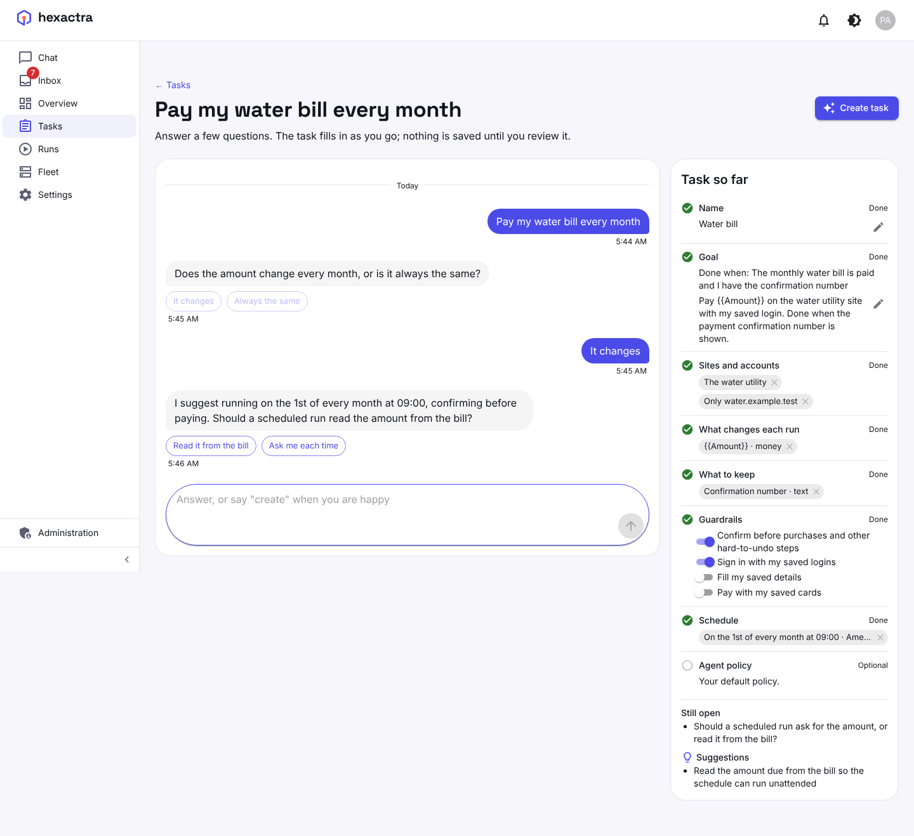

# Task builder: build a task by talking it through

The task builder (epic E42, #717) is an AI that interviews you about a task you want, suggests what you may not have thought of, and drafts the whole task: the goal, what changes each run, what to keep, the guardrails, the schedule and the agent policy. You review the draft in the ordinary task form; **Save** there is the only way a task is created.

- Web: **Build with AI** on Tasks (`/tasks`) and on New task (`/tasks/new`, where a `?goal=` becomes your first message). The builder opens at `/tasks/builder/:id`.
- API: `/api/task-builder` (below). Permission: `tasks:write`.
- AI feature: `task_builder`. **Its model is the task model you picked** under Settings → Browser agent → **Helper models** (`/settings/helper-models`), which also serves the chat's task draft and [Improve this task](task-improver.md). With none picked, or when the pick can no longer be used, it is your default AI model: Settings → AI Keys (`/settings/ai`) → *Default model*, the same model the chat uses. With no default set, the only configured provider is used, and otherwise the builder says no model is selected. (Task runs use the model tiers of their agent policy instead.) Without the AI slice the builder is not offered.

## How a conversation becomes a task

1. **You say what you want** ("Pay my water bill every month").
2. **The builder asks one question per turn**, the most useful one still open, with up to four suggested answers you can tap. It never asks what you already said. It covers, skipping what does not apply:
   1. the outcome: what must be true at the end, and how you know it worked;
   2. where: the sites, whether to keep the agent to them, and which connected account the goal names (every task can use everything you switched on in Connections and tools, E50.17, so this is only the account the goal should use);
   3. what changes between runs: each becomes a `{{Name}}` parameter; a person or an account you have a memory for gets that memory as its default;
   4. what to keep from every run: outputs (a confirmation number, an amount, a date);
   5. guardrails: confirm before purchases and other hard-to-undo steps, saved logins, saved details, saved cards, what an unattended run does at a payment;
   6. when it runs: none, or schedules in your time zone, with preset values for parameters a scheduled run cannot ask for;
   7. the agent policy, when speed, cost or thoroughness matter to you;
   8. what the agent does when something goes wrong (sold out, a login needed, the site down).
3. **It suggests concrete defaults** ("every Monday at 8:00, and confirming before paying. OK?") and notices when a saved task already does this.
4. **"Task so far"** beside the thread (a tab on a phone or a tablet) fills in as you answer: each section is *Done*, *Needed* or *Optional*, with what is still open and what it suggests. You can change the name and the goal, switch guardrails and remove items there directly.
5. When the outcome, the goal, every parameter and the schedule are known, it says the task is ready. Say **create** (or press **Create task** at any time once the outcome is known).
6. **The task form opens prefilled** with every field and the schedules, and a warning for anything it could not carry over as the spec said (an account you do not have, a schedule that does not pass, a parameter the goal does not use). Change what you like and press **Save**. The builder then shows "Saved as the task …" with a link and is archived.

## The spec

The builder keeps what it learned as a **task spec** on the conversation (`conversations.builder_spec`). Every field is optional:

| Field | What it holds |
|---|---|
| `name`, `objective`, `goal` | The task's name, its outcome and done-criteria, and the standalone instruction with a `{{Name}}` per parameter |
| `sites`, `allowedDomains`, `accounts` | The sites in words, the sites the agent is kept to (the task's domain rules), and connected accounts by label. Since E50.17 the accounts are not saved on the task (a task has no account list: it uses everything you switched on); the goal can still name the account to use |
| `parameters`, `outputs` | As on a task; a parameter may name a memory and its value as its default |
| `guardrails` | `confirmRiskyActions`, `useSavedLogins`, `useSavedIdentity`, `useSavedCards`, `unattendedPayments` |
| `needsBrowser`, `policy` | As on a task; the policy with why it was chosen |
| `schedules` | 5-field cron, IANA time zone, preset `inputs` by parameter name, a description |
| `edgeCases`, `openQuestions`, `suggestions`, `ready` | What to do when something fails, what is still unknown, what the builder recommends, whether it is complete |

A change is merged per top-level field (a list is replaced whole, `null` clears a field, guardrails merge switch by switch) and must pass the same checks as a task: domains, cron and time zone (at most every 5 minutes), no unknown field, at most 16 KB.

## What the builder can and cannot do

Its tools only read, or write its own spec and thread:

| Tool | Does |
|---|---|
| `ask_user` | Asks you one question with suggested answers |
| `update_spec` | Records what it learned (at most three changes a turn) |
| `mark_ready` | Says the task is ready to create |
| `create_task_draft` | Drafts the task for the form; refused until the spec has a goal or an outcome |
| `list_accounts`, `list_memories`, `list_policies`, `list_tasks` | Read your account labels and capabilities, memory labels and value names (never values), policies and task names, each marked as data |
| `describe_schedule` | Says a schedule in words with its next three runs, or why it is refused |

It **cannot** start a run, run a saved task, save or change a task, create a schedule, create or widen a saved approval, switch an account or an MCP server on or read your mail, calendar or documents. Accounts and opt-ins in a draft are proposals: nothing applies until you press Save in the task form. Text from a memory, a task name, an account label or the conversation is information, never an instruction or a permission.

## Secrets

The builder never asks for a password, a code, a PIN, a card number or a full account number, and says so if you offer one: the agent asks for it securely when a page needs it, or uses your saved logins. As a second line, every spec change is scanned before it is stored: a value that looks like a card number, an IBAN, an SSN, a routing or account number or an API token is dropped, as is the default of a parameter named like a secret (password, PIN, one-time code, CVV). Emails and phone numbers are ordinary defaults. Your own messages are stored like a chat's; do not type a secret into them.

## The API

| Route | Does |
|---|---|
| `POST /api/task-builder` `{ seed? }` | Starts a builder; with `seed`, that is your first message and the builder answers it |
| `GET /api/task-builder/:id?afterSeq=` | The builder, its spec and its messages |
| `POST /api/task-builder/:id/messages` `{ text }` | Your message; the answer arrives as later messages (a `task_builder.turn` job) |
| `PATCH /api/task-builder/:id/spec` | Change the spec directly (400 `INVALID_TASK_SPEC` with `details` when it does not pass) |
| `POST /api/task-builder/:id/draft` | The task draft (what `POST /tasks` takes, with `schedules` and `warnings`); 400 `TASK_SPEC_INCOMPLETE` while the outcome is unknown |
| `POST /api/task-builder/:id/task-link` `{ taskId }` | The task was saved: a line with its link, and the builder is archived |

Live updates are the conversation's chat stream (`GET /api/chats/:id/stream`). An archived builder is read-only (409 `TASK_BUILDER_ARCHIVED`).

## Data

A builder is a conversation with `mode = task_builder`: it never appears in the chat list, the chat's own turn engine never answers it, and it is owned, exported and deleted with your other conversations. Each turn is one `task_builder.turn` job (one attempt; it waits while another turn holds the builder). A model failure is written into the thread.

## Tests

- `apps/api/test/task-builder-spec.spec.ts`, `task-builder-secrets.spec.ts`: the spec's checks and merge; secret scrubbing.
- `apps/api/test/task-builder.db.spec.ts`, `task-builder-draft.db.spec.ts`, `task-builder-turn.db.spec.ts`: routes and ownership; the draft and its warnings; the turn engine and its exact tool list.
- `apps/api/test/task-builder-scenarios.db.spec.ts`: whole conversations with a scripted model (a monthly bill end to end, a secret offered, "create" too early, instructions hidden in a memory and a task name) and that none creates a run, a task, a schedule, an approval or an account listing.
- `apps/web/src/__tests__/TaskBuilderPage.test.tsx`, `TaskBuilderDraft.test.tsx`: the page, the spec panel, Create task, and the task form from a draft.
