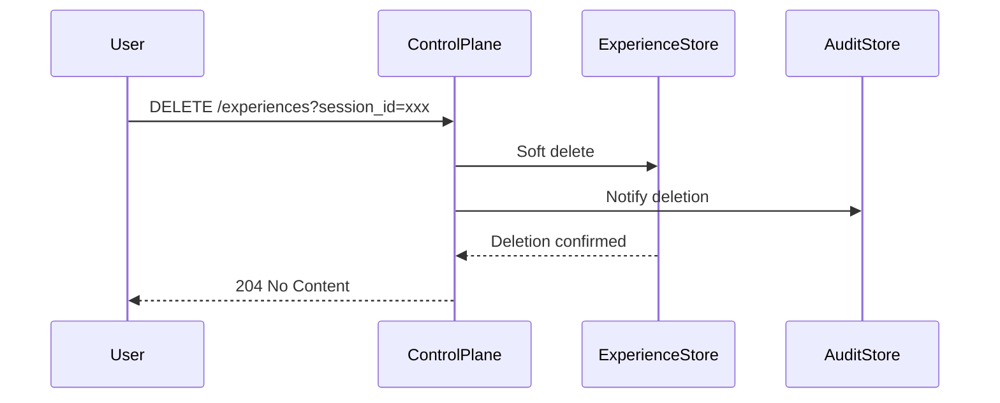

# Agent Experience Framework Data Governance

## Overview

The Agent Experience Framework (AEF) is an **optional** component that enables sanitized outcome export and experience retrieval without requiring the AEF to control sessions, contain credentials, or become a v1 dependency.

This document covers data governance, deletion policies, and interoperability contracts for AEF integration.

## Consent Management

### Opt-in Requirement

- AEF export is **opt-in** per session
- Consent must be explicitly granted before any experience events are exported
- Users can revoke consent at any time via the control plane API
- Revoked consent immediately stops future exports

### Consent Schema

```json
{
  "session_id": "uuid",
  "user_id": "uuid",
  "consent_granted": true,
  "consent_timestamp": "2024-10-17T10:30:00Z",
  "consent_version": "1.0",
  "revoked": false,
  "revocation_timestamp": null
}
```

## Event Retention

### Experience Events

- Events are retained for **90 days** by default
- Events older than retention period are automatically deleted
- Audit log events are retained separately (see Audit Logging)

### Export Versioning

- Each export includes a version identifier
- Schema changes require version bump and migration path
- Old exports remain readable with appropriate version handling

### Provenance Tracking

Each exported event includes:

```json
{
  "event_id": "uuid",
  "session_id": "uuid",
  "event_type": "action.completed",
  "timestamp": "2024-10-17T10:30:00Z",
  "version": "1.0",
  "provider": "hexactra-control-plane",
  "metadata": {
    "source": "browser-action",
    "sanitized": true,
    "audit_event_id": "uuid"
  }
}
```

## Data Deletion

### User-Initiated Deletion

Users can request deletion of:

1. **Experience data** - AEF-exported events
2. **Audit data** - Execution events (separate store)
3. **All data** - Both experience and audit

### Deletion Process



### Hard vs Soft Deletion

- **Soft deletion**: Marked as deleted, retained for compliance
- **Hard deletion**: Irreversible removal, used for revoked consent

## Interoperability Contract

### AEF Provider Requirements

AEF providers must:

1. Accept experience events in the defined schema
2. Support consent management endpoints
3. Provide health check and version endpoints
4. Handle batched exports efficiently

### Hexactra Requirements

Hexactra control plane:

1. **Never sends credentials** to AEF
2. **Sanitizes all data** before export
3. **Maintains audit trail** independent of AEF
4. **Fails gracefully** if AEF is unavailable

## Privacy and Security

### Data Minimization

- Only necessary fields are exported
- Sensitive data (passwords, tokens) is redacted
- User content is minimized to action metadata

### Audit Trail Separation

Experience events and audit events are stored separately:

| Store | Purpose | Retention | Access |
|-------|---------|-----------|--------|
| Experience | AEF learning | 90 days | AEF provider |
| Audit | Execution log | 7 years | Operator only |

### Operator Inspection

Operators can inspect which memories influenced a run:

```bash
# View experience events for a session
hexactra experiences list --session-id <id>

# View audit events
hexactra audit list --session-id <id>
```

## Deletion and Revoke Behavior

### Session Deletion

When a session is deleted:

1. Experience events are soft-deleted
2. Audit events remain (compliance requirement)
3. Consent records are marked as revoked

### Provider Failure

If AEF provider fails:

1. Events are queued locally
2. Retry with exponential backoff
3. After timeout, events are dropped but audit continues

## Testing

### Consent E2E Tests

- [ ] Opt-in consent flow
- [ ] Consent revocation
- [ ] Export after consent change

### Deletion E2E Tests

- [ ] Soft deletion (recoverable)
- [ ] Hard deletion (irreversible)
- [ ] Session deletion
- [ ] Credential leak prevention

### Failure Scenarios

- [ ] AEF unavailable during export
- [ ] Reconnect after failure
- [ ] Regression of prior APIs

## Compliance

### GDPR Rights

Hexactra supports:

- **Right to erasure**: Deletion endpoints
- **Data portability**: Export format support
- **Consent management**: Explicit opt-in/opt-out

### Data Residency

- AEF provider determines data residency
- Hexactra control plane does not require specific location
- Operators can configure AEF provider selection

## Next Steps

1. Implement deletion endpoints in control plane
2. Add consent management UI
3. Create test AEF provider for E2E testing
4. Document operator setup for AEF integration
