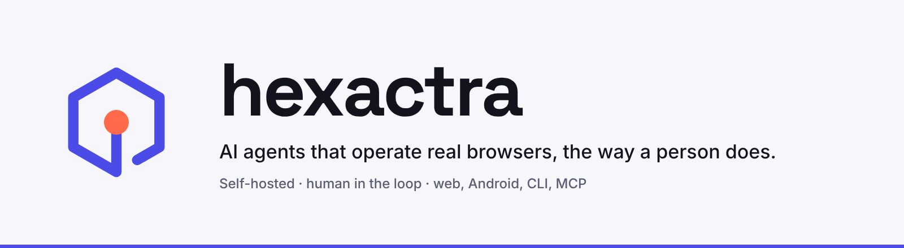

# hexactra brand

The mark, the wordmark and the color theme used by every hexactra surface: the Console (web and Android), the Chrome extension and the dashboard. Tracked in #283.

<picture>
  <source media="(prefers-color-scheme: dark)" srcset="hexactra-banner-dark.png">
  
</picture>

## The idea

hexactra lets an agent operate a computer the way a person does. The **Trace** mark draws that: one continuous line that starts at a single point (the coral dot, where the hand starts) and traces a hexagon. It is one gesture, not a printed shape.

## Files

### Masters (SVG, edit these)

| File | Use |
|---|---|
| `hexactra-mark.svg` | Mark on light backgrounds |
| `hexactra-mark-dark.svg` | Mark on dark backgrounds |
| `hexactra-mark-mono.svg` | One color (`currentColor`): notification badges, themed icons, print |
| `hexactra-app-icon.svg` | App icon: the white mark on a rounded indigo plate (favicon, PWA "any" icons, extension 48 and 128 px) |
| `hexactra-app-icon-small.svg` | Heavier strokes for 16 and 32 px |
| `hexactra-icon-maskable.svg` | Full-bleed, mark inside the safe zone: PWA "maskable" icons that Android and Chrome crop |
| `hexactra-icon-square.svg` | Full-bleed square: the iOS home-screen icon (iOS rounds it) |
| `hexactra-lockup.svg`, `hexactra-lockup-dark.svg` | Mark and wordmark side by side (wordmark as live text) |

### Exports (PNG, generated, use these anywhere)

| File | Size | Use |
|---|---|---|
| `hexactra-banner.png`, `hexactra-banner-dark.png` | 1600×440 | README header (light and dark) |
| `hexactra-app-icon-512.png` | 512 | Quick preview |
| `png/hexactra-app-icon-1024.png` | 1024 | Store listings, slides |
| `png/hexactra-icon-maskable-1024.png` | 1024 | Platforms that mask the icon |
| `png/hexactra-mark-512.png`, `png/hexactra-mark-1024.png` | 512, 1024 | Mark on transparent, light backgrounds |
| `png/hexactra-mark-dark-1024.png` | 1024 | Mark on transparent, dark backgrounds |
| `png/hexactra-mark-black-1024.png`, `png/hexactra-mark-white-1024.png` | 1024 | One-color mark |
| `png/hexactra-lockup.png`, `png/hexactra-lockup-dark.png` | 940×240 | Lockup on transparent, light and dark |
| `png/hexactra-social-preview.png`, `png/hexactra-social-preview-dark.png` | 1280×640 | GitHub social preview (Settings → General → Social preview) and link cards |

The SVG lockups set the wordmark as live text in Space Grotesk, which only renders where that font is installed. Use the PNG lockups elsewhere, or convert the text to outlines in a design tool.

## Regenerating icons

Every raster icon comes from these SVGs. After changing one, run:

```bash
node scripts/brand/render-icons.mjs   # needs Playwright with Chromium
```

It needs Playwright with Chromium and the console's installed fonts (`cd console && npm ci`). It writes the Console PWA icons (any, maskable, iOS, favicon, push badge), the Chrome extension icons, the PNG exports and banners above, and copies the favicon to the Console and the dashboard. Commit what it writes. The Android launcher, themed and notification icons are vector drawables in `console/apps/android/app/src/main/res/drawable/`, drawn on the same 120-unit grid: change them by hand alongside the SVGs.

## Wordmark

- Always lowercase: **hexactra**. Never "Hexactra" or "HEXACTRA" in the logo.
- Space Grotesk Bold, tracking -0.02em.
- Prose may still capitalize the name at the start of a sentence, and screen readers get the product name ("Hexactra Console") as the logo's accessible name.

## Color tokens

| Token | Light | Dark | Use |
|---|---|---|---|
| Primary | `#4B4BE8` | `#8C8CFF` | Mark line, primary buttons, links, selection |
| Accent | `#FF6B4A` | `#FF8A6E` | The starting dot, small highlights. Never body text on light backgrounds |
| Danger | `#C2412A` | `#FF8A6E` | Deny, stop and remove actions; the extension's connected badge |
| Background | `#F6F6FB` | `#0D0E17` | Page |
| Surface | `#FFFFFF` | `#181A28` | Cards, panels |
| Text | `#12131C` | `#ECEDF7` | Body |
| Muted | `#5A5E72` | `#A3A7BD` | Secondary text, labels |
| Divider | `#E3E4EF` | `#2A2D42` | Borders |

Contrast (measured): white on primary 6.0:1, white on danger 5.1:1, dark text on the dark primary 6.7:1, muted on background 6.0:1 (light) and 7.3:1 (dark). Coral accent on white is 2.8:1, so it is for marks and dots, never text.

Where the tokens live:

- Console web: `console/apps/web/src/theme.ts` (`BRAND`), with the light primary and background in `console/packages/shared/identity.json`, so `scripts/rename.mjs` still recolors the app.
- Console Android: `identity.json` again (launcher background, status bar), via the platform's Gradle identity.
- Chrome extension: CSS custom properties at the top of `apps/chrome-extension/sidepanel.html`.
- Dashboard: CSS custom properties in `apps/dashboard/index.html`.

## Terminal (CLI and TUI)

The `hexactra` CLI and its terminal UI use the dark-scheme tokens, which read well on the dark backgrounds most terminals have:
- primary `#8C8CFF` for headings, the selection and the banner;
- accent `#FF8A6E`;
- the terminal's own green, yellow and red for status.

Color is off under `NO_COLOR`, `--no-color` and `TERM=dumb`.

- The theme and the banner live in `console/apps/cli/src/brand.ts`. They reach the platform CLI through `createCli({ tuiTheme, tuiMenuRoot })`.
- The root menu is grouped (Agent, Worker, Server, Developer, Account) and differs logged in and logged out; the tree is `console/apps/cli/src/menu.ts` (`createCli({ tuiMenu })`), and its logged-out note is the `tuiMenuRoot` footnote. Screenshots: [console/apps/cli/README.md](../../console/apps/cli/README.md#the-terminal-ui).
- The banner is the Trace mark in Unicode Braille beside the wordmark and tagline. It shrinks to a smaller mark under 60 columns and to `⬡ hexactra` under 26. `hexactra --help` prints it too, as plain text when piped.
- The Braille mark (`console/apps/cli/src/brand-mark.ts`) is generated from `hexactra-mark-mono.svg`: `node scripts/brand/render-terminal-mark.mjs` (needs Playwright with Chromium).

## Typography

- **Space Grotesk** (700): the wordmark and headings h1 to h4.
- **Inter** (400, 500, 600): everything else.
- The Console self-hosts both through `@fontsource`, so the content security policy (`font-src 'self'`) holds. The extension and the dashboard name them first in their font stacks and fall back to system fonts.

## Usage rules

- Keep clear space around the mark of at least the dot's diameter.
- Do not rotate the mark, close the line's open end, recolor the line and the dot alike in full color, or put the mark on a busy photo.
- Below 24 px, use the small app icon or the mono mark.
